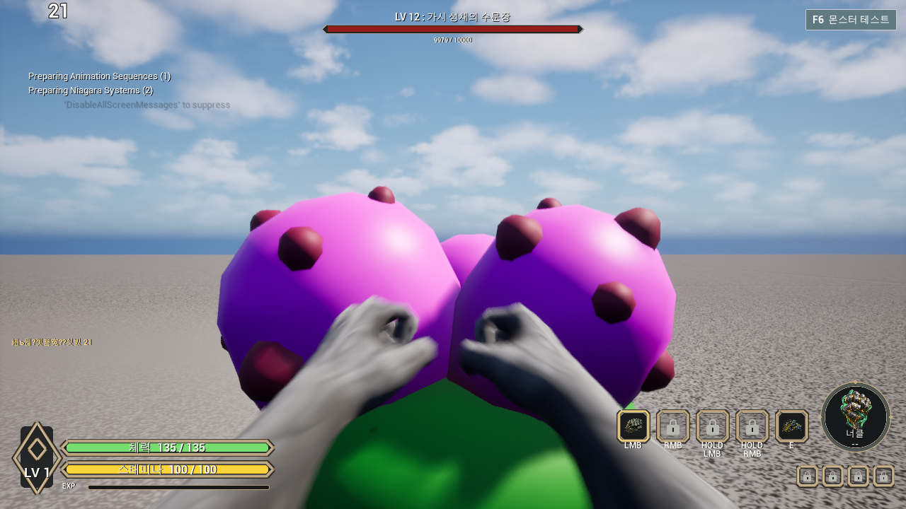

# 실제 애니메이션 단계별 사진 인덱스

기존 Jab 몽타주/시퀀스와 게임플레이 시계는 유지하고 소유자 표시 포즈의 팔 회전4개/IK 및 component framing만 변경한 후보이다. 사진은 D3D11 Offscreen 실제 캡처이며 보정·연출 이미지가 아니다. 단계 구분은 실제 입력 수락·피해·회복 메타데이터를 따른다.

실제 스킬/몽타주/시퀀스 경로와 모든 시각·궤적은 owner-framing-bounded-final1031.json에 있다. world/body와 actual proxy/cached camera의 손 궤적은 서로 다른 좌표로 집계한다. 사진은 요청과 같은 렌더 프레임 또는 이후 프레임에 촬영됐으며 지연을 함께 표시한다.

물리 입력/일반 필드 완주/패키징은 미실행이다. 제품 기본은 OFF다. 이 인덱스는 사진 링크와 측정값이며 모든 모션의 clipping-free 동작을 인증하지 않는다.

## Weighted — OFWeightB1031

### 공격 각도 0°

실제 재생률 1.393600; 수락→첫 피해 0.122327s, 기대 지연 0.107635s, 오차 0.014692s. 허용 구간 [-0.019114, 0.123327]s는 실제 관측 프레임 간격을 따른다. 고정16.7ms 이내라고 해석하지 않는다.

입력 전 준비: world 17.452303s / montage 0.000000s / 요청→촬영 1프레임, 0.075427s.

Weighted 입력 전 준비 0도〔보조 사진 정리로 삭제됨; [대표 사진 목록](../README.md)〕

실제 수락 직후: world 17.934285s / montage 0.025244s / 요청→촬영 0프레임, 0.000000s.

Weighted 실제 수락 직후 0도〔보조 사진 정리로 삭제됨; [대표 사진 목록](../README.md)〕

최초 피해 관측: world 18.056612s / montage 0.195720s / 요청→촬영 0프레임, 0.000000s.

action·쿨타임·combo 회복: world 18.802346s / montage 0.000000s / 요청→촬영 1프레임, 0.016667s.

Weighted action·쿨타임·combo 회복 0도〔보조 사진 정리로 삭제됨; [대표 사진 목록](../README.md)〕

### 공격 각도 -30°

실제 재생률 1.393600; 수락→첫 피해 0.110662s, 기대 지연 0.107635s, 오차 0.003027s. 허용 구간 [-0.025802, 0.017667]s는 실제 관측 프레임 간격을 따른다. 고정16.7ms 이내라고 해석하지 않는다.

입력 전 준비: world 19.935275s / montage 0.000000s / 요청→촬영 1프레임, 0.032339s.

Weighted 입력 전 준비 -30도〔보조 사진 정리로 삭제됨; [대표 사진 목록](../README.md)〕

실제 수락 직후: world 20.443471s / montage 0.034564s / 요청→촬영 0프레임, 0.000000s.

Weighted 실제 수락 직후 -30도〔보조 사진 정리로 삭제됨; [대표 사진 목록](../README.md)〕

최초 피해 관측: world 20.554133s / montage 0.188782s / 요청→촬영 0프레임, 0.000000s.

Weighted 최초 피해 관측 -30도〔보조 사진 정리로 삭제됨; [대표 사진 목록](../README.md)〕

action·쿨타임·combo 회복: world 21.336484s / montage 0.000000s / 요청→촬영 1프레임, 0.016667s.

Weighted action·쿨타임·combo 회복 -30도〔보조 사진 정리로 삭제됨; [대표 사진 목록](../README.md)〕

## Original — OFOrigB1031

### 공격 각도 0°

실제 재생률 1.393600; 수락→첫 피해 0.115349s, 기대 지연 0.107635s, 오차 0.007714s. 허용 구간 [-0.017667, 0.116349]s는 실제 관측 프레임 간격을 따른다. 고정16.7ms 이내라고 해석하지 않는다.

입력 전 준비: world 17.408935s / montage 0.000000s / 요청→촬영 1프레임, 0.084217s.

Original 입력 전 준비 0도〔보조 사진 정리로 삭제됨; [대표 사진 목록](../README.md)〕

실제 수락 직후: world 17.907296s / montage 0.023227s / 요청→촬영 0프레임, 0.000000s.

Original 실제 수락 직후 0도〔보조 사진 정리로 삭제됨; [대표 사진 목록](../README.md)〕

최초 피해 관측: world 18.022645s / montage 0.183977s / 요청→촬영 0프레임, 0.000000s.

Original 최초 피해 관측 0도〔보조 사진 정리로 삭제됨; [대표 사진 목록](../README.md)〕

action·쿨타임·combo 회복: world 18.796706s / montage 0.000000s / 요청→촬영 1프레임, 0.016667s.

Original action·쿨타임·combo 회복 0도〔보조 사진 정리로 삭제됨; [대표 사진 목록](../README.md)〕

### 공격 각도 -30°

실제 재생률 1.393600; 수락→첫 피해 0.112220s, 기대 지연 0.107635s, 오차 0.004585s. 허용 구간 [-0.017667, 0.017667]s는 실제 관측 프레임 간격을 따른다. 고정16.7ms 이내라고 해석하지 않는다.

입력 전 준비: world 19.920783s / montage 0.000000s / 요청→촬영 1프레임, 0.016667s.

Original 입력 전 준비 -30도〔보조 사진 정리로 삭제됨; [대표 사진 목록](../README.md)〕

실제 수락 직후: world 20.419188s / montage 0.023227s / 요청→촬영 0프레임, 0.000000s.

Original 실제 수락 직후 -30도〔보조 사진 정리로 삭제됨; [대표 사진 목록](../README.md)〕

최초 피해 관측: world 20.531408s / montage 0.179616s / 요청→촬영 0프레임, 0.000000s.

Original 최초 피해 관측 -30도〔보조 사진 정리로 삭제됨; [대표 사진 목록](../README.md)〕

action·쿨타임·combo 회복: world 21.316865s / montage 0.000000s / 요청→촬영 1프레임, 0.016667s.

Original action·쿨타임·combo 회복 -30도〔보조 사진 정리로 삭제됨; [대표 사진 목록](../README.md)〕

대표 사진 정리: 위 촬영·수치·실패 서술은 당시 검증 기록이다. 현재 사진은 [대표 목록](../README.md)만 보관하며, 삭제된 보조 사진을 성공 이미지로 대신 표시하지 않는다.

## 대표 사진 보관 상태

사용자 요청에 따라 중복·이전·보조 사진을 정리했다. 현재 `20261031_OwnerViewFraming_Review` 묶음에는 대표 1장을 보관한다. 이 문서의 촬영 개수·파일명·시각 판정은 당시 실행 이력이며, 현재 사진 목록은 [대표 사진 목록](../README.md)을 따른다. 수치 결과·텍스트 실패 기록은 그대로 유지했다.

## 핵심 검증 기록 보관 상태

중복·중간 JSON을 정리했다. 현재 `20261031_OwnerViewFraming_Review` 묶음에는 핵심 10개를 보관한다. 과거 실행·실패 서술은 유지하며 현재 파일 목록은 [핵심 기록 목록](../Records.md)을 따른다.
