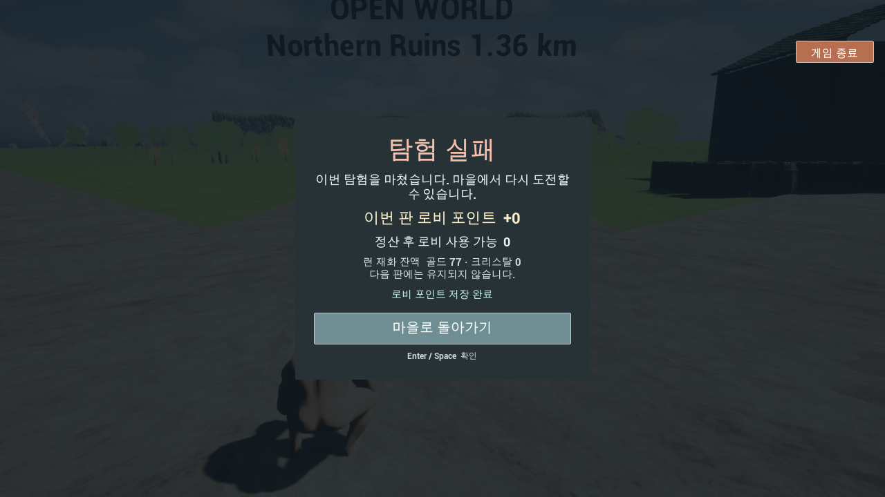

# 플레이어 지상 패배 자세 애니메이션 기록

작업 사본 `OrdinaryMonsterGait20261121`, 작업 브랜치 `Sprint#25-1-player-death-motion`, UE 5.8 기준 `ad94906d`. 원본은 프로젝트 초기 Manny `MM_Death_Front_01`, 파생 시퀀스는 `A_CommonGroundedDefeat`, 스켈레톤은 `SK_Mannequin`이다. Blender에서 0.80초로 구성하고 수평 루트와 발볼 접촉을 보정했다. 첫 진입은 마지막 한 틱에 그려진 Manny 자세를 0.22초 섞는다.

OpenRunMap 기본 HumanMale의 프로그램 W·Space와 네이티브 피해를 사용했다. 캡슐은 실제 피해 프레임에 정지했다. 결과는 16.667ms 뒤 열렸으며, 0.60초 화면에서 팔과 다리 및 그림자는 결과창 아래로 내려왔다. 0.8초에 끝 자세에 도착한 뒤 1초 관측의 마지막 자세가 유지됐다. 지상 및 공중의 수치 범위와 캡처 비교는 기능의 [검증 기록](../../Feature/doc/2026-11-21_player-grounded-defeat.md)에 보관했다.

