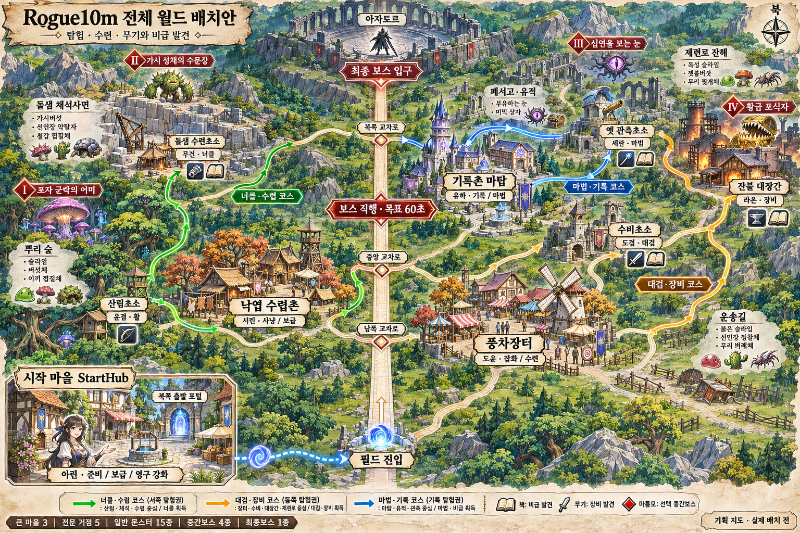

# 월드맵 제작 참조 묶음

2026-11-12 한국 시간. 이 채팅에서 작성한 기획과 생성 이미지를 실제 맵 제작자가 함께 참조하도록 보존한 묶음이다.

## 먼저 읽기

[월드맵 실제 제작 기준](../../WorldMapProductionGuide.md)을 먼저 읽는다. 이후 사용자 결정이 언제나 우선하며, 본문·JSON·이미지·과거 자료 순으로 해석한다. 제작자는 이 묶음을 읽은 뒤 실제 에디터 상태와 대조한다.

| 파일 | 용도 |
| --- | --- |
| [지도 PNG](rogue10m-world-map-concept-20261112.png) | 큰 마을3·전문 거점5·사냥터·직업 NPC·보스·획득 아이콘의 시각 참조 |
| [월드 배치 JSON](world-layout-20261112.json) | 로컬 좌표·도로·대표 경로·일반15종·중간4/최종1의 계획 데이터 |
| [획득처 JSON](acquisition-catalog-20261112.json) | 우선3계열·후속8직업, 현장 무기·비급·입문 수련 |
| [생성 기록](image-generation-notes-20261112.md) | 생성 도구·원본·해시·프롬프트 요구 요약·해석 한계 |

## 이미지의 사용 경계

- 이미지 생성 도구가 만든 배치 콘셉트다. 실제 Unreal 레벨 캡처·내비게이션·충돌·거리·성능의 증거가 아니다.
- 남쪽 필드 진입→북쪽 보스 입구의 중앙 직행로, 서쪽 수렵/너클·동쪽 장비/대검·북동 마법/기록의 관계를 읽는다.
- StartHub는 별도 준비 공간이다. 필드의 큰 마을3곳이나 일반 몬스터 종수에 더하지 않는다.
- 지도 안 작은 몬스터 이름은 생성 과정에서 축약/오기가 있을 수 있다. 정확한15종은 JSON/제작 기준을 따른다.
- 중앙 교차로의 붉은 장식 마름모는 중간보스가 아니다. 선택 중간보스는 Ⅰ~Ⅳ의4종이며 최종은 인간형 아자토르1종이다.
- 색 경로는 가능한 선택 예시다. 모든 지역을 순회하거나 색 경로를 반드시 따를 의무가 없다.
- 이미지의 책/무기 아이콘은 탐험 발견 지점이다. 중·상위 비급을 NPC 보상 메뉴에 넣는 지시가 아니다.
- 이미지에 없는 후속 NPC나 세부 비급 위치는 획득처 JSON을 읽는다. 픽셀 좌표를 그대로 월드 좌표로 변환하지 않는다.
- 지도 글씨/아이콘/풍경이 후속 사용자 결정이나 제작 기준과 다르면 문서의 규칙을 적용한다.

이 묶음은 계획 데이터이며 런타임 자동 설치·세이브 이행·맵 덮어쓰기를 실행하지 않는다.
