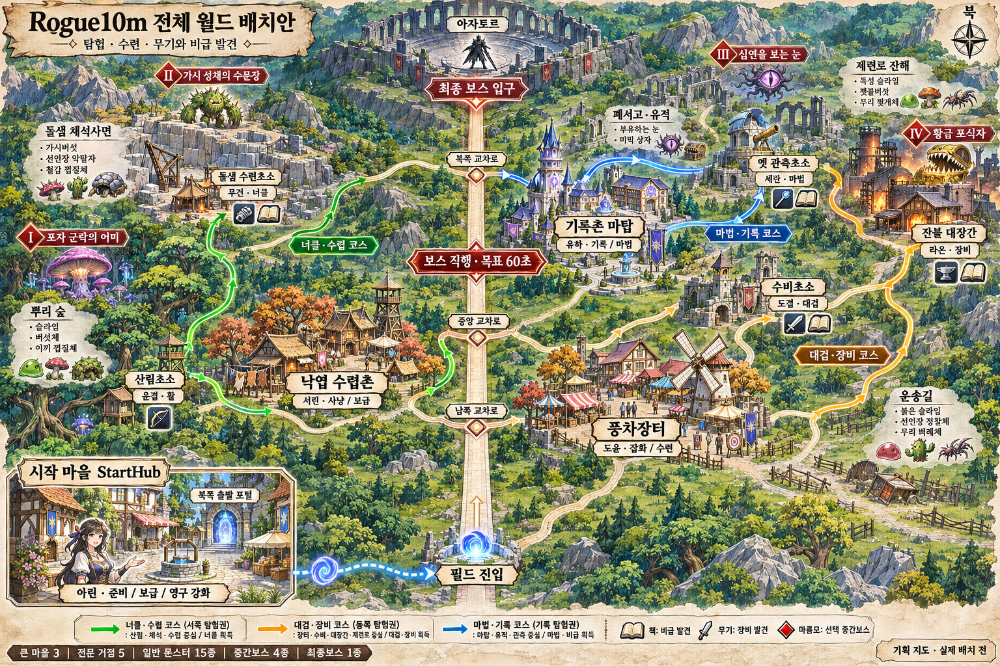

# 월드맵 실제 제작 기준

작성: 2026-11-12, 한국 시간. 당시 상태는 제작 참조 통합 완료·실제 적용 전이었다. 2026-11-16에는 독립 Crop 후보의 Landscape 정리·저장을 검증했고, 11/17에는 중앙3회 보행·29개 도로 표면 보정·독립 cold 보존47항목을 통과했다. 현재 구현 범위와 남은 인수 항목은 [11/17 결과서](../Feature/doc/2026-11-17_landscape-traversal-resume.md), 앞선 실패·복구 이력은 [11/16 결과서](../Feature/doc/2026-11-16_landscape-production-result.md)를 따른다.

사용자 요청에 따라 이 채팅에서 정리한 시작 마을, 큰 마을, 전문 거점, 사냥터, NPC 대화, 직업별 무기·비급 획득 경로와 생성 지도 이미지를 실제 제작용 기준으로 묶는다. 이 문서는 기존 맵이 이미 아래 모습으로 완성됐다는 보고가 아니다.

## 현재 맵과 제작 위치

`/Game/Rogue10m/Maps/StartHub`는 시작 메뉴와 마을 플레이에 사용한다. `/Game/Rogue10m/Maps/OpenRunMap`은 정상 출발 포탈, 전투, 보스 클리어에 사용한다. 이후 오픈 월드 작업은 기존 `OpenRunMap`을 열고 Map Maker에서 필요한 World Partition 작업 구역을 골라 진행한다. 지난 지형·도로·동굴 후보는 복구본과 설계 기록으로 참조하며, 배치가 필요한 요소를 기존 레벨에 작은 단위로 적용한다. [두 맵 통합 결과](../Feature/doc/2026-11-18_playable-map-consolidation.md)

## 제작 전 반드시 함께 읽을 자료

1. 이 문서: 최신 사용자 결정, 미정 사항, 제작 순서와 인수 기준.
2. [전체 지도 원본과 해석 규칙](References/WorldMap/README.md): 시각 참조와 생성 이미지의 한계.
3. [배치 데이터](References/WorldMap/world-layout-20261112.json): 지점, 양방향 도로, 사냥터, 몬스터, 보스, 예시 경로.
4. [획득처 데이터](References/WorldMap/acquisition-catalog-20261112.json): 직업 NPC, 특정 무기, 너클·대검 20개 기술, 마법 입문·주문서, 후속 직업.
5. [제작 패킷](../Feature/architect/2026-11-12_world-map-production-reference.md): 적용·검증·롤백 경계.

우선순위는 **이후의 명시적 사용자 지시 → 이 문서의 확정 규칙 → 배치/획득처 JSON → 지도 이미지 → 과거 기획**이다. JSON과 본문이 충돌하면 임의 적용하지 말고 문서를 정합화한다. 이미지는 분위기·상대 배치 참조이며, 작은 글자·아이콘·픽셀 위치가 규칙을 새로 만들지 않는다.

## 확정 규칙과 기획 제안의 구분

### 유지할 사용자 결정

- 3인칭 싱글플레이. 런 상한은 20분이다.
- 필드 진입점에서 최종 보스 **입구**까지 비전투 기본 이동 약 60초 이내를 목표로 한다. 선택 성장 경로는 약 15분에 입구 도착이며, 보스 처치는 그 이후다.
- 중앙 직행로는 처음부터 열려 있다. 마을 방문 수, 레벨, 특정 기술, 필드 보스 열쇠, 퀘스트 완료를 통행 조건으로 만들지 않는다.
- 사냥꾼 마을, 일반 물품·수련 거점, 마탑 마을 같은 큰 마을을 필드 중간에 두고 작은 초소·사냥터에 직업 NPC와 특정 무기·비급을 분산한다.
- 일반 몬스터는 최소 15종이다. **중간보스 4종과 최종보스 1종은 별도**로 계산한다. 훈련 표적·색만 다른 복사본·같은 적의 반복 배치로 수를 채우지 않는다.
- 모든 무기에 동시 입력/차징 전용 기술을 강제하지 않는다. 지원 입력과 장착 가능 기술은 무기별로 정의한다. 기본공격과 Ctrl 아이덴티티는 일반 장착 기술과 구분하며 마법사는 별도 주문 규칙을 따른다.
- 마법사는 **Ctrl 한 번으로 주문 상태 진입 → 첫 Q부터 고정 제한시간 시작 → 시간 안에 QQQ 완성 → 마력미사일 자동 발사**다. 추가 확정 클릭을 붙이지 않는다. 후속 입력으로 기한을 연장하지 않는다.
- 일반 의뢰는 비급을 확정 보수로 약속하거나 완료창에서 중·상위 비급을 선택 지급하지 않는다. 임무 지역에서 전투·탐색하다 비급을 발견하게 한다.
- 입문·하위 스킬북에 한해 간단한 의뢰/수련의 보상임을 직접 안내할 수 있다. 보상 기술을 이미 사용할 수 있어야 수련을 통과하는 순환 조건은 금지한다.
- 책·무기 획득, 학습, 장착은 별도다. 기존 숙련·선행·자원 조건을 모두 유지한다. 기본공격과 별도 활성 기술을 중복 집계하지 않는다.
- 런의 장비·아이템·비급·숙련·배운 기술은 종료 시 초기화한다. 로비 재화·영구 강화·정상 습득으로 공개한 Discovery 정보는 보존한다. Discovery는 영구 사용권이나 무료 학습권이 아니다.
- 필드 메뉴에서는 시간이 흐른다. 명시적인 안전 구역에서 해당 메뉴를 열 때만 게임·AI·런 시계를 함께 정지한다. 마을 입장만으로 자동 정지하지 않는다.

### 아직 확정하지 않은 항목

- 입력 제한시간의 초 수치, 시간 초과에 오주문 페널티를 적용할지, 주문 후 모드 유지/해제, 취소 키. 시간 초과 시 미발동·입력 초기화는 현재 설계 가정이며 페널티 확정으로 확대하지 않는다.
- 주문 문법 확장, 마법서클의 정확한 뜻, 초과 마나/오주문의 손실 공식, 현재/최대 체력 중 손실 대상, 즉발 숙련 기준.
- 아래 좌표와 도로의 실제 월드 앵커, 고도, 중심선, 마을 크기, 지형 충돌·NavMesh·추적 반경.
- 신규 NPC·고유 무기·재료 이름, 비급의 세부 등급, 가격·확률·피해량·학습 수치. 모두 제작/튜닝 제안이다.
- 너클·대검·마법 외 후속 직업은 전수처와 획득 동선을 예약한다. 현재 구현 완료나 즉시 출시 범위로 간주하지 않는다.

## 전체 공간 구성

좌표는 필드 진입 S=(0,0), 북쪽 +Y인 **로컬 미터**다. 실제 Unreal 좌표에 바로 덮어쓰지 않는다. 제작자가 기존 보스 바닥·남쪽 접근·지형 계약을 확인한 뒤 로컬→월드 변환을 한 번 정하고 cm 단위로 적용한다. 필드 전체를 축소하거나 이동속도를 바꿔 60초를 맞추지 않는다.

| 지점 | 좌표(m) | 기능과 배치 주의 |
| --- | --- | --- |
| S 필드 진입 | (0,0) | 입력 가능한 출발점. StartHub와 별도 |
| J100/J180/J240 | (0,100)/(0,180)/(0,240) | 실제로 길을 갈아탈 수 있는 중앙 교차로 |
| B 최종 보스 입구 | (0,300) | 입구 통과선. 보스 액터·전투 공간은 북쪽에서 별도 정의 |
| H 낙엽 수렵촌 | (-140,100) | 큰 사냥꾼 마을, 회복·재료·사냥 정보 |
| P 산림초소 | (-250,100) | 윤결과 순찰대 흔적, 후속 활 전수처 |
| W 뿌리 숲 | (-315,150) | 숲 사냥·유품·보급고 |
| Q 돌샘 수련초소 | (-280,220) | 무건·너클 수련. 몬스터는 초소 바깥 채석사면 |
| M 풍차장터 | (140,100) | 큰 거래·일반 수련 거점 |
| A 동쪽 운송길 | (220,90) | 도난 운송품·전복 수레·일반 조우 |
| G 무너진 수비초소 | (180,180) | 도겸·대검, 마탑/잔불로 갈라지는 길 |
| T 기록촌 마탑 | (70,230) | 큰 기록·마법 마을. 광장/상호작용은 중앙축 동쪽 |
| O 옛 관측초소 | (210,250) | 세란·마법 실습, 유적/제련로/마탑 연결 |
| F 잔불 대장간 | (310,230) | 라온·장비·제련소 단서 |
| Z 제련로 잔해 | (370,275) | 고위험 일반 조우·무기/비급 보관실 |
| R 폐서고·유적 | (150,300) | 기록판·관측실·숨은 서류함 |

중앙축은 S↔J100↔J180↔J240↔B다. 서쪽 고리는 S↔H↔P↔W↔Q↔J240, 동쪽 기본길은 S↔M↔A↔G↔T↔J240이다. G↔F↔Z↔O↔T와 T↔R↔O↔T는 선택 고리다. H/M은 J180으로 복귀할 수 있고, J100에서 H/M, J180에서 T로도 연결한다. 정확한 29개 양방향 연결은 JSON을 따른다.

교차로가 아닌 곳에서 도로가 평면으로 겹치지 않게 한다. 실제 맵에서 교량·우회로가 필요하면 충돌·고도와 연결을 함께 수정하고 기준 데이터도 갱신한다. 중앙길은 마을 광장·던전 진입·강제 대화·적 추적 범위로 막지 않는다.

## 시작 마을 StartHub

현재 지면은 60m×60m이고, 경계 벽 안쪽은 58.2m×58.2m다. 초기 120m×120m 마을의 중앙 우물, 남쪽 등장, 북쪽 포탈과 준비 구역을 더 짧은 동선으로 배치했다. [시작 마을 축소 결과](../Feature/doc/2026-11-18_start-hub-quarter.md)

| 공간 | 기능 | 운영 기준 |
| --- | --- | --- |
| 남쪽 도착길·아린 | 짧은 안내·보급·준비 상태 | 기존 아린 모델/호흡 Idle/대화 기반 보존. 통과를 막지 않음 |
| 중앙 우물 광장 | 서비스와 출발문을 읽는 기준점 | 우물 양옆 통행, 북쪽 시야 확보 |
| 남서 장비점·테오(가칭) | 기초무기·소모품·장착·기존 강화 | 입고와 장착 구분. 임의로 영구 장비 창고를 만들지 않음 |
| 남동 영구 강화소·미엘(가칭) | 로비 재화로 영구 투자 | 이번 런 수련/필드 구매재화와 분리 표시 |
| 북서 원정 접수소·바르(가칭) | 다음 런 난이도 | 선택과 비용/보상 설명을 출발 전에 확인 |
| 북동 지도·기록소·리네(가칭) | 지역 기능·발견 정보 | 미공개 상위 조건 누설 금지, Discovery와 학습 구분 |
| 서쪽 선택 수련장 | 이동·기본공격·회피·지원 기술 | 반복 XP/숙련/재료 생산 금지, 출발 필수 조건 아님 |
| 북쪽 출발문 | 정상 저장 후 필드 진입 | 상점 이용 중 우연히 겹치지 않도록 대기 공간 분리 |

첫 방문은 도착→아린 선택 대화→기초무기·보급 확인→원하는 서비스→출발이다. 반복 방문은 설명 자동 반복 없이 빠르게 준비한다. 초반 기초무기 전체 지급 방향을 유지하되, 시작 마을에서 제작 중인 너클·대검을 지급하는 것은 새 운영 제안이다. 기존의 '너클만 지급/자동 장착' 문장을 최신 정책으로 복원하지 않는다.

물약2개와 기초무기의 새 준비 단계당1회 지급을 시험할 수 있다. 반복 대화·재접속·아이템 버리기로 재충전하지 않는다. 지급 시점/준비 ID/포기 비용 비환불과 기존 프로필 기록의 호환은 별도 설계·검증 후 적용한다. 학습한 주문만 실제로 연습하며 입문 전 문양 수련은 비피해 입력 미니게임으로 분리한다.

아린 첫 대사: “여기서는 준비할 시간이 있어요. 북쪽 문을 넘은 뒤부터20분이에요.” 승리 후: “해냈군요. 가져온 성과부터 확인해 봐요.” 실패 후: “돌아왔네요. 다음에는 어느 쪽부터 준비할까요?” 포기 후에는 결과에 맞는 정리 대사를 사용하고 보상을 추가하지 않는다.

## 큰 마을과 전문 NPC

| 장소 | 외형·내부 동선 | NPC·서비스 |
| --- | --- | --- |
| 낙엽 수렵촌 | 사냥막·가죽 건조대·망루. 입구 의뢰판→공동 작업 광장→약방, 서쪽 산림길 | 서린: 회복·재료·사냥 의뢰. 순찰대 소문으로 P/W 안내 |
| 풍차장터 | 풍차·천막·수레. 도로 옆 거래 광장과 가장자리 연무장 | 도윤: 일반 장비·잡화·거래/운송. 상점은 의뢰 완료 전에도 사용 |
| 기록촌 마탑 | 마탑·공개 서고·연구 도구. 광장과 출입을 동쪽으로 모음 | 유하: 기록·단서·학습 조건 설명. 세란의 관측초소와 역할 분리 |
| 돌샘 수련초소 | 모닥불·닳은 바위·수련함, 바깥에 채석사면 | 무건: 하위 권법 전수·현장 단서. 숙련 자동 승급의 gate 아님 |
| 수비초소 | 병기실·부러진 방패·경비 기록 | 도겸: 하위 검술 전수와 폐경비소 단서 |
| 옛 관측초소 | 관측판·실패한 실험 도구·물길 기록 | 세란: 마법 입문/실습, 실험실 단서 |
| 잔불 대장간 | 작업 광장→외곽 화덕→선택 제련로 | 라온: 장비·재료 교환과 화덕 조사 |
| 산림초소 | 숲을 내려다보는 작은 망루·순찰 장비함 | 윤결: 사냥 정보, 후속 활 계열 전수 자리 |

직업은 무기 장착을 기준으로 연결한다. 직업 NPC의 연속 의뢰를 마쳐야 해당 무기나 보스에 접근할 수 있는 구조는 만들지 않는다. 작은 NPC 자리 모두를 자동 안전 구역으로 취급하지 않으며 provider로 안전 문맥을 명시한다.

### 대화 상태와 예시

대화는 최초 소개→서비스/의뢰 선택→진행 단서→완료 보수→같은 런 재방문 반응으로 나눈다. 가까이 지나가는 것만으로 자동 대화하지 않는다. 기본 인사는1~2문장, 긴 지역 설명은 별도 선택지다. 보상 수령 가능 상태를 우선 표시하고, 수령 후 같은 부탁이나 보상을 반복하지 않는다.

| NPC | 최초/의뢰 | 진행/발견 단서 | 완료/재방문 |
| --- | --- | --- | --- |
| 서린 | “서쪽 수레와 저장굴 입구에 보급 상자가 남아 있어요. 회수해 주시면 보수를 드릴게요.” | “깨진 수레 옆을 찾아보세요. 상자에 흰 천을 묶어 뒀어요.” | “다행히 안쪽은 멀쩡하네요.” / “부족해진 물건부터 확인해 볼까요?” |
| 도윤 | “곡물이 창고까지 못 왔어요. 길에 남은 흔적을 좀 봐주시겠어요?” | “찢어진 자루가 나왔다면 길은 맞아요.” | “이제 어디서 빠졌는지 알겠네요.” / “필요한 게 달라졌으면 말씀해요.” |
| 무건 | “채석장 안쪽에 작업 도구가 남았다.” | “옛 대련장 오른쪽 벽을 봐. 다른 돌보다 닳은 곳이 있다.” | “길은 다시 쓸 수 있겠군.” / 실제 수련 행동에 맞는 짧은 반응 |
| 도겸 | “폐경비소 상황을 봐 주겠나.” | “큰 병기함은 이미 비었어. 기록은 마당 쪽에 남았을 거다.” | 현장 조사 보수 지급, 발견한 기록에는 별도 반응 |
| 유하 | “외곽 비석의 글자를 떠 와 주세요. 지워진 부분은 비워 둬도 괜찮아요.” | “서고에서 같은 문양을 보면 어디 있었는지도 기억해 두세요.” | “이 획이 이어지는군요.” / 새 단서와 이전 정보 대조 |
| 세란 | “문양 연습을 마치면 마력미사일 입문서를 드릴게요.” | “첫 문양을 새겼으면 이어서 완성해 보세요.” / “불탄 방에도 타지 않은 서류함이 하나 있어요.” | 입문 수련 초회 보수와 실제 주문 연습을 분리 |
| 라온 | “인장 둘과 화덕 상태만 확인해 와.” | “붉게 갈라진 바닥은 돌아가.” | “수고한 값은 챙겨 가.” / “장비는 버텼어?” |

낮은 체력·적은 남은 시간·의뢰 진행·발견 물품에 따라 짧은 반응을 바꾼다. 이전 런의 무기/학습이 유지된 것처럼 말하지 않으며 새 런과 같은 런 재방문을 구분한다.

## 퀘스트·비급·재료의 연결

일반 의뢰 완료 보수는 런 재화·소모품·일반 재료다. 중·상위 비급은 의뢰 현장의 옆길·유품·기록함·위험 구역에서 발견한다. NPC 머리 위 보상 아이콘이나 완료창의 비급 택일 보상으로 바꾸지 않는다.

| 지역 의뢰 | 확정 목표 예시 | 수행 중 자연스러운 발견 |
| --- | --- | --- |
| 뿌리길 보급품 | 고정 보급 상자2개 | 부서진 수레 옆 수련자 유품·숲 보급고 |
| 사라진 운송품 | 지정 적의 꾸러미 또는 고정 운송품 | 전복 수레·무기 운송함·폐경비소 샛길 |
| 갈라진 채석장 | 고정 광석 표본·도구/배수로 조사 | 작업실 훈련기록·옛 대련장·지하 훈련고 |
| 남겨진 기록 | 지정 감시자의 기록판 또는 고정 비석 탁본 | 폐서고 보관실·숨은 서류함 |
| 식은 화덕 | 지정 운송 인장·외곽 화덕 조사 | 고철 운송함·폐병영·제련로 병기고 |

목표 물품은 일반 드롭 RNG와 분리해 확정 획득한다. 수락 전 처치/회수의 인정 방식은 의뢰 데이터로 정하고, 재생성되지 않는 목표가 없어져 의뢰가 막히지 않게 한다. 일반 가방 부족으로 목표를 영구 상실하지 않는 보관/사실 기록 경로가 필요하다. 완료 보수의 가방 부족은 수령 대기로 처리한다.

지역 재료는 사용처를 함께 만든다: 점액 응고물·포자→서린 회복품, 붉은 응고물·가시섬유→도윤 물품/매각, 철갑 파편→방어 장비, 비전 잔재→마법 소모품, 불씨핵·금속편→라온 공격 장비. 재료만 쌓이는 미구현 제작 시스템을 전제로 하지 않는다. 교환 수량·드롭률은 아직 확정하지 않는다.

모든 의뢰/보상은 같은 RunId의 상태와 영수증으로1회 지급한다. 스트리밍·재방문·같은 상자 재열기로 적·보상·추첨을 반복 생성하지 않는다. 발견한 비급을 보고 전에 사용하거나 다른 길로 떠날 수 있다. 고정 비급은 현재 계획에서 고정 배치하며, 향후 변동을 넣으면 런 시작 시 고정한 후보를 사용한다.

첫 던전은 같은 월드에서 걸어서 왕복한다. 중간 이동에 새 런 포털/ReturnToTown을 재사용하지 않는다. 런 시계·의뢰·이미 받은 보상이 유지돼야 한다. 강제 종료 후 월드 전체 복원을 새로 약속하지 않는다.

## 무기·직업·비급 획득처

우선 NPC는 Q의 무건, G의 도겸, O의 세란이다. Q의 돌샘 수련너클, G의 성문지기 대검, O의 별가지 지팡이는 특정 현장 무기 제안이며 새 에셋 존재를 뜻하지 않는다. 위치의 세부 오프셋은 획득처 JSON을 따른다.

| 너클 | 장소 | 대검 | 장소 |
| --- | --- | --- | --- |
| 연환권 | 무건 초급 수련의 명시적 보상 | 분쇄참 | 도겸 초급 수련의 명시적 보상 |
| 붕권 | W 수련자 유품 | 회전참 | G 폐경비소 안뜰 병법서함 |
| 금강쇄 | Q 배수 작업실 훈련기록 | 파쇄참 | F 고철 무기 운송함 |
| 유운수 | Q 옛 대련장 벽 틈 | 돌진참 | A 전복 수레 |
| 철산고 | Q 운반꾼 쉼터 작업대 아래 | 반격참 | G 방패 기록함 |
| 파진각 | P 너머 쓰러진 나무 공터 | 올려베기 | G 동쪽 돌계단 쉼터 |
| 백열난무 | W 절벽 아래 보급고 | 대지파쇄 | Z 지하 작업함 |
| 무극패왕권 | Q 지하 훈련고 | 섬멸연참 | F 폐병영 훈련실 |
| 태산압정 | Q 고원 아래 연습장 | 패왕참 | Z 북쪽 병기고 |
| 천붕권 | Q 뒤편 주먹 자국/바위틈 | 단공참 | F 남쪽 협곡 은닉함 |

마력미사일 입문서는 세란의 비피해 문양 미니게임 후 지급하고, 화염탄은 F/O 사이 불탄 실험실 내열 서류함, 냉기파는 O 북쪽 물길 기록실에서 발견한다. 유하가 마탑에서 정보/이론을 설명할 수 있지만 같은 입문서를 중복 지급하는 별도 원장을 만들지 않는다.

후속8직업의 예약 위치와 대표 경로는 획득처 JSON에 둔다: 단검 나린(수렵촌 남쪽 폐작업장), 쌍검 서율(장터 밖 교량), 활 윤결(P), 표창 소하(서쪽 능선), 쌍단검 도하(A 배수로), 장검 이현(T 남쪽 예배당), 대방패 태건(북서 옛 성문), 검버클러 로안(남쪽 교량). 모두 우선3계열과 구분된 후속 계획이다.

비급을 주워도 자동 학습/장착하지 않는다. 조건 부족이면 책을 보존하고, 성공 학습 때만 소비한다. 이미 배운 책은 보존·매각·선택 교환하며 강제 망각/합성을 요구하지 않는다. 기존 무료 전수/기본공격과 중복되지 않게 기술별 획득 정책을 정합화한다. 비급 획득에 그 비급의 기술을 먼저 사용해야 하는 장벽은 금지한다.

## 일반 몬스터 최소15종

현재 공용 로스터에는 일반20·중간4·최종1 정의가 있다. 정의/로컬 파일 존재는 아래15종의 새 AI·실제 배치 완료를 뜻하지 않는다. 기존 외형7계열·8기본 형상을 재사용할 수 있지만, 종수는 공격·이동·대응·드롭 차이로 검증한다. 색/HP만 바꾼 복사본으로 채우지 않는다.

| 구역 | 종 / MonsterId | 새 행동 제안 | 대응·드롭 방향 |
| --- | --- | --- | --- |
| W | 초록 점액체 / VerdantSlime | 느린 단발 들이받기 | 옆 이동·회복 공략 / 점액 응고물 |
| W | 어린 포자 버섯 / Sporeling | 근접 포자 방사 | 이탈·재진입 / 포자 주머니 |
| W | 이끼 등껍질 / MossShell | 느린 회전·정면 방어 | 측면 접근 / 이끼껍질 |
| A | 붉은 점액체 / CrimsonSlime | 준비 후 고정 착지 도약 | 착지점 회피 / 붉은 응고물 |
| A | 선인장 정찰병 / CactusScout | 가시 발사·거리 견제 | 차폐 후 접근 / 가시·섬유 |
| A | 군집 드론8호 / SwarmDroneEight | 측면 접근·짧은 찌르기 | 진입 시 공략 / 날개막·외피 |
| Q 외곽 | 가시 버섯 / ThornMushroom | 방향 가시줄 방사 | 공격선 사이 이동 / 단단한 가시 |
| Q 외곽 | 선인장 약탈자 / CactusRaider | 두 번 이어지는 근접 공격 | 마지막 타격 후 반격 / 질긴 섬유 |
| Q 외곽 | 철갑 등껍질 / IronShell | 직선 구르기 | 측면 회피·종료 공략 / 철갑 파편 |
| R | 동굴 감시자 / CaveBeholder | 직선 예고·고정 방향 공격 | 옆 이동·지형 차폐 / 눈결정 |
| R | 비전 감시자 / ArcaneBeholder | 이전 위치에 시간차 표식 | 바닥 이동 / 비전 잔재 |
| R | 어린 미믹 / YoungMimic | 단서 있는 위장·전방 물기 | 정면 경계·옆 회피 / 기록편·장비 |
| Z | 맹독 점액체 / ToxicSlime | 잠시 남는 점액으로 접근 방해 | 우회 / 독주머니 |
| Z | 불씨 버섯 / EmberMushroom | 불씨 투척·지연 폭발 | 착지 예고 회피 / 불씨핵 |
| Z | 군집 절단자9호 / SwarmRipperNine | 통과 후 복귀하는 연속 돌진 | 복귀까지 확인 / 절단 발톱 |

새 장판·투사체·상태효과·방어·위장은 각각 구현과 실제 검증이 필요한 기능이다. 팩 이름/클립만으로 제공된다고 가정하지 않는다. 기본 이동·공격으로 모든 종에 대응할 수 있어야 한다. 단독 소개→두 역할 혼합→선택 고난도 조우 순으로 구성하고, 좁은 입구에 사선·장판을 중첩해 회피를 막지 않는다.

## 중간보스4종과 최종보스1종

| 분류 | ID·이름 | 좌표 후보 | 제안 전투·보상 |
| --- | --- | --- | --- |
| 중간1 | SporeMatriarch / 포자 군락의 어미 | (-350,190) | 여러 포자 예고 속 안전 위치 선택, 생존 장비·희귀 재료 |
| 중간2 | ThornWarden / 가시 성채의 수문장 | (-310,300) | 정면 압박 뒤 회복, 근접 장비·재료 |
| 중간3 | AbyssEye / 심연을 보는 눈 | (200,340) | 직선·바닥 예고 조합, 마법/비급 관련 발견 기회 |
| 중간4 | GoldenMimic / 황금 포식자 | (410,320) | 연속 물기·돌진, 희귀 장비·재료 |
| 최종 | AbyssOverlordAzathor / 아자토르 | B 북쪽 별도 전투 공간 | 현재 인간형 방향 유지, 강타·횡방향·지면 공격의 대응과 승리 정산 |

중간보스는 각각 W/Q/O/Z의 곁가지다. 보스 추적/공격 범위가 안전 초소나 중앙축을 침범하지 않게 한다. 최종보스는 옛 로스터의 Beholder 행을 외형 지시로 사용하지 않고 최신 인간형 적용 기록을 확인한다. 보스 입구 전 자유 왕복과 교전 후 이탈/회복/리셋 정책은 구분하며 후자는 별도 결정한다.

## 대표 경로와 시간

6m/s·평면 직선 중심선 계산값이다. 실제 경사·건물·충돌·로딩·NPC 접근·전투를 포함한 기록이 아니다.

| 경로 | 지점 순서 | 거리 하한 | 이동 하한 |
| --- | --- | --- | --- |
| 직행 | S→J100→J180→J240→B | 300.0m | 50.0초 |
| 너클·수렵 | S→H→P→W→Q→J240→B | 783.0m | 130.5초 |
| 대검·장비 | S→M→A→G→F→Z→O→T→J240→B | 999.5m | 166.6초 |
| 마법·기록 | S→M→J180→T→R→O→T→J240→B | 875.9m | 146.0초 |

성장 경로는 이동·샛길3~4분, 사냥·의뢰5~6분, 선택 도전 약3분, 탐색·정리1~2분을 초기 예산으로 조정한다. 세 고리/모든 비급/네 중간보스를 한 판에 다 끝내는 코스가 아니다. 활동을 덜 고르면 더 일찍 보스에 도착한다. 약15분은 입구 도착,20분은 전체 상한이다. 준비/접근/보스전을 중복 합산하거나 시간을 채우려 대기·왕복을 강제하지 않는다.

## 실제 제작과 인수 기준

1. 현재 레벨·저장 자산·보스 바닥·입구·프로필 경로를 읽기 전용으로 확인하고 소유자/원본 해시를 기록한다. 기존 후보 그레이박스·실제 여행 진행 기록을 먼저 확인해 재생성하지 않는다.
2. 새 앵커와 중앙축/세 권역을 프로젝트 소유 후보 레벨에서 블록아웃한다. World Partition·OFPA·기존 PCG 계약을 유지한다.
3. 큰 마을1곳+작은 초소1곳+사냥터1곳+중위 비급 발견1곳을 끝까지 연결한다. 실제 NPC 선택·목표 획득·독립 비급 획득·재방문·보상1회를 검증한다.
4. 일반15종을 각각 단독 검증한 뒤 혼합 배치한다. 외형/준비/접촉/회복, 벽·고도·대상 소실·사망 후 정리, 실제 드롭과 가방 초과분을 확인한다.
5. 나머지 권역·직업 획득처·선택 중간보스를 확장한다. 입문 기술이 없어도 발견 장소에 도달하는지 확인한다.
6. 실제 기본 이동 직행3회60초 이내, 서로 다른 성장 경로 최소5회, 마을 생략·역순·재방문, 승리·사망·시간 초과·포기·저장 재시도를 확인한다.
7. 같은 체크포인트를 cook/package하고 실제 Game EXE에서 맵·자산·NPC·전투·귀환·재시작을 확인한다. 계산/정적 검사/프로그램 입력/물리 입력/전체 런을 구분해 기록한다.

적합한 보유 환경·NPC·몬스터·모션·VFX부터 재사용한다. `Stylized_Village`, `MonsterForSurvivalGame`, 기존 아린/인간형 보스·프로젝트 파생물을 우선 조사하되 현재 계정 소유·UE호환·실사용은 실제 사용 항목별로 다시 확인한다. vendor 원본은 보존한다. 에셋은 Unreal Editor에서만 편집한다.

## 과거 자료와 현재 상태 확인용 참조

- [기존 전체 동선 명세](../Feature/architect/2026-11-10_five-village-route-spec.md): 과거 동급 다섯 마을/19연결은 이 문서의3큰거점·전문초소/29연결로 개편한다. 기존 기록은 보존한다.
- [시작 마을 제작 결과](../Feature/doc/2026-10-05_start-village.md), [NPC 선택 서비스 검증](../Feature/doc/2026-11-10_npc-dialogue-selection.md).
- [실제 여행 통합 진행](../Feature/doc/2026-11-11_gameplay-integration-after-windows.md): 당시 통합/중단 상태이며 최신 에디터를 다시 확인한다.
- [직업 설계](WeaponClassDesign.md), [모션·VFX 기획](SkillMotionVFXDesign.md), [기술 제작표](SkillProductionTracker.md): 이름/역할 참조. 일률적 동시·차징 배분과 마법 미확정 설명은 이후 사용자 결정이 우선한다.
- [런 도메인](RapidFieldRules.md), [런 종료](RunCompletionGuide.md), [기존 몬스터](OpenWorldMonsterDesign.md), [인간형 보스](../Feature/doc/2026-11-10_humanoid-boss-npc.md).
- [Fab 재사용](FabAssetReuseGuide.md), [맵 편집 도구](WorldMapMakerGuide.md), [애니메이션 기록](AnimationRecordingGuide.md), [하네스](LazyCodexHarness.md).

이 목록 일부는 공유 작업 사본에만 있는 미커밋 선행 자료다. 실제 제작자는 현재 checkout에서 파일과 적용 상태를 확인한다. 핵심 제작 규칙·좌표·획득처·이미지는 이 참조 묶음 안에 자체 보존해 과거 미커밋 자료를 유일한 근거로 삼지 않는다.

## 2026-11-13 Source 제작 체크포인트

정상 Source StartHub에 기존세포털을유지한 Compact 후보용추가입구1개와표시Actor5개를저장하고새프로세스정밀재로드를확인했다. 실제일반여행/사용자입력/새Windows반영은미검증이다. 기존D는이번추가전버전으로보존하며맵1800m의축소완료를뜻하지않는다. 자세한범위와원본보존증거는 Feature/doc/2026-11-13_hub-compact-entry.md를참조한다. 배치/획득처JSON의설계규칙은변경하지않았다.

## 2026-11-16 Landscape 기획과 다음 제작 단계

사용자의 기획 선공개→Landscape 제작 지시에 따라 [1차 기획서](../Feature/architect/2026-11-16_landscape-production-plan.md)와 [지형 좌표 보충 JSON](References/WorldMap/landscape-production-20261116.json)을 추가했다. 기존 좌표와 중앙300m·3큰마을·5초소·29도로를 유지하는9×5컴포넌트(1,012.5×562.5m) 안이다. 에디터 복구 후 사용자가 외곽211개 삭제를 승인해 독립 Crop 후보를 native Landscape 도구로 편집·저장했다. 새 에디터에서45개 지형/충돌과 높이·페인트·레이어·액터 보존26항목이 통과했다. Undo/Redo 직후 composite 오류와 도로 격자선 레이2점의 실패를 보존하며, 상세 검증·보행 상태는 [제작 결과서](../Feature/doc/2026-11-16_landscape-production-result.md)를 따른다. 최종 지형·콘텐츠 인수 완료와 구분한다. 기존 두 카탈로그는 그대로다.

후속 [참조 검사·프로필 초기화 C++ 수정](../Feature/doc/2026-11-16_reference-scanner-compatibility.md)은 새 DLL의 별도 검증으로 loaded reflection 미지원0·보존9항목/이전cold7항목과 native 프로필 회귀를 통과했다. 향후 지형 검증은 새 DLL에서 success와 loaded_reflection_walk_complete를 모두 요구하며 과거 미지원 허용 예외는 제거했다. 이는 실제 보행·도로 시각 연속성·native/custom/미로드/전이 참조 전체 인수와 별도다. 과거 실패 증거는 수정하지 않는다.

## 2026-11-18 사용자 지시를 반영한 지형·마을 보완

Crop 후보의 내부는Z9600cm로 평탄하게 정리했다. 기존 S50m→B96m의 상승 설계는 이번 평지 지시로 대체한다. XY의21지점·29도로·중앙300m는 유지한다. 외곽은 최대32.94m 높은 둥근 능선과 숨김 Pawn 차단13개로 구획하고, H/M/T에는 목재 울타리·낮은 목책·석벽과 열린 출입구13곳을 적용했다. 울타리 안은 갈색 흙, 바깥은 잔디로 읽히게 하며 도로 가장자리도 잔디로 전이한다.

현재 완성 범위와 검증은 [자연 경계·마을 제작 결과](../Feature/doc/2026-11-17_natural-world-boundaries.md)와 [보충 카탈로그](References/WorldMap/landscape-natural-boundary20261117.json)를 따른다. 새 배치는 지역 표식·환경 소품과 보스 입구의 시각 문주이며 NPC·퀘스트·보상·적15종의 신규 기능을 설치한 결과가 아니다. 기존 Q의 지하 훈련실과Z의 지하 보관 공간은 여전히 계획 단계다. 실제 천장·갈림길·복층 동굴은 별도 제작과 통행 검증이 필요하다.

## 2026-11-18 Q/Z 실제 지하 동굴 보완

위 문단은 자연 경계 체크포인트 당시의 상태다. 후속 사용자 지시로 Q60×60m 훈련 동굴과Z70×60m 작업·보관 동굴을 실제 굴착·천장·바닥·벽으로 저작했다. 각 동굴에는 주 경로·갈림길·비밀방·회수 지름길이 있으며40m 하행로로10m 아래의 바닥에 연결한다. 중앙로와H/M/T는 평지로 유지하고 기존29도로·21지점·획득 규칙을 보존한다.

[동굴 기획](../Feature/architect/2026-11-18_underground-caves.md), [동굴 결과와 검증 상태](../Feature/doc/2026-11-18_underground-caves.md), [보충 카탈로그](References/WorldMap/caves20261118.json)를 함께 읽는다. 발헤임 공식 동굴 이미지를 참고해 기존 바위 파생물·목재·국소 조명을 적용했다. 가시 상자와유물은 배치 표식이며 K08/G07 실제 아이템 지급·자동 습득 기능을 추가하지 않는다. 충돌 검사 합격과 실제 삼인칭·저장본 재로드·전체 게임플레이 인수는 결과서에서 구분한다.

최신 기본 삼인칭 검증은12개 동선·276지점·실제 화면6개를 모두 통과했다. 카메라에 걸리던 Q 비밀방 복귀의 바위 두 개를 안쪽으로 옮긴 후 전방향1440질의와 새 전체 보행을 확인했다. 독립 재로드의32조건·2016질의도 통과했으며, 이 범위는 동굴 블록아웃과 기본 카메라의 인수다.

## 2026-11-18 Q/Z 연속 암반 최신 보완

후속 사용자 지시에 따라 사각 벽·평평한 천장 앞에 바위를 붙인 외형을 연속 암벽과 불규칙한 천장으로 보완했다. [최종 결과](../Feature/doc/2026-11-18_organic-cave-refinement.md), [설계와 완료 대조](../Feature/architect/2026-11-18_organic-cave-refinement.md), [새 보충 카탈로그](References/WorldMap/cave-organic20261118.json)가 현재 Q/Z 형상의 최신 참조다. 앞의 동굴 기록은 보완 전 이력으로 보존한다.

프로젝트 소유 메시2개·재질2개를 저작했고 기존1,408actor·47재질·179,488지형 높이와 중앙로·H/M/T평지·동선·획득 규칙을 유지했다. 보행 바닥8610cm·잔디 지붕9602cm는 보존하고 새 시각 바닥은1cm아래8609cm다. 실제 기본 카메라276경유점·12왕복 체인·6화면, 정적2,016질의·cold20조건/2,016질의·파일 범위24조건을 통과했다. 최소 카메라 거리231.904cm·최대 수축99.344cm이며 PIE종료 후dirty0이다. 요청한 동굴 보완은 완료했으나 전체 맵 제작·전투·아이템 지급·Shipping인수는 별도다. 전체 맵 제작 완료 전 develop/test/main승격은 보류한다.
