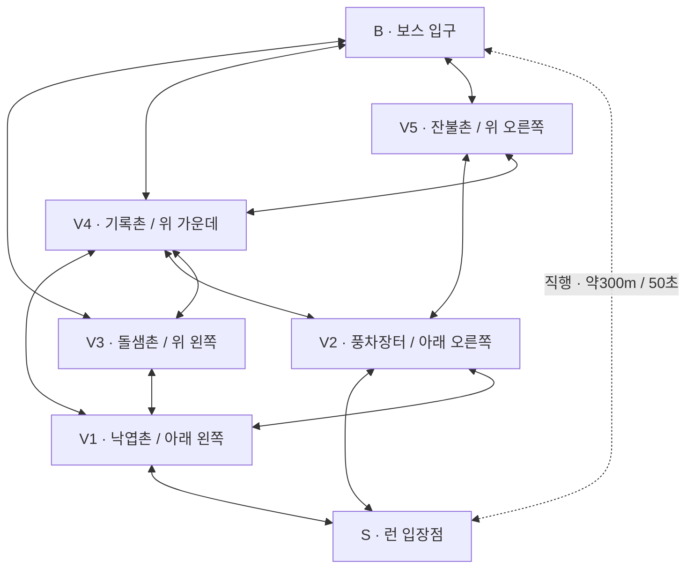

# 다섯 마을과 선택형 성장 동선 기획

작성일: 2026-11-10. 상태: **기획 초안 완료 / 배치·구현·주행 검증 전**.

## 1. 작업 범위와 기준

이 문서는 출력 로그·용량 정리·보스·NPC·무기 작업과 분리한 지역 기획이다. 기존 소스와 에셋, 맵, 설정, 브랜치 상태는 변경하지 않는다. 기존 문서는 읽기 전용으로 확인했다. 현재 작업 폴더는 `Sprint#9-29-humanoid-boss-npc`, 조사 시작 HEAD는 `51f2def0`이며 다른 작업의 미커밋 변경이 있다. 공유 체크아웃에서 브랜치를 전환하거나 다른 변경을 스테이징하지 않는다.

상위 채팅에서 전달한 두 번째 그림의 설명을 기준으로, 아래 두 마을에서 위쪽 세 마을로 여러 경로가 갈라진 뒤 보스에 합류하는 양방향 연결을 제안한다. 이 작업에는 그림 원본이 첨부되지 않았으므로 아래 간선은 원본 선을 그대로 옮긴 확정 도면이 아니다.

확정 요구와 초안의 가정을 구분한다.

| 구분 | 내용 |
| --- | --- |
| 요구 | 시작점에서 최종 보스 입구까지 비전투 기본 이동으로 1분 이내 |
| 요구 | 다섯 마을의 고유 퀘스트·상점·던전·아이템 중 필요한 성장을 선택 |
| 요구 | 일반적인 성장 경로 약 15분, 전체 런 제한 20분 |
| 요구 | 마을을 건너뛰거나 돌아가서 퀘스트를 이어갈 수 있는 양방향 경로 |
| 요구 | 방문 순서와 시간 배분이 핵심이며 퀘스트·마을·필드 보스는 필수 관문이 아님 |
| 초안 해석 | 15분은 보스 처치를 포함한 **활성 런 시간**으로 계산한다. 15분에 입장만 하는 안과 구분하며 사용자 확정이 필요하다. |
| 초안 가정 | 기본 걷기 6m/s, 질주·이동 특성·장비 보너스·순간이동 없이 300m/50초 직행 축을 설계한다. |
| 초안 가정 | 다섯 마을을 모두 방문하거나 모든 의뢰·던전을 완수할 필요는 없다. 보통 2~3개 마을의 활동을 선택한다. |

`Docs/RapidFieldRules.md:7-10,20-25,50-54,65-79`의 최신 요구를 우선한다. 과거 프로토타입의 여섯 무기·영구 숙련 추천을 현재 기획에 다시 적용하지 않는다. 첫 버전 무기는 너클과 대검이며 시작 지급은 너클이다.

## 2. 현 프로젝트에서 확인한 것

| 항목 | 근거 | 판단과 한계 |
| --- | --- | --- |
| 기존 공간 | `Docs/WorldStructure.md`, `Scripts/Editor/OpenWorldLayout.py:20-83` | 기존 OpenRunMap은 약 1.8km × 1.8km, 남쪽 야영지·서쪽 숲·강 교차로·폐풍차·바위 고원·북쪽 유적이다. 이것은 다섯 개의 기능 완성 마을을 뜻하지 않는다. |
| 기존 직행 | `Feature/doc/2026-10-05_open-world-playmap.md:21` | 제작 좌표상 약 1,357.2m/226.2초(6m/s). 실제 전 구간 주행 실측이 아니며 현재 60초 목표와 맞지 않는다. |
| 과거 지도 | `Feature/doc/evidence/open-world-map-20261005/OpenRunMap_Map.png`, `map-data.json` | 실제로 이미지를 열어 강·세 교량·세 갈래 길·유적 위치를 확인했다. 10월 제작 자료이며 11월 현재 런타임 재측정 자료로 쓰지 않는다. |
| 현재 편집기 | Unreal MCP `SceneTools.get_current_level` 읽기 | 조회 시 `/Game/Rogue10m/Maps/StartHub`. 다른 작업을 위해 맵을 바꾸거나 PIE·선택·카메라를 조작하지 않았다. 현재 OpenRunMap 전체를 라이브 재검증한 것은 아니다. |
| 이동 기본값 | `Rogue10mCharacterDataAsset.h:61,64`, `Rogue10mCharacterStats.h:143-145` | 걷기 600cm/s·질주 900cm/s 기본값. 실제 속도에는 장비·숙련·특성·에셋 override가 영향을 준다. 모든 프로필이 실제로 600이라는 뜻은 아니다. |
| 런 제한 | `Rogue10mGameState.h:78`, `.cpp:24-35,86-99` | 기본 1,200초, 1초 TimerManager, 0에서 실패. 시작 시 시간을 새로 채우므로 중간 던전 이동에 재사용하지 않는다. |
| 현재 안전 메뉴 | `Rogue10mGameMode.cpp:45-51`, `Feature/doc/2026-11-03_safe-menu-pause.md` | 정확한 StartHub + Standalone + WaitingToStart에서만 정지한다. 실행 중인 다섯 마을의 안전 문맥은 구현되어 있지 않다. |
| 서비스 | `Docs/TownServicesPersistenceGuide.md` | 기존 허브 NPC 서비스와 저장이 있다. 이를 필드 마을 상점 다섯 개의 구현 완료로 세지 않는다. |
| 퀘스트 | `Rogue10mProgressionSaveGame.h:109`, `Rogue10mTutorialNPC.cpp:377` | 보상 수령 기록은 있으나 일반 퀘스트의 수락·목표·중단·재개 상태와 지역 의뢰 시스템은 확인하지 못했다. |
| 런 경계 | `Docs/RapidFieldRules.md:12-18,82-89`, `Feature/doc/2026-11-03_next-run-validation.md` | 런 성장·아이템·학습과 로비 성장·Discovery를 구분한다. 지역 재방문은 같은 런 안의 재개이며 다음 런에 무료 완성 상태를 주지 않는다. |
| 던전 왕복 | `Rogue10mRunPortal.cpp:55-85`, `Rogue10mProgressionSubsystem.cpp:524-532` | 기존 출발 포털은 활성 필드에서 쓰도록 설계되지 않았다. StartHub 입장 기준 저장을 요구하며 별도 던전 왕복·시간 보존 계약이 없다. |
| 보스 접근 | `Feature/doc/2026-11-01_boss-south-approach.md` | 기존 보스 보호 바닥과 남쪽 경사로 계약이 있다. 다른 작업에서 바꾸는 보스·NPC·무기 소스를 이번 기획에서 수정하지 않는다. |

위 소스 경로는 `Source/Rogue10m/` 아래의 실제 클래스 파일이다. 조사 당시 값이며 병렬 작업이 끝난 뒤 배치 담당자가 다시 확인한다.

## 3. 권장 공간 원칙과 기존 맵과의 관계

**기본 이동으로 300m 내외인 직행 축을 먼저 만들고, 그 양옆으로 마을 경로를 넓히는 안을 권장한다.** 직행 축은 입장 즉시 보이며, 보스는 처음부터 접근 가능하다. 마을 방문 수, 열쇠, 명성, 강제 필드 보스 처치로 길을 잠그지 않는다. 처음 너클만 가진 캐릭터도 기본 이동·공격·기본 방어로 대응할 공간은 보장하고, 승리 난이도와 접근 가능성을 구분한다.

1.8km 월드 전체를 균일하게 축소하는 작업은 필요하지 않다. 핵심 플레이 경로를 약 600m 폭의 구역에 재구성하고 기존 외곽은 후속 탐험 공간으로 둘 수 있다. 다만 기존 남쪽 시작점과 북쪽 보스 입구를 동시에 고정하면 약 1.36km이므로 60초 도보 목표를 달성할 수 없다.

| 후속 배치안 | 장점 | 비용과 선택 조건 |
| --- | --- | --- |
| A. 기존 북부 보스 구역 유지, 런 입장점과 다섯 마을을 가까운 구역으로 재배치 | 진행 중인 보스·보호 바닥의 이동을 줄이고 300m 직행 축을 만들 수 있음 | 기존 남쪽 야영지 시작 동선·포털 도착점·조우 배치를 다시 설계해야 함. 입구 위치와 보스 실제 위치는 별도 확인 필요. |
| B. 남쪽 입장점 유지, 보스 입구를 가까운 구역으로 재배치 | 기존 출발 구역을 유지 | 병렬 보스 작업과 충돌하므로 그 작업 완료 후 소유 담당자가 바닥·경사로·스트리밍·조우를 함께 검증해야 함. |
| C. 기존 두 위치 유지, 빠른 이동 수단 추가 | 기존 지도 위치 보존 | 기본 도보 60초 요구와 다름. 새로운 이동·시간·왕복 계약이 필요하므로 현재 권장안에서 제외하고 사용자 선택 시 별도 기획. |

추천은 A지만 **이번 문서는 어느 안도 배치·적용하지 않는다**. 실제 앵커를 선택하기 전에는 아래 로컬 좌표를 월드 좌표에 덮어쓰지 않는다. 현재 맵 제작기 `CreateOpenWorld.py`도 검증 목적으로 재실행하지 않는다.

## 4. 경로망 초안

`S`는 OpenRunMap의 런 입장점, `B`는 보스 **입구**다. 별도 준비 맵 StartHub는 다섯 마을에 포함하지 않는다. 보스 액터는 입구 안쪽 별도 전투 공간에 있고 입구→첫 접촉 이동도 보스전 예산에 포함한다.



모든 일반 연결은 왕복 가능하다. 직접길과 마을길은 시각적으로 구분하되 교차점에서 숨은 일방통행·강제 입장 판정을 만들지 않는다. 마을 사이 지름길은 걷기만으로 열려 있으며 특정 퀘스트 보상을 요구하지 않는다. 보스 입구까지의 길과 보스전 개시 이후 퇴장 규칙은 분리한다. 보스전 개시 후 이탈 가능 여부는 기존 보스 작업과 조율할 미정 사항이다.

도식의13개 간선은 주요 지점 사이의 **이름 붙인 연결**이며 실제 도로의 교차점까지 모두 쪼갠 그래프는 아니다. 아래 직선 가정을 그대로 배치하면 직행 축은 V1↔V2와 `(0,80)`, V1↔V4와 `(0,185)`, V3↔V4와 `(0,230)`에서 만난다. 초안에서는 세 곳 모두 표식이 있는 **평면 교차로**로 두고 자유롭게 방향을 바꿀 수 있도록 제안한다. 따라서 추가 합류·지름길을 허용하며, 명시한13개 간선만 통과하도록 보이지 않는 벽을 두지 않는다. 실제 배치 도면은 이 교차점들을 별도 노드로 포함해야 한다. 고저차 분리나 굽은 길로 바꿀 경우 실제 중심선 거리와60초 기준부터 다시 계산한다.

### 배치와 길이의 설계 가정

로컬 좌표는 미터 단위이며 북쪽은 +Y다. `S(0,0)`, `V1(-140,80)`, `V2(140,80)`, `V3(-300,230)`, `V4(60,230)`, `V5(300,230)`, `B(0,300)`으로 계산했다. 마을 좌표는 경로 합류 지점이며 건물과 서비스 광장 면적·고도는 아직 정하지 않았다.

**아래는 평면 직선 거리의 하한을 이용한 초안 계산이다. 저장된 맵의 길이·지형·실제 플레이 시간 실측이 아니다.** 실제 중심선 길이는 굽이·교량·회전·경사·회피 공간 때문에 늘 수 있다. 300m 직행에는 10초, 약 60m의 설계 여유가 있으나 현재 데이터만으로 실제 60초 통과를 주장하지 않는다.

| 왕복 연결 | 가정 거리 | 걷기 6m/s 순수 이동 |
| --- | --- | --- |
| S ↔ V1 / S ↔ V2 | 각 161m | 각 26.9초 |
| S ↔ B | 300m | 50.0초 |
| V1 ↔ V2 | 280m | 46.7초 |
| V1 ↔ V3 / V2 ↔ V5 | 각 219m | 각 36.6초 |
| V1 ↔ V4 | 250m | 41.7초 |
| V2 ↔ V4 | 170m | 28.3초 |
| V3 ↔ V4 | 360m | 60.0초 |
| V4 ↔ V5 | 240m | 40.0초 |
| V3 ↔ B / V5 ↔ B | 각 308m | 각 51.3초 |
| V4 ↔ B | 92m | 15.4초 |

길 시작부에는 보스 방향·마을 고유 기능·남은 거리의 일관된 표식을 둔다. 안전구역 밖 갈림길에서도 보스 실루엣 또는 방향 표시로 직행을 선택할 수 있어야 한다. 현재 강은 시각 수면이며 수영이 없으므로 새 길이 강을 건너면 적법한 교량·충돌을 함께 설계한다.

## 5. 다섯 마을의 선택 가치

이름·아이템·내용은 전부 **신규 콘텐츠 제안**이다. 현재 해당 마을·퀘스트·비급·아이템이 구현되어 있다는 뜻이 아니다. 효과량·가격·수량·희귀도 명칭·드롭률은 정하지 않았다. 새 캐릭터를 만들지 않고 기존 기능과 조우에 맞는 데이터를 먼저 구성한다.

| 마을 | 선택 이유와 고유 의뢰 | 현장 상점 성격 | 선택 던전 | 고유 보상 아이템 방향 | 활동 예산 가정 |
| --- | --- | --- | --- | --- | --- |
| V1 낙엽촌 | 낮은 위험의 회복 준비. 버섯길에서 잃어버린 보급 상자를 찾아 보고. 중간에 떠나도 회수 진행 유지. | 기본 회복·생존 장비. 기본 물품은 다른 마을에서도 마련할 수 있음. | 뿌리 저장굴: 짧은 일반 조우와 상자 회수 | `수지 보호대` 후보: 생존 성향 런 장비 | 짧은 의뢰·조우 90~120초, 던전 선택 시 별도 60~90초 |
| V2 풍차장터 | 거래·런 재화 준비. 곡물 도난 흔적을 조사한 뒤 현금 보상 또는 후속 운송 의뢰를 선택. 긴 호위 대기를 강제하지 않음. | 기본 등급 대검 획득처·소모품. 기존 고정 대검 획득처와 퀘스트 획득 대안 유지. | 풍차 지하창고: 짧은 적 조우와 운송 물품 회수 | `곡물상인의 인장` 후보: 거래 성향 런 아이템 | 의뢰 90~120초, 던전 60~90초 |
| V3 돌샘촌 | 전투 투자. 채석장 조우를 해결하거나 수문장 선택 조우에 도전. 수문장 처치는 최종 보스·자동 숙련 승급의 조건이 아님. | 방어·근접 장비와 기본 소모품 | 갈라진 채석장: 120~180초 전투 활동. 필드 보스는 추가 선택으로 분리 | `돌샘 비급` 후보: 기존 너클·대검 학습 계통과 연결할 런 비급 | 일반 전투 의뢰 90~120초, 던전 120~180초, 필드 보스 추가 120~180초 |
| V4 기록촌 | 빌드 방향 선택. 다른 마을에서 얻은 단서를 이곳에서 분석하고 원래 의뢰인에게 돌아가 연계 완료 가능. | 기존 두 무기의 비급·빌드 보조 물품. 구매는 현장 방문 방식. | 봉인 서고: 짧은 탐색·기본 전투로 기록 회수 | `기록자의 수첩` 후보: 이번 판 학습 경로를 고르는 비급 | 분석·보고와 조우 90~120초, 던전 90~120초 |
| V5 잔불촌 | 높은 위험의 장비 후보. 유적 밖 위험 조우를 해결하고 상자 보상을 선택. 보스 대응을 편하게 할 수 있으나 필수 기술을 독점하지 않음. | 대검·너클 공격 장비 후보와 공통 회복 물품 | 꺼진 제련로: 120~180초 선택 조우 | `잔불 장신구` 후보: 공격 성향 런 장비 | 의뢰 90~120초, 던전 120~180초 |

상점은 기본 등급, 퀘스트는 더 희귀한 보상, 드롭·히든 피스는 좋은 등급을 얻을 기회라는 기존 방향을 유지한다. 마을별 특색은 선택 가치를 만들기 위한 것이며, 보스 대응에 반드시 필요한 유일 물약·열쇠·기술을 독점하는 장벽을 만들지 않는다. 실제 품목이 확정되기 전 임의의 기존 아이템 효과를 덮어쓰지 않는다.

V4의 서고 보상이 마나·내공 동시 사용 허용이나 MageRank 영구 성장으로 자동 연결되는 것은 아니다. 융합 미니게임·상위 에너지 호환성·실패 손실은 기존 별도 미정 범위를 유지한다.

## 6. 건너뛰기·재방문·보상 계약

예시 연계는 `V1에서 의뢰 수락 → V3에서 선택 조우/단서 확보 → V4에서 분석 → V1에 보고 → 원하는 위쪽 길로 보스 접근`이다. 중간에 V2·V5를 방문하거나 의뢰를 미뤄도 진행을 잃지 않는다. 수락 전에 일반 조우를 완료한 경우 소급 인정 여부는 의뢰별 데이터로 명시해야 하며 무조건 다시 스폰시키지 않는다.

- 단순 통과·대화 닫기·미수락·다른 마을 방문은 영구 실패가 아니다. 일회성 종료는 플레이어가 명시적으로 포기했거나 의뢰에 미리 안내한 실패 조건이 있는 경우로 한정한다.
- 같은 RunId 안에서 `미수락 → 진행 중 → 목표 달성 → 보고/보상 수령`을 보존한다. 목록 표시와 보상 영수증은 분리한다. 완료한 의뢰를 다시 대화해도 보상을 복제하지 않는다.
- 진행 상태는 월드 파티션으로 없어지는 NPC·상자 액터 자체에만 두지 않는다. 후속 구현에서는 PlayerState의 전용 퀘스트 ActorComponent 등 런 수명 상태를 소유하는 곳에 두고 액터는 이를 표시한다.
- 보상 영수증은 `(RunId, QuestId, RewardStage)` 등 안정적인 식별자로 중복을 막는다. 인벤토리 공간·비용 검증이 실패하면 물품 지급·재화 차감·완료 영수증이 절반만 반영되지 않아야 한다. 기존 보급 수령 ID를 퀘스트 진행 상태로 오용하지 않는다. 현재 `ClaimedRewards`는 런 초기화에서 지워지는 기록이며 영구 퀘스트 진행을 뜻하지 않는다.
- 퀘스트·던전·이번 판 아이템은 런 종료 후 초기화한다. 영구 Discovery는 정보 공개이며 다음 런의 무료 보상·자동 학습·조건 우회가 아니다. 의뢰 성과의 로비 재화 정산 계수는 기존 미정 정책으로 둔다.
- 이 재개는 같은 런 안에서 되돌아오는 기능이다. 종료·강제 종료 후 남은 시간·몬스터·퀘스트를 복원하는 중단 재개 기능까지 약속하지 않는다. 기존 실제 세이브를 삭제하거나 자동 이행하지 않는다.

## 7. 15분 경로와 20분 상한

모든 수치는 첫 플레이 테스트 전의 **예산**이다. 맵이 넓어서 15분이 걸리는 구조 대신 어떤 활동에 시간을 쓸지 선택하게 한다. 다음 예시는 강제 코스가 아니다.

| 경로 예시 | 선택과 가정 |
| --- | --- |
| 즉시 도전 | S → B. 300m/50초 순수 걷기 + 진입 여유, 마을 활동 0. 60초는 보스 입구 도달 기준이며 승리 보장이 아님. |
| 일반 성장·재방문 | S → V1 → V3 → V4 → V1 → V4 → B. 평면 약 1,332.8m/222.1초. 세 마을 선택과 V1 연계 보고, V2·V5 건너뛰기를 함께 시험. |
| 반대편 성장 | S → V2 → V5 → V4 → B. 평면 약 712.8m/118.8초. 절약한 이동 시간을 추가 조우·던전 또는 이른 보스 도전에 배분. |
| 다섯 마을 방문 | S → V1 → V3 → V4 → V2 → V5 → V4 → B. 평면 약 1,462.1m/243.7초. 모든 의뢰·던전을 완수한다는 뜻이 아니며 방문마다 활동을 선택. |

일반 성장·재방문 예시의 15분 예산은 다음과 같다.

| 항목 | 활성 시간 예산 | 포함 범위 |
| --- | --- | --- |
| 지역 사이 이동과 재방문 | 4분 15초 | 약 222초 평면 이동에 약33초 여유. 6m/s라면 실제 중심선 약197m 증가에 해당하는 설계 여유이며 실측 보장은 아님. |
| 선택 성장 활동 | 6분 30초 | V1 짧은 의뢰 1분45초 + V3 던전 3분 + V4 분석/전투 1분45초. 의뢰 목표를 겸하는 같은 처치를 이중 합산하지 않음. |
| 현장 구매·보고 실행 | 30초 | 상호작용 접근·확정·배출 등 실제 런 시계가 흐르는 부분. 안전 메뉴 안에서 정지한 생각 시간은 제외. |
| 지역 내부 위치 잡기·변동 | 45초 | 광장→목표·입구 접근 등. 지역 간 이동 및 던전 3분과 중복 계산하지 않음. |
| 보스 입구 이후 전투·마지막 타격 | 3분 | 보스 접근·패턴 대응·회복·최종 처치. 현재 진행 중인 보스 작업의 실측으로 대체할 가정. |
| 합계 | **15분** | 보스 처치 포함. 저장·결과 UI·StartHub 복귀 시간은 런 제한 밖. |
| 남는 한도 | **5분** | 길 찾기·실수·추가 성장·느린 보스전의 여유. 추가 마을을 전부 완수할 권리를 보장하는 시간은 아님. |

이 예산은 15분 달성을 보장하지 않는다. 실제 경로가 약1.53km/255초의 이동 예산보다 길거나 조우가 목표보다 느리면 강제 질주를 요구하기보다 이동 동선·의뢰 길이부터 줄인다. 세 마을 활동이 짧은 의뢰·던전 중 하나씩을 선택한 값임을 유지한다.

돌아가기 결정은 `왕복 이동 예상 + 남은 목표 + 보스까지 이동 + 보스 예상 + 여유`가 잔여 시간에 들어오는지로 판단한다. 예를 들어 V4↔V1 왕복만 순수 보행 약 83초다. 이미 완성한 보고 하나를 위해 되돌아가는 선택이 다른 던전 한 번과 비교 가능해야 한다. 이 예측은 목표 UI의 안내 후보이며 현재 기능이 아니다.

### 안전지대와 시계

20분은 기존 GameState의 **활성 게임 시간**으로 유지한다. 마을에 서 있는 것만으로는 정지하지 않는다. 최신 요구처럼 명시적인 안전 마을 안에서 메뉴를 열었을 때 월드·AI·런 시계를 함께 정지시키는 후속 구현이 필요하다. 필드·던전의 메뉴에서는 계속 흐른다.

따라서 실제 벽시계 기준 플레이 시간은 15분 또는 20분보다 길 수 있다. 이번에는 현재 StartHub 전용 provider를 바꾸지 않았으므로 필드 마을 pause 기능도 아직 없다. 보스 입구와 안전구역은 겹치지 않게 두고, 안전 메뉴를 이용해 보스 공격을 멈추거나 닫을 때 피해가 몰리는 경계를 검증한다. 새 pause 구현은 기존 컨트롤러별 소유권·중첩 창·닫기 입력 계약을 보존한다.

## 8. 던전·에셋·구현 경계

첫 버전 던전은 **OpenRunMap 안의 선택형 소규모 공간**을 권장한다. 입구에서 같은 RunId·남은 시간·퀘스트 상태를 유지한 채 안팎을 걷는다. 필요하면 기존 월드 스트리밍을 사용하되 단순 OpenLevel 왕복으로 처리하지 않는다.

기존 RunPortal을 필드 던전 입구에 그대로 붙이면 StartHub 기준 저장 조건에 걸려 이동이 거부될 수 있다. 시작 플래그를 끄는 것만으로도 해결되지 않는다. 새 월드는 대기 상태로 들어가거나 다시 StartRun하면 1,200초를 새로 채우므로 런 연속성과 맞지 않는다. 별도 맵이 꼭 필요하면 세션 시계·RunId·복귀 위치·던전 완료·정산을 보존하는 계약부터 별도 설계한다. 종료 후 StartHub로 가는 ReturnToTown도 중간 재방문용으로 재사용하지 않는다.

| 재사용 후보 | 선택 이유 | 확인된 상태 / 후속 확인 |
| --- | --- | --- |
| `/Game/Stylized_Village` 환경 | 현재 화풍·마을 건축·길·나무를 이어 다섯 마을의 외형 차이를 조합 가능 | `Docs/FabAssetReuseGuide.md:28`의 과거 Fab 카드 확인과 기존 제작 사용 기록. 이번에 현재 계정 소유·약관·UE 버전·팩 대응을 재확인한 것은 아님. 실제 적용 전 필요한 메시·재질만 재확인. |
| 기존 OpenRunMap 지형·길·교량 | 새 팩 반입 없이 경로 후보와 충돌 비교 가능 | 저장된 제작 좌표·지도 확인. 새 배치 적합성·LOD·충돌·스트리밍·최신 라이브 상태는 미검증. |
| 기존 지역 몬스터·상자·물약 데이터 | 공용 전투와 지급 계약을 유지하며 선택 조우·보상을 구성 | 현재 자산이 있다는 사실과 새 의뢰의 런타임 연결은 별개. 새 몬스터·보스·무기 모델을 이 기획에서 만들거나 바꾸지 않음. |

후속 콘텐츠 작업은 vendor 원본을 보존하고 프로젝트 소유 자식·Data Asset으로 조정한다. 이 단계에서는 구매·다운로드·팩 설치·에셋 생성·수정이 없으므로 현재 소유나 라이선스 판정을 완료했다고 표기하지 않는다.

## 9. Ultrawork Packets와 검증 기준

이번 문서 작업은 Architect의 범위 정의·기획 작성, Reviewer의 계약 검토, Doc Writer의 결과 기록으로 나눈다. 구현과 Builder는 수행하지 않는다. 공유 C++ WIP 때문에 문서 검증을 새 Editor 빌드 통과로 대체하거나 다른 작업의 실패를 고치지 않는다.

| Packet | 목표·후속 변경 위치 | 완료 조건 | 검증 방법·명령 | 롤백 경계 |
| --- | --- | --- | --- | --- |
| P0 현재 기획 | 기존 문서·소스 읽기, 이 문서만 추가 | 요구·가정·모순·결정·시간 예산·검증 기준 기록 | 문서 내 거리/합계 계산, 독립 정적 검토, `git diff --check -- Feature/architect/2026-11-10_five-village-route-plan.md` | 이 신규 문서만 제거 가능. 기존 WIP 불포함. |
| P1 앵커·블록아웃 | 합의된 입장점/보스 입구·길·마을 부지. Editor로만 배치 | 기본 너클·무보너스 도보에서 실제 입구 <60초, 모든 간선 양방향 통과 | 배치 전 전용 work 브랜치·물리 checkout 확인, Editor 실제 보행·연속 위치/시간 기록, `Scripts/CheckGeneratedChanges.ps1` | 이번 배치의 프로젝트 소유 환경/OFPA·관련 도착점만. 보스·원본 팩은 별도 소유자와 조율. |
| P2 마을 1개 수직 검증 | 전용 퀘스트 component·Data Asset·현장 상점·안전 provider | 수락→이탈→스트리밍 해제→재방문→1회 보상, 안전 메뉴/필드 메뉴 시계 계약 | C++ 변경 시 `Scripts/BuildEditor.ps1`, 새 전용 runtime fixture, 실제 메뉴·시계/AI 관측, `Scripts/CheckGeneratedChanges.ps1` | 전용 기능·fixture·데이터만. 생산 세이브 삭제·기존 NPC 서비스 전역 교체 금지. |
| P3 다섯 마을 확장 | 검증된 데이터 패턴과 같은 월드 던전 | 독립 선택·재방문·재고·보상 정합, 신규 런 초기화 | 고유 QA RunId·프로필, 모든 간선 양방향, 던전 왕복 시 RunId/시계 유지, 보상 재호출·용량 부족 검사 | 지역별 자산·데이터·테스트로 구분. 공용 시스템 롤백은 별도 검토. |
| P4 시간·플레이 검증 | 콘텐츠 길이·길 찾기·기존 보스 공간 조정 | 60초 직행과 약15분 선택 성장, 20분 상한·기본 대응·원본 저장 보존 | 자동 수치·프로그램 입력·사람 물리 입력·완주를 따로 기록. 통합 후 관련 QA/빌드 및 CheckGeneratedChanges | 조정한 지역·수치만. 기존 보스/무기 변경과 섞지 않음. |

### 플레이 테스트 판정표

| 테스트 | 조건과 관측 | 합격 기준 |
| --- | --- | --- |
| 직행 | 정상 StartHub 포털 입장부터 시작. 걷기·초기 너클·추가 이동 보너스 없음. 로드·입력 가능 시각·타이머 시작 시각을 각각 기록. | 타이머 시작→실제 보스 입구 통과가 <60초. 좌표 근접만 아니라 충돌 통과·바닥 도달 확인. 3회 모두 통과를 1차 기준으로 제안. |
| 속도 차이 | 초기·기존 프로필의 실제 MaxWalkSpeed, 특성/장비·질주 여부 기록 | 600 기본값과 실제 속도를 분리. 질주로만60초가 되는 결과는 기본 이동 통과로 세지 않음. |
| 선택 경로 | 왼쪽·오른쪽·중앙·V1↔V2 횡단·세 위쪽 마을→B의 양방향 주행 | 강·다리·경사·충돌·스트리밍으로 막히는 간선0, 보스 입구까지 마을 완료 gate0. |
| 건너뛰기·재방문 | V1 의뢰 수락→V3/V4→다른 마을→V1 복귀. 미수락 통과와 목표 달성 후 늦은 보고도 분리 | 같은 RunId의 진행 손실0, 재보상0. NPC/목표 스트리밍 해제 후에도 상태 일치. |
| 안전 메뉴 | 안전구역 입장만, 안전 메뉴, 중첩 메뉴, 필드 메뉴, 안전 경계 이탈 시나리오 | 입장만으로 정지하지 않음. 안전 메뉴는 월드·AI·시계 함께 정지, 필드/던전 메뉴는 진행. 기존 외부 pause 소유권 보존. |
| 던전 | 입구→조우/보상→같은 필드 복귀 | RunId 불변·시계 리필0·정상 활동시간 차감·보상1회. 별도 새 런 시작0. |
| 일반15분 | 2~3개 마을 활동과 재방문을 포함한 선택 코스, 보스 마지막 타격까지 기록 | 1차 콘텐츠 튜닝 기준은 12~17분 범위·중앙값 약15분으로 제안. 사람 최소5회와 경로 다양성을 확보하며 통계적 인증으로 부풀리지 않음. |
| 상한·기본 대응 | 정상20분 자연 소진, 승리/시간초과 경계, 마을 전부 건너뛴 초기 장비 보스 대응 | 0초 실패·종료1회·기존 정산/귀환 보존. 특정 마을 기술이 없어도 모든 필수 기믹에 기본 행동 대안 존재. |
| 종료·다음 런 | 정상 승리·사망·시간초과·포기 후 같은 프로필 다음 런 | 런 퀘스트/이번 판 물품 초기화, 로비/Discovery 보존, 기존 세이브 변형0. 포기는 승인된 입장 기준 재화 복원 정책 유지. |

증거에는 경로별 좌표/중심선 거리, 실제 속도·RunId·잔여 시간, 준비/완료·보상 영수증, 안전 문맥/메뉴 상태를 남긴다. 수치 통과·프로그램 입력·사람 물리 입력·실제 한 판 완주는 구분한다. 이 문서 작업에서는 위 플레이 테스트를 실행하지 않았다.

## 10. 사용자와 후속 담당자에게 필요한 결정

| 우선순위 | 필요한 결정 | 권장 초안 / 미결 시 영향 |
| --- | --- | --- |
| 배치 전 필수 | 60초 도보를 위해 입장점과 보스 입구 중 어느 쪽을 옮길지 | A안: 기존 북부 보스 구역을 우선 보존하고 입장점/마을 재구성. 둘 다 고정하면 기본 도보 요구 달성 불가. |
| 시간 튜닝 전 필수 | 일반15분의 끝이 보스 입구인지, 보스 처치인지 | 보스 처치까지15분, 현재 초안은 전투3분을 예약. 입구까지15분이면 전체 목표는18~20분으로 다시 예산화해야 함. |
| 배치 전 확인 | 두 번째 그림의 정확한 연결 중 반드시 유지해야 하는 간선 | 아래2·위3·양방향·보스합류는 반영. 현재13개 간선은 문장 설명을 바탕으로 한 제안이며 원본 도면 확정이 아님. |
| 콘텐츠 확정 전 | 다섯 마을 이름·고유 보상·주제 | 현재 이름/효과 방향은 임시. 기능 역할부터 확인하고 수량·가격·효과·드롭률은 데이터 튜닝으로 분리. |
| 보스 통합 전 | 보스전 시작 후 필드로 이탈/마을 재방문 허용 여부 | 입구 전에는 모든 길 왕복. 교전 개시 이후 퇴장·보스 리셋·회복 악용은 보스 담당자와 별도 계약. |

15분/20분을 벽시계로 바꾸는 선택은 안전 메뉴 정지 요구와 충돌하므로 이 문서에서 새로 도입하지 않는다. 최신 요구가 이미 정한 런/영구 도메인·초기 무기·기본 도보·메뉴 정지 정책은 다시 승인받을 항목으로 올리지 않는다.

## 11. 결과 기록과 상위 채팅 인계

이번 변경은 이 기획 문서 한 파일이다. 라이브 맵 전환·콘텐츠 생성·C++/설정·빌드·플레이·세이브 수정·Git 브랜치/커밋/푸시/승격을 실행하지 않았다. 별도의 기획 문서만 작성하라는 위임 범위와 병렬 작업 충돌 방지를 따른다.

독립 Reviewer가 기본 이동·런 시계·메뉴 안전 조건·보급 기록·던전 이동 계약을 소스에서 교차 확인했다. 세 예시 경로의 거리/시간, 아래2·위3의 마을 구성, 주요 연결13개, 총900초 합계도 재계산했다. 보급 수령 기록의 잘못된 영구성 표현을 고쳤고, 직선 경로의 세 평면 교차점을 명시해 실제 도로망과 요약 그래프를 구분했다. 이 검토는 문서·수학·정적 계약 검토이며 새 맵 주행 통과가 아니다.

공유 `Docs/SprintChangeLog.md`와 일일 DevLog는 다른 작업의 기록과 함께 **상위 통합 담당자가 아래 후보를 추가**한다. 이 문서 작업에서 공유 기록을 덮어쓰거나 기존 항목을 완료로 바꾸지 않는다. 통합 시 신규 work 번호는 최신 원격과 Sprint 상태를 확인해 결정한다.

### 일일 DevLog·Notion 요약 후보

```text
[지역 동선 기획 / 구현 전]
다섯 마을을 선택하며 성장하는 양방향 경로망을 별도 문서로 정리했다.
기본 도보 직행은300m/50초를 설계 가정으로 두고, 세 마을 선택·재방문·보스 처치를 합한15분 예산과20분 상한을 구분했다.
기존1.8km맵의 남쪽 시작→북쪽 보스는 제작 좌표상약1357m/226초여서 입장점 또는 보스 입구 재배치가 필요하다.
현재 필드 마을 안전 메뉴·일반 퀘스트 진행·별도 레벨 던전 왕복은 미구현이며, 기존 포털 재사용은 런 시계/입장 기준 저장과 충돌한다.
문서1파일만 추가했으며 맵·보스·NPC·무기·설정·코드·세이브는 수정하지 않았다. 거리/시간은 실측 전 가정이다.
[Notion 요약 후보]
목표: 60초 도보 직행과 선택 성장15분, 전체20분 안에서 마을 건너뛰기·되돌아가기를 허용한다.
결정 필요: 입장점/보스 입구 재배치 우선순위,15분 완료 기준, 그림의 필수 간선.
관련 문서: Feature/architect/2026-11-10_five-village-route-plan.md
```

### SprintChangeLog 후보

- 목표: 아래 두 마을·위 세 마을의 양방향 연결과60초 직행/선택 성장15분/상한20분을 충돌 없이 기획한다.
- 주요 변경: 독립 기획 문서1개, 마을별 선택 가치·재방문·시간 예산·기존 런/포털/안전 메뉴와의 모순·후속ULW검증 기준.
- 검증: 기존 문서/소스 독립 정적 검토·기존 지도 이미지 확인·MCP 현재 맵 읽기·거리/합계 계산. 실제 새 동선·15분·20분 플레이 미실행.
- 상태: 기획 초안 완료, 배치/구현 전. 사용자 결정과 통합 담당자의 브랜치/공유기록 반영 대기.
- 관련 문서: `Feature/architect/2026-11-10_five-village-route-plan.md`, `Docs/RapidFieldRules.md`, `Docs/WorldStructure.md`.
