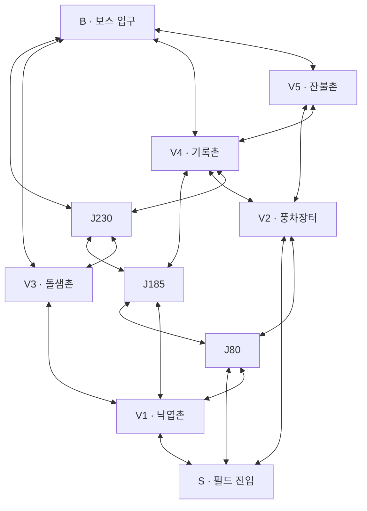

# 다섯 마을·갈림길·선택 퀘스트 경로 보완 명세

작성: 2026-11-10 / 상태: **설계·정적 검증 완료, 맵 배치·플레이 검증 전**.

## 범위와 요구 우선순위

이번 위임의 기준은 **직행하면 보스 입구까지 1분 이내, 선택 콘텐츠로 성장하면 보스 입구까지 약 15분**이다. 보스 처치는 그 이후다. 기존 [초안](2026-11-10_five-village-route-plan.md)의 ‘보스 처치를 포함한 15분’ 해석과 확인 요청은 이 명세로 대체한다. 원본 초안은 보존한다. 이 시간 기준은 이미 전달된 사용자 요구이므로 다시 승인을 기다릴 항목이 아니다.

다섯 마을은 각각 방문할 이유가 있지만 다음 지역 이동에 퀘스트가 필요하지 않다. 마을 전부 건너뛰기, 일부만 방문하기, 역순 방문하기, 같은 런에서 돌아가 의뢰 이어하기를 허용한다. 보스 입구는 처음부터 열려 있다. 승리가 어렵다는 이유로 방문 수·레벨·특정 기술·필드 보스 열쇠를 강제하지 않는다.

상위 작업과 같은 물리 체크아웃의 `Sprint#9-29-humanoid-boss-npc`, 조사 HEAD `51f2def0`에서 읽기 전용 조사와 별도 문서·증거 작성만 수행한다. 기존 WIP를 보존하고 브랜치 전환·커밋·푸시를 하지 않는다. 에디터·빌드·PIE 실행, 공유 소스·설정·맵·에셋 수정은 범위 밖이다. 이 문서는 새로운 필드 구현 완료 보고가 아니다.

## 현재 구현과 측정 상태

| 확인 대상 | 근거 | 확인한 사실 / 한계 |
| --- | --- | --- |
| 과거 배치 | `Scripts/Editor/OpenWorldLayout.py:18-83`, `Docs/WorldStructure.md` | 약 1.8km 사각 월드. 남쪽 야영지 `(0,-65000)`cm, 북부 보스 폐허 중심 `(15000,68000)`cm. 기존 숲·풍차·고원은 기능을 갖춘 다섯 마을과 다르다. |
| 기존 직행 도로 | `Feature/doc/evidence/open-world-map-20261005/map-data.json` | XY 중심선 1357.200m, 높이 포함 1360.895m. 6m/s 단순 계산 226.816초. 플레이 실측이 아니며 60초 목표와 맞지 않는다. |
| 과거 프로그램 입력 | `DevLog/BasicRunPlayQA/BasicRun1101H/Driver/events.csv` | `stage=field_ready` wall21.774 → `actual_boss_reached` wall341.441, 차이319.667초. 성장·구매·서쪽 교량·고원·남쪽 경사로 경유 구버전 기록. 달리기 포함, 보스 액터 18m 근접 판정이며 입구 통과가 아니다. |
| 해당 실행의 분류 | `DevLog/20261101_BossSouthApproach_Review/VERIFICATION.json`, `Tests/Rogue10mBasicRunPlaytest.cpp:762` | 프로그램 입력·렌더 실행, 물리 입력 미실시. 60초 목표 미검증을 명시한다. 15분 경로 성공 증거로 재사용하지 않는다. |
| 속도 기본값 | `Data/Rogue10mCharacterDataAsset.h:61,64`, `Character/Rogue10mCharacterStats.h:143-145` | 걷기600·달리기900cm/s. 실제 장비·특성·에셋 override는 별도 기록해야 한다. |
| 런 시계 | `Core/Rogue10mGameState.h:78`, `.cpp:24-35,86-99` | 기본1200초, 1초 타이머 차감, 0에서 패배. 새 맵에서 StartRun을 다시 호출하면 시간 연속성을 깨뜨린다. |
| 보스 승리 조건 | `Components/Rogue10mRunCompletionComponent.cpp:40-59` | 활성 런·남은 시간·최종보스 사망 조건이 있고 마을 방문·퀘스트 조건은 없다. Blueprint 내부의 추가 조건까지 이번 조사로 확인한 것은 아니다. |
| 퀘스트 상태 | 소스의 QuestId/QuestState/ObjectiveId/RequiredQuest 탐색 | 일반 의뢰의 수락·목표·재개 시스템을 찾지 못했다. Quest 아이템 종류나 보상 수령 기록을 이 시스템의 구현으로 세지 않는다. |
| 안전 메뉴 | `Core/Rogue10mGameMode.cpp:45-51` | 현재 Standalone+정확한 StartHub+WaitingToStart 문맥이다. 필드 마을 pause provider는 별도 구현 대상이다. |
| 던전 왕복 | `World/Rogue10mRunPortal.cpp:55-85`, `Core/Rogue10mProgressionSubsystem.cpp:524-532` | 런 입장 기준 저장은 StartHub/WaitingToStart 조건. 활성 런의 마을·던전 이동에 기존 출발 포털을 재사용하면 거부·새 런 위험이 있다. |

위 클래스 경로는 `Source/Rogue10m/` 기준이다. 현재 에디터 상태는 이번 작업에서 조회하지 않았으며, 기존 초안의 StartHub 조회를 새 관측으로 주장하지 않는다. 11월10일 현재의 연속 실제 주행 측정값은 없다.

## 배치 방향과 경로망

권장 방향은 **기존 보스 구역·바닥·남쪽 접근 계약을 보존하고, 런 입장점과 마을 부지를 보스 입구 근처에 새로 배치**하는 A안이다. 현재 남쪽 입장과 북쪽 보스 위치를 모두 고정한 채 도보 60초를 달성할 수는 없다. 전체 월드를 축소하거나 이동속도를 올리는 해결책은 채택하지 않는다. 실제 앵커는 보스 담당자와 조율한 뒤 배치 담당자가 정한다. 아래 좌표를 현재 월드 좌표에 그대로 덮어쓰지 않는다.

좌표는 제안 로컬 평면의 미터 단위다. 북쪽 +Y. `S`는 활성 런 진입점, `B`는 보스 **입구 통과선**이다. StartHub 준비 마을은 다섯 마을에 포함하지 않는다.

| 지점 | 로컬 XY(m) | 기능 |
| --- | --- | --- |
| S | (0,0) | 입력 가능한 필드 시작·직행 안내 |
| J80 / J185 / J230 | (0,80) / (0,185) / (0,230) | 표식이 있는 실제 평면 교차로 |
| V1 낙엽촌 | (-140,80) | 아래 왼쪽·회복과 보급 |
| V2 풍차장터 | (140,80) | 아래 오른쪽·재화와 거래 |
| V3 돌샘촌 | (-300,230) | 위 왼쪽·근접 전투 성장 |
| V4 기록촌 | (60,230) | 위 가운데·기록과 비급 |
| V5 잔불촌 | (300,230) | 위 오른쪽·위험 대비 장비 |
| B | (0,300) | 보스 입구. 보스 액터 위치·교전 개시와 분리 |



**10개 지점·19개 양방향 연결**로 관리한다. 모든 연결의 퀘스트 조건은 비어 있고, 같은 월드의 도보 이동이다. 기존 초안의 13개 큰 연결을 실제 교차로에서 분할한 것이며, 추가 강제 관문을 만든 것이 아니다. JSON의 간선이 계산 기준이다.

중앙 길은 마을 서비스 광장·강제 NPC 대화·던전 입장 트리거를 통과하지 않는다. 선택 조우는 길 바깥으로 식별하고 추적·회피 공간을 둔다. 마을길에는 보스 방향·마을 기능·예상 거리 표식을 같은 규칙으로 둔다. 강을 건널 때는 기존 시각 수면에 보이지 않는 바닥을 가정하지 않고 적법한 교량·경사·충돌을 배치한다. 보스 입구 전에는 어디서든 경로를 되돌릴 수 있다. 교전 개시 후 퇴장·보스 회복·리셋 정책은 별도 보스 계약으로 남긴다.

중앙 300m 직선은 6m/s에서50초의 이론 하한이다. 실제 길 중심선330m 이내(55초 이론)를 1차 배치 예산으로 삼고 가속·회전·문턱 등 약5초 여유를 둔다. 이 값은 통과 보장이 아니다. 고도·충돌·스트리밍·입력 지연을 포함해 실제60초를 측정한 뒤 통과 여부를 판단한다.

## 다섯 마을의 고유 활동

이름·의뢰 ID·보상명·아이템 효과는 **콘텐츠 제안**이다. 현재 데이터 자산 ID나 구현된 품목을 뜻하지 않는다. 상점은 기본 등급, 퀘스트는 상대적으로 희귀한 보상, 드롭·히든 피스는 좋은 보상 기회라는 기존 방향을 따른다. 수치·가격·확률은 후속 튜닝이다.

| 마을 | 고유 선택 퀘스트와 중단·복귀 | 상점 / 선택 던전 | 고유 보상 방향 |
| --- | --- | --- | --- |
| V1 낙엽촌 | `Q_V1_supply`: 뿌리길 보급 상자 회수. 수락 후 바로 V3로 가도 회수·보고 상태 보존. 완료 보고는 재방문 때 가능. | 공통 회복품·생존 장비 / 뿌리 저장굴. 상자 회수 위치를 던전 안으로 옮기는 변형도 가능하나 같은 목표를 두 번 세지 않음. | 수지 보호대: 생존 성향 런 장비 후보. 보스 필수 방어·유일 회복 수단이 아님. |
| V2 풍차장터 | `Q_V2_stolen_grain`: 도난 흔적과 창고 조우 확인, 재화 보상 또는 후속 운송 의뢰 선택. 강제 대기 호위 없음. | 기본 등급 대검·공통 소모품 / 풍차 지하창고. 대검의 기존 고정 장소·퀘스트 획득 대안 보존. | 곡물상인의 인장: 거래 성향 런 아이템 후보. 방문해야만 다음 상점이 열리는 구조 금지. |
| V3 돌샘촌 | `Q_V3_quarry`: 채석장 일반 조우와 전투 수련. 별도 북쪽 순찰 `E_V3_north_patrol`은 추가 선택. 수문장/필드 보스는 던전과 교환 가능한 활동이며 필수 처치 아님. | 방어·근접 장비·공통 회복품 / 갈라진 채석장 `D_V3_quarry`. | 돌샘 비급: 너클·대검의 기존 학습 조건을 따르는 런 비급 후보. 숙련100 자동 승급에 새 gate를 추가하지 않음. |
| V4 기록촌 | `Q_V4_record`: 현지 기록을 회수·해석하는 독립 의뢰. V1의 단서도 선택 연계로 분석 가능하지만 V1 미방문이어도 현지 의뢰 제공. 분석 뒤 V1에 돌아가 보고 가능. | 두 무기의 비급·빌드 보조품 / 봉인 서고. 현지 탐색과 의뢰 목표를 겸하면 한 활동으로만 계산. | 기록자의 수첩: 이번 판 학습 경로 선택 후보. 영구 MageRank·마나/내공 자유 혼합을 지급하지 않음. |
| V5 잔불촌 | `Q_V5_embers`: 유적 외곽 위험 조우와 보상 상자. 제련로 도전 대신 외곽 조우만 끝내고 보스로 가도 됨. | 공격 성향 장비·공통 회복품 / 꺼진 제련로 `D_V5_furnace`. | 잔불 장신구: 위험 대비 공격 장비 후보. 특정 보스 패턴의 유일 해법·열쇠가 아님. |

각 마을은 진입→기능 식별→선택 활동→어느 길로든 이탈하는 작은 루프로 만든다. 최초 방문 대화·완료 보고·상점 구매 없이도 통과 가능하다. 다섯 마을의 모든 의뢰·던전을20분 안에 끝내도록 요구하지 않는다.

## 경로와 시간 예산

아래 길이는 **평면 직선 합계·기본 속도 가정의 하한**이다. 건물 내부, 굽이, 고저차, 회피, 전투, 대화는 포함하지 않는다. `J` 교차로 생략 없이 JSON에 기록해 재계산 가능하게 했다.

| 경로 | 지점 순서 | 거리 하한 / 순수 이동 | 의도 |
| --- | --- | --- | --- |
| 직행 | S→J80→J185→J230→B | 300.000m /50.000초 | 모든 마을·퀘스트를 건너뜀. 실제 목표60초 이내. |
| 서쪽·재방문 | S→V1→V3→J230→V4→J185→V1→J185→V4→B | 1332.758m /222.126초 | V1 보고 재방문, V2·V5 생략. |
| 동쪽 성장 | S→V2→V5→V4→B | 712.758m /118.793초 | V1·V3 생략, 절약한 이동 시간을 제련로에 투자. |
| 다섯 마을 방문 | S→V1→V3→J230→V4→V2→V5→V4→B | 1462.075m /243.679초 | 전 마을 방문 가능성 예시. 모든 활동 완료 코스가 아님. |
| 서쪽 전부 생략 | S→V2→V4→B | 423.441m /70.573초 | 일부 방문·미수락 통과를 확인할 짧은 경로. 60초 직행 테스트와 다름. |

### 대표 경로 A: 서쪽 활동과 V1 재방문

| 활동 | 런 활성 시간 예산 | 중복 방지 기준 |
| --- | --- | --- |
| 마을 간 이동·왕복 | 255초 | 계산222.126초+약32.874초 길 여유. 광장 접근은 아래 별도. |
| V1 보급 의뢰 | 105초 | 회수 목표와 그 목표의 전투를 합친 시간. 보고 메뉴 제외. |
| V3 채석장 던전 | 180초 | 던전 안 이동·전투·보상 전부. |
| V4 기록 의뢰 | 165초 | 탐색·분석 준비·현지 조우. 서고와 공유하면 별도 던전 시간 추가 금지. |
| V3 북쪽 별도 순찰 | 120초 | 채석장과 다른 조우 ID. 선택하지 않으면 도착이 빨라짐. |
| 실제 시계가 흐르는 구매·보고 동작 | 30초 | NPC 접근 후 확정·복귀 등. pause 중 생각 시간 제외. |
| 마을 내부 접근·변동 | 45초 | 지역 간 도로·던전 내부 이동과 중복 제외. |
| 보스 입구 도달 | **900초 /15분** | 보스 전투·결과 UI·허브 복귀 제외. |

### 대표 경로 B: 동쪽 활동에 더 투자

| 활동 | 런 활성 시간 예산 |
| --- | --- |
| 마을 간 이동 | 165초(하한118.793초+약46.207초 여유) |
| V2 도난 곡물 의뢰 | 150초 |
| V5 제련로 던전 | 270초 |
| V4 기록 의뢰 | 165초 |
| 시계가 흐르는 구매·보고 | 45초 |
| 마을 내부 접근·변동 | 105초 |
| 보스 입구 도달 | **900초 /15분** |

두 예산은 경로 선택의 예시이며 퀘스트 수락이나 시간 경과로 입구를 여는 스크립트가 아니다. 같은 처치가 의뢰와 던전을 동시에 진행시키면 실제 경과시간은 한 번만 합산한다. 15분을 맞추려고 적·상자 재생성, 대화 대기, 이동 왕복을 강제하지 않는다.

| 런 전체 계획 | 예산 |
| --- | --- |
| 입장→선택 성장→보스 입구 | 15분 |
| 입구→첫 접촉·보스 처치 | 3분, **미실측 가정** |
| 길 찾기·전투 편차 여유 | 2분 |
| 현재 런 상한 | 20분 |

시간 판단은 `추가 활동 + 보스까지 이동 + 보스전 예상 + 여유 ≤ 남은 시간`으로 한다. 임시 보스전180초·최소 여유60초 기준이면960초(16분)가 **입구 도착**의 설계 경계다. 성장 중단·보스 방향 이동 시작은 `960초 - 현재 위치에서 B까지 예상 이동시간`보다 빨라야 한다. V3에서는 직선 하한만 약51.3초이므로, 길 여유가 없다고 가정해도 약908.7초 이전에 떠나야 한다. 실제 안내에는 관측한 중심선·속도와 여유를 사용한다. 아직 HUD 기능이 아니다. 실제 보스전이3분보다 길면 먼저 성장 활동량·보스 진입 시점을 다시 조정하며, 사용자20분 상한을 임의로 늘리지 않는다.

### 시계의 정의

15분·20분은 런 활성 시간이다. RunState가 InProgress가 된 시각, 필드 입력 가능 시각, 입구 통과 시각을 각각 기록해 로드 후 조작 불가 시간을 숨기지 않는다. 실시간 벽시계는 별도 보관한다.

안전 마을에 서 있기만 하면 시계가 흐른다. 명시적 안전 구역에서 해당 메뉴를 열었을 때 월드·AI·런 시계를 함께 멈추는 것은 기존 요구이며 후속 provider 구현이 필요하다. 필드·던전 메뉴는 계속 흐른다. 현재 구현되지 않은 필드 pause를 이미 적용한 예산처럼 보고하지 않는다. 첫 통합 테스트에서는 실제 pause 전후 시간을 분리하고 관측된 동작으로 계산한다.

## 퀘스트 재개·보상·던전 계약

- 같은 RunId에서 미수락→진행 중→목표 달성→보상 수령을 보존한다. V1 수락→V3 목표→V4 분석→V1 보고는 선택 연계이며, 아무 단계에서든 다른 길로 떠날 수 있다.
- 수락 전 처치·회수의 소급 인정은 의뢰 데이터에서 정한다. 재생성되지 않는 목표는 같은 런의 사실 기록으로 인정하거나 수락 없이도 회수 가능한 물품으로 설계해 막힘을 방지한다. 단순 미수락 통과를 실패로 처리하지 않는다.
- 상태는 스트리밍 NPC 액터에만 두지 않고 PlayerState의 전용 퀘스트 ActorComponent 등 런 수명 소유자에서 유지한다. 데이터 정의는 Data Asset에 둔다. 이는 제안이며 새 클래스·저장 스키마를 이번에 만들지 않는다.
- `(RunId, QuestId, RewardStage)`별 보상 영수증으로 중복 지급을 막는다. 공간 부족·재화 부족·저장 실패에서 지급과 완료 표시가 반쪽만 반영되지 않게 한다. 기존 보급 Claim 기록만으로 진행 상태를 대체하지 않는다.
- 재방문은 같은 런 안의 기능이다. 종료·강제 종료 후 월드·시계까지 복원하는 중단 재개는 약속하지 않는다. 새 런에서는 런 의뢰·장비·아이템·학습을 초기화하고 로비 성장·재화·Discovery 정보는 기존 계약대로 보존한다. 생산 저장을 삭제·이행하지 않는다.
- 첫 던전은 OpenRunMap 안의 걸어서 드나드는 공간으로 구성한다. RunId·남은 시간·의뢰·이미 받은 보상은 유지한다. 별도 맵 던전은 세션 연속성 계약을 먼저 만든 뒤 적용한다. 기존 RunPortal·ReturnToTown을 중간 왕복에 재사용하지 않는다.

## 재사용 자산과 충돌 경계

`Docs/FabAssetReuseGuide.md`를 확인했다. Stylized Village/Hivemind의 건축·길·나무·소품과 기존 OpenRunMap 지형·교량을 우선 후보로 한다. 기존 지역 몬스터·아이템·상자 데이터를 사용해 조우를 분리한다. 현재 화풍을 유지하고 vendor 원본은 보존하며 프로젝트 소유 자식·데이터로 구성한다.

이는 10월19일 Fab 카드 확인·과거 제작 사용 기록과 로컬 경로 근거다. 이번에 계정 소유권·약관·팩 버전·실제 메시/재질·라이브 연결을 새로 확인하지 않았다. 실제 배치 때 필요한 제품과 항목만 소유·사용 조건·UE 호환·충돌·LOD·스트리밍 비용을 다시 확인한다. 구매·다운로드·팩 설치·새 모델 생성은 수행하지 않았다.

| 조율 대상 | 충돌 가능성 / 대응 |
| --- | --- |
| 대검 애니메이션·손잡이 | 전투·이동 속도 실측에 영향. 진행 중인 소스/자산은 수정하지 않고 승인된 체크포인트에서 속도를 재관측. |
| 인간형 보스·보호 바닥·남쪽 경사로 | A안으로 기존 조우 공간 우선 보존. 실제 입구 앵커와 진입선은 보스 담당자가 확정. |
| NPC 대화·서비스·저장 | Arin/TutorialNPC 공용 파일을 직접 늘리지 않고 후속 전용 의뢰 component/provider로 분리 검토. 기존 상호작용 회귀 유지. |
| 에디터·빌드 소유 | 이번에는 둘 다 실행하지 않음. 맵 배치와 빌드가 필요한 후속 packet은 상위 작업 종료·잠금 해제 후 실행. |
| 공용 기록 문서 | SprintChangeLog·당일 DevLog는 이번 항목만 끝에 추가. 기존 기록을 교체하지 않음. |

## Ultrawork Packets와 인수 기준

`Docs/LazyCodexHarness.md`의 Scope Gate→Breakdown→Architect→Implementer→Builder→Reviewer→Doc Writer→Exit Gate를 적용한다. 이번 범위의 Implementer는 문서·JSON·정적 검사 작성, Builder는 런타임 빌드가 아닌 설계 검사다. 기능 구현·빌드 통과로 확대 해석하지 않는다.

| Packet | 목표·변경 범위 | 완료 조건·검증 명령 | 롤백 경계 |
| --- | --- | --- | --- |
| R0 현재 조사 | 기존 문서·소스·과거 측정 읽기 | 요구·가정·현재 구현·과거 측정을 구분. 독립 소스 감사 | 파일 변경 없음 |
| R1 이번 설계 | 이 명세·짝 결과·전용 evidence와 로그 추가 | 아래 VerifyRoutePlan 정적 검사, 독립 리뷰, 경로 제한 diff 및 생성파일 검사 | 신규 문서/evidence와 추가한 로그 항목만 |
| R2 후속 블록아웃 | 실제 입장/입구·마을·교차로·충돌 | 전용 work 브랜치에서 담당자 Editor 배치, 도보3회60초 이내,19간선 왕복 실제 통과. `Scripts/CheckGeneratedChanges.ps1` | 프로젝트 소유 환경·도착점·표식만. vendor·보스 별도 |
| R3 후속 수직 구현 | 마을1개, 퀘스트 상태·현장 상점·안전 provider | `Scripts/BuildEditor.ps1`, 재방문/스트리밍/중복 보상/메뉴 runtime QA | 전용 component·데이터·fixture만 |
| R4 후속 확장 | 다섯 마을 데이터·같은 월드 던전 | 모든 지역 미수락 통과, 역순·건너뛰기·복귀, RunId/시계 연속성 | 지역별 데이터·배치만 |
| R5 후속 통합 QA | 콘텐츠 길이·보스 도착·20분 종료 | 실제 사람5회 이상, 서로 다른 경로, 아래 판정표. 관련 빌드·회귀 후 기록 | 튜닝한 데이터·배치만 |

재현 명령(프로젝트 루트):

```powershell
& './Feature/doc/evidence/five-village-route-spec-20261110/VerifyRoutePlan.ps1'
.\Scripts\CheckGeneratedChanges.ps1
```

정적 검사는 노드/간선·양방향·빈 퀘스트 조건·모든 마을 제거 후 보스 도달·숨은 평면 교차점·예시 경로·거리·중복 없는 시간 합계를 확인한다. 맵 충돌·퀘스트 저장·상점 연결·실제 플레이는 검사하지 않는다.

| 후속 플레이 검증 | 조건과 합격 기준 |
| --- | --- |
| 직행 | 정상 StartHub 포털 진입, 초기 너클·추가 이동 보너스/질주/순간이동 없음. 실제 MaxWalkSpeed 기록. 런 시작→입구 통과60초 이내3회. 입구선 통과·접지 확인, 근접 반경 판정으로 대체 금지. |
| 경로 자유 |19간선 양방향 통과, 다섯 마을 전부 미수락 또는 생략 후 입구 도달. 강제 대화·방문 수·퀘스트·필드 보스 gate0. |
| 재방문 |V1 수락→다른 마을/목표→NPC 스트리밍 해제→V1 복귀. 동일 RunId·목표 유지·보상1회. 미수락 목표·용량 부족·대화 취소도 분리. |
| 던전·메뉴 |던전 왕복 RunId 불변·시계 리필0. 안전 입장만으로 정지0, 안전 메뉴 월드/AI/시계 동시 정지, 필드 메뉴 계속 진행. |
|15분 입구 도착 | 대표 두 경로와 자유 선택으로 사람 최소5회. 초기 튜닝 창13~16분, 중앙값 약15분 제안. 입구·첫 공격·처치 시각 별도. 강제 대기·모든 의뢰 완료 요구 없음. 소표본을 인증 통계로 표현하지 않음. |
| 보스·20분 | 초기 너클 직행에도 기본 행동 대응 공간 존재. 보스전3분 가정 재측정. 자연20분 소진·승리 경계·정산/다음 런 검사. |

원본 영상/연속 위치·속도·RunId·런 잔여 시간·pause 구간·의뢰 상태·보상 영수증을 남긴다. 수치 검사, 프로그램 입력 렌더 실행, 물리 입력, 전체 런 완주는 각각 표기한다. 이번에는 이 플레이 검증을 수행하지 않았다.

## 남은 의사결정과 인계

1. **배치 담당 결정:** A안 기준 실제 런 진입점·보스 입구선 월드 앵커와 원본 그림의 필수 연결. 현재 좌표는 기존 설명을 발전시킨 제안이며 그림 원본을 이번 작업에서 보지 않았다.
2. **콘텐츠 담당 결정:** 마을 이름·품목·효과·등급·가격·재화 수치. 현재는 역할과 선택 가치만 확정할 수 있는 수준이다.
3. **보스 담당 결정:** 교전 후 필드 이탈·리셋·회복 정책과 실제 전투 시간. 입구 전 자유 왕복과 별개다.
4. **통합 순서:** 대검/보스/빌드 작업 종료 뒤 R2→R3 수직 검증→R4 확장→R5 시간 튜닝. 기존 Save/PlayerState/카메라·입력 계약을 유지한다.

15분의 끝이 입구라는 점, 선택 퀘스트, 마을 생략·재방문,20분 상한은 미결 항목이 아니다. 현재 차단된 도구 호출은 없다. 플레이 미실행은 상위 위임의 충돌 방지 범위에 따른 것이다.
