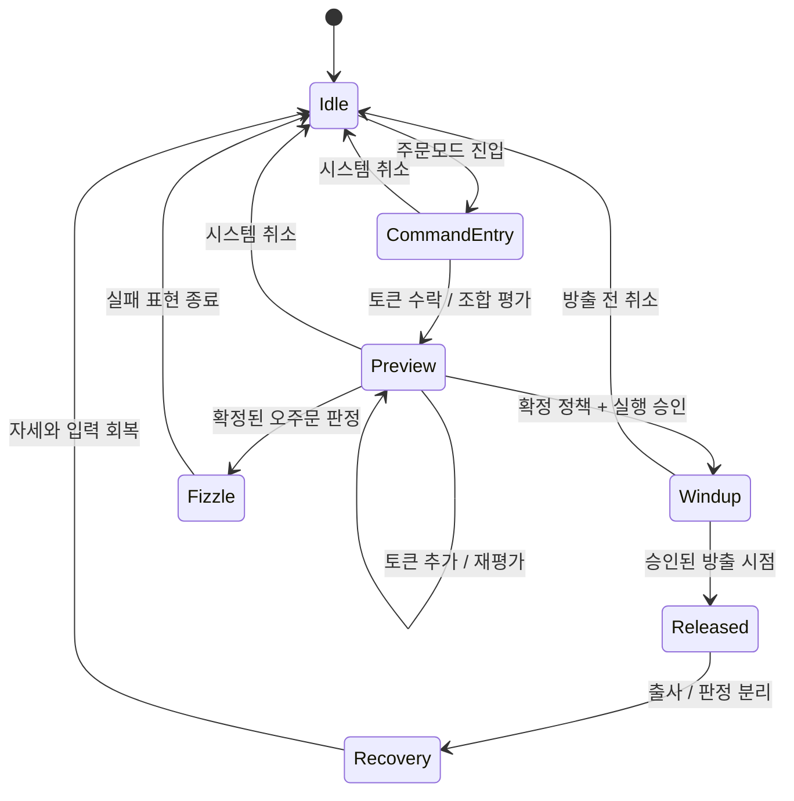

# 마법 주문·마법진 Niagara 연계 설계

작성일: 2026-11-10 UTC. 상태: **독립 설계 완료 / 구현·에디터 검증 전**.

조사 사본은 `D:\Project\Rogue10m`, 관찰 브랜치는 `Sprint#9-29-humanoid-boss-npc`, HEAD는 `51f2def03774afc64874a521f6804743014c1cf3`이다. 다른 작업의 미커밋 변경이 있으므로 HEAD만으로 조사한 소스 상태 전체가 재현되지는 않는다. 아래 행 번호는 조사 당시 작업 파일 기준이다.

이번 작업은 이 문서 한 파일만 추가한다. 소스·Config·에셋·기존 문서·공용 DevLog·SprintChangeLog 수정, 브랜치 전환, 에디터·빌드·PIE 실행, 커밋·푸시는 담당하지 않는다. 공용 기록의 충돌을 피하기 위해 마지막 절에 부모 작업이 반영할 한국어 기록안을 제공한다.

## 1. 범위와 기존 문서의 역할

이 문서는 이미 작성된 기술 목록이나 스토리보드를 다시 만들지 않고, 마법 입력부터 효과 종료까지 **이벤트·좌표·시간·수명·Niagara 파라미터·검증 조건**을 구체화한다.

- 사용자 규칙과 미정 항목: [WeaponClassDesign.md](../../Docs/WeaponClassDesign.md), [SkillMotionVFXDesign.md 13절](../../Docs/SkillMotionVFXDesign.md#13-마법사-별도-기획입력표현-계약).
- 실제 원본과 대표 시각 콘셉트: [FantasyMotionVFXSources.md 2·4절](../../Docs/FantasyMotionVFXSources.md).
- 현재 제작 단계: [SkillProductionTracker.md](../../Docs/SkillProductionTracker.md).
- 재사용·증거 원칙: [FabAssetReuseGuide.md](../../Docs/FabAssetReuseGuide.md), [AnimationRecordingGuide.md](../../Docs/AnimationRecordingGuide.md), [LazyCodexHarness.md](../../Docs/LazyCodexHarness.md).

이하 **확인**은 메시지·문서·파일·소스에서 확인한 사실, **이력**은 기존 조사나 제작 기록, **제안**은 앞으로 구현하고 검증할 계약을 뜻한다. 예시 자산명·이벤트명·수치는 별도 표기가 없어도 제안이며 현재 자산/API로 간주하지 않는다.

## 2. 사용자 기획의 확정 범위

2026-11-10 사용자 메시지와 위 기존 기획을 대조했다.

| 구분 | 확정한 내용 | 이번 설계의 반영 |
| --- | --- | --- |
| 입력 | Ctrl로 주문 명령 입력, Q/E/R의 순서 조합 | 입력 가능한 상태와 확정된 시전을 분리 |
| 가중치 | 조합으로 마나 소모·공격력·속성 가감 | 계산 결과를 표현층에 전달; Niagara가 공식을 계산하지 않음 |
| 위험 | 마나 초과·잘못된 주문에 최대마나 및 체력 손실 | 확정 전 경고, 판정 후 실패·손실 표시를 각각 재생 |
| 지속 범위 | 사용자의 후속 정정은 **이번 판까지** | 프로필 기본 능력치 영구 손상으로 표현하지 않음 |
| 성장 | 리듬게임 등 다양한 미니게임으로 마법 해금, 마법서클 도입 | 해금 연출과 전투 시전 연출을 별도 실행으로 관리 |
| 즉발 | 높은 숙련 또는 약 2단계 하위 마법을 일반 Q/E/R에 설정 | 같은 주문 효과를 재사용하되 명령 문자 입력 단계는 생략 |
| 소스 | 지정 Combat Magic Animations로 마법도 기획 | 원본 동작 선정 후 프로젝트 파생 몽타주와 별도 VFX를 연계 |

메시지 근거: `Sentinel_a9f42721c9a88191ad4f750a338603f7`(Ctrl/QER), `Sentinel_d0bc92d374c08191bd020407e0ce9d02`(가중치·초과), `Sentinel_d258c8ec5d688191bbcd3216e07fe837`(오주문), `Sentinel_8deb4a26b140819187dbc2b95d90734c`(이번 판 정정), `Sentinel_5e953152396c819183df76b86f286fa4`(미니게임), `Sentinel_9634e3e00b648191a7bfc0b0aea1366e`(서클), `Sentinel_e788f2f1e5948191b78306ca13896c47`(즉발), `Sentinel_f83b1058556081918a4d61a1128d163b`(Fab 지정). 사용자 이력 읽기 도구로 재확인했으며 과거 다른 날짜의 융합 실패 규칙을 이번 주문 실패 공식으로 덮어쓰지 않았다.

아직 결정되지 않은 것은 Ctrl hold/toggle, 주문 길이·확정/취소 입력·시간제한, 문자열 접두어가 여러 주문과 겹칠 때 처리, 실패 판정 시점, 가중치/초과 공식, 체력 손실의 현재/최대 구분, 서클의 단계 의미, 즉발 OR/AND·2단계 비교 기준, 해금·숙련 저장 범위다. 이 문서는 Enter·Ctrl 해제·특정 문자열을 확정 키/주문으로 지정하지 않는다. 완성 가능한 접두어를 입력하자마자 자동 발사하면 더 긴 주문 입력을 막을 수 있으므로, 주문 정의와 확정 정책을 함께 결정해야 한다.

## 3. Fab·보유·로컬·사용 이력을 분리한 판단

지정 상품은 [Combat Magic Animations / SoerGame](https://www.fab.com/listings/05d90ca6-d294-4b93-a1b7-232214057850)이다. 이번 공개 페이지 열람에서 마법 전투 모션과 Unreal Engine 포맷을 확인했다. 공개 추출 화면에는 라이선스가 선택 상태로만 나오며 계정 보유 표시는 없다. 공개 페이지의 `Allows usage with AI: No`, `Generated with AI: No` 표기도 확인했다. 이 표기와 취득 시 적용 계약을 동일한 것으로 단정하지 않는다.

| 확인 층위 | 근거 | 말할 수 있는 것 / 남은 것 |
| --- | --- | --- |
| 과거 계정 보유 | [2026-10-19 UI-023](../doc/evidence/fab-owned-assets-20261019/launcher-observations.json) | 당시 My Library 카드 관찰. 당시 버전·라이선스·내부 구성 검사는 안 함 |
| 같은 날 상세 조사 이력 | [FantasyMotionVFXSources.md 25–34행](../../Docs/FantasyMotionVFXSources.md) | 2026-11-10 로그인 UI에서 보유/Standard/UE5.6–5.8, 35개 In-place, Epic/MetaHuman·IK를 확인했다는 기록. 이번 작업에서 계정 UI를 새로 열지는 않음 |
| VFX와의 구분 | 위 상세 조사 | Characters/Materials/MaterialInstances/Textures 0 기록. 이 상품을 마법진·이펙트 팩으로 설명하지 않음 |
| 현재 로컬 | `Content/CombatMagicAnims/Animations` 파일 목록 | 이번 조사에서 `.uasset` 35개 파일 실재 재확인. 로드·컴파일·손 궤적·게임 실사용 검증은 안 함 |
| 개별 애니메이션 감사 이력 | [asset-audit.json](../doc/evidence/humanoid-boss-npc-20261110/asset-audit.json) | AS_ManaCastShot의 스켈레톤/약 7.8초 길이 기록. 실제 방출 프레임이나 플레이어 적용 증거는 아님 |
| 제작 연결 이력 | [ConfigureClassCombatAnimationVFX.py](../../Scripts/Editor/ConfigureClassCombatAnimationVFX.py) 184–198·273–315행 | Staff 몽타주와 Cast/Charge/Impact를 만드는 설정. 현재 로드된 DA 참조나 화면 검증을 대신하지 않음 |
| 현재 런타임 | 이번 작업에서는 미확인 | 구현 담당이 실제 로드된 DA→Montage→Sequence·Skeleton 및 Niagara 경로를 출력하고 촬영해야 함 |

[Fab Standard 일반 요약](https://www.fab.com/eula)은 프로젝트에 포함한 사용·수정을 설명하며 독립 자산 재배포를 제한한다. 이 일반 요약과 기존 Standard 표시만으로 개별 취득 시점의 전체 적용 조건을 재구성하지 않는다. 이번 작업은 구매·다운로드·팩 반입·외부 AI 서비스에 원본 업로드를 하지 않았다. 후속 반입 담당이 필요한 제품의 취득 조건과 포맷을 다시 확인한다.

### 재사용할 원본과 별도 제작할 표현

| 역할 | 우선 원본/경로 | 선택 이유와 한계 |
| --- | --- | --- |
| 첫 시전 모션 | `/Game/CombatMagicAnims/Animations/AS_ManaCastShot` | 로컬 실재 및 기존 공식 미리보기 관찰 이력. 좌우손·방출·회복 구간은 측정 필요 |
| 화염탄 모션 | `AS_FireballCharge` → `AS_FireballSpell` | 두 로컬 파일 존재. 연결 자세·hold 반복·방출 프레임·슬롯 호환 미검증 |
| 방어/지면 후보 | `AS_MagicDefend`, `AS_GroundManaShot` | 파일 존재. 방어 성공·반사·지면 피해 기능을 제공하는 증거는 아님 |
| 기존 Staff 표현 | `/Game/Rogue10m/VFX/Character/Combat/Staff/NS_Staff_Cast`, `NS_Staff_Charge`, `NS_Staff_Impact` | 로컬 실재. 먼저 에디터에서 구조·파라미터·종료 상태를 검사해 파생 가능성을 평가 |
| 원 VFX 출처 이력 | `/Game/AdvancedPortalsSystemVFX/VFX/Vortex/NS_Portal_Vortex_9`, `NS_Portal_Vortex_10`, `/VFX/Sparks/NS_Sparks_06` | 위 제작 스크립트의 Staff 원본. 별도 팩이며 최신 계정 보유·조건은 이 작업에서 확인하지 않음 |
| 마법진 문양 | 프로젝트 소유 파생 재질 + 평면/원형 표시 | 조사한 마법 모션 상품은 문양 재질을 제공하지 않음. 적합한 보유 마법진을 먼저 찾아 편집하고, 없으면 단순 UV 링·획·점·각을 새로 제작하는 이유를 기록 |

모든 파생물은 제안 경로 `/Game/Rogue10m/VFX/Character/Combat/MagicCircle/` 및 `/Game/Rogue10m/Animation/Combat/MagicCircle/`에 둔다. vendor 원본이나 다른 작업의 `WeaponFantasy20261110` 자산을 수정하지 않는다. 기존 Staff 효과를 고르더라도 현재의 크기·시간 보정을 새 마법진에 그대로 적용하지 않는다.

## 4. 지금 구현된 기반과 추가로 필요한 계약

| 소스 확인 | 현재 동작 | 설계상 의미 |
| --- | --- | --- |
| [Character.cpp](../../Source/Rogue10m/Character/Rogue10mCharacter.cpp) 약 356행, [MouseCombatInputComponent.cpp](../../Source/Rogue10m/Components/Rogue10mMouseCombatInputComponent.cpp) 22행 이후 | 일반 Q/E/R, LMB/RMB/동시·차징 입력 경로 | 전용 주문 파서·상태 컴포넌트는 Source/Config 텍스트 조사에서 발견 못 함 |
| [CombatComponent.cpp](../../Source/Rogue10m/Components/Rogue10mCombatComponent.cpp) 1144–1254행 | 승인 단계의 자원/쿨다운, 즉시 CastEffect, 이후 첫 판정 타이머 | CastEffect는 수락 표시. 손에서 실제로 발사되는 순간과 같다고 가정하지 않음 |
| 같은 파일 1242–1254행 | 첫 지연은 `HitStartDelaySeconds / (AttackSpeed × AnimationPlayRate)` | 원본 초 단위 프레임과 실제 게임 시간 구분 필요 |
| 같은 파일 1305·1398–1407행 | pulse마다 CombatView를 읽고, Projectile은 구간별 박스 overlap. Single이면 사거리 전체 1회 검사 | 이동 화염탄 액터·충돌·고정된 발사 방향은 별도 기능 |
| 같은 파일 1414–1423행 | Circle은 전방 지점 중심의 구체 overlap | 지면 부착/커서 지정/보이는 바닥원과 일치하는 평면 판정 아님. 이 검사에서 지형 차폐 검사도 확인 못 함 |
| 같은 파일 1500–1525행 | ApplyDamage가 양수일 때 ImpactEffect | 실제 피해 성공과 시각 명중 피드백 연결 기반. 0피해/면역 접촉은 성공 타격과 구별 필요 |
| 같은 파일 1705–1715행 | Staff 적중 위치는 대상 bounds 중심 | 정밀 표면 접촉점/법선으로 표현하면 안 됨 |
| [AttackSkillData.h](../../Source/Rogue10m/Data/Rogue10mAttackSkillData.h) 279행 이후 | Cast/Charge/Impact 및 소켓·크기·수명·1인칭 보정 | 마법진/출사/이동/실패 전용 필드·이벤트 추가 필요 |
| CombatComponent.cpp 1558–1635·1734–1755행 | 충전 중단 및 일반 효과 타이머에서 즉시 비활성화·파괴; 일반 효과에 time dilation 적용 | 긴 준비진/잔광이 잘릴 수 있음. 새 수명 관리와 기존 즉시 파괴 경로를 섞지 않음 |

**첫 구현 단위 제안:** 즉시 마력탄 한 종류와 비피해 입력 마법진으로 입력→승인→방출→확인된 타격→회복을 먼저 증명한다. 현재 판정에서 피해가 즉시 발생한다면 같은 시점에 짧은 직선 광흔적을 보여준다. 천천히 날아가는 구체는 실제 이동·차폐·충돌이 피해를 결정하는 후속 단위와 함께 만든다. 기존 Single overlap이 막힌 지형 뒤를 타격하는지 먼저 검사하고, 차폐 계약이 필요한 경우 C++에서 해결한 뒤 벽에 부딪히는 연출을 연결한다.

## 5. 이벤트와 실행 수명 제안

### 상태 흐름

일반 Q/E/R 즉발은 적격성 검사 후 Windup에 합류하는 제안이다. 즉발은 명령 입력 생략을 뜻하며 피해 지연까지 0으로 바꾸는 결정이 아니다. Released 이후 투사체/잔류 효과는 캐릭터 회복과 독립 수명으로 관리한다. 허공 종료는 실패 주문이나 페널티가 아니다.

### 새로 정의할 표현 이벤트

| 이벤트 제안 | 유일한 발생 주체 | 표현 동작 | 중복 방지/수명 |
| --- | --- | --- | --- |
| `CommandModeChanged` | 입력 라우터 | 작은 빈 문양틀 열기/닫기, HUD 모드 표시 | 입력 epoch별 1개; 실제 QER 문자열은 HUD에 보존 |
| `CommandTokenAccepted` | 문자 파서 | Q=획, E=점, R=각의 형태·위치 누적 | 수락된 press당 1회; 키를 속성/가중치와 임의 매핑하지 않음 |
| `SpellPreviewChanged` | 주문 검증기 | 예상 비용·속성·위험, 끊어진 링/경고 | 미완성·미해금·오주문 후보를 구별; 능력치 변경 없음 |
| `SpellExecutionAccepted` | 권한 C++ 실행 경로 | 준비진·시전 모션 시작 | 실행ID 발급, 비용·쿨다운 단일 확정; 기존 승인 경로와 이중 차감 금지 |
| `SpellReleaseCommitted` | C++ 실행 스케줄러 | 손앞진 열림, 출사 핵, 승인된 방향/원점 고정 | 실행ID당 출사 1회. Notify는 표현 동기화/관측에만 사용 |
| `SpellPulseEvaluated` | 실제 판정 경로 | 즉시/구간 광흔적 | 실행ID+타격번호; 실제 검사한 원점·방향·길이 사용 |
| `SpellHitConfirmed` | 실제 양수 피해 결과 | 대상 확인 타격 문양, 짧은 핵 | 실행ID+타격번호+대상으로 1회. Niagara 충돌에서 피해 재호출 금지 |
| `SpellContactRejected` | 실제 차폐/면역 판정 | 작은 소멸/방어 접점 | 물리 접촉을 검증한 경우만; 면역은 양수 피해 성공으로 표시하지 않음 |
| `SpellFizzleConfirmed` | 확정된 오주문/실패 규칙 | 문양 안쪽 붕괴, 실패 원인 문구 | 실패ID로 1회. 실제 런 페널티는 별도 권한 결과에만 반응 |
| `SpellExecutionEnded/Cancelled` | 실행 소유자 | 준비진·대기 입력·루프음 정리 | 멱등 처리; 이전 epoch 콜백/풀 재사용 콜백 무시 |
| `RunPenaltyChanged` | 런 상태 소유자 | 손실 구간·이번 런 문구 갱신 | 효과 재생과 무관하게 상태 유지; 표현 종료가 페널티를 삭제하지 않음 |

이벤트 payload 제안은 `RunId`, `InputEpoch`, `ExecutionId`, `HitIndex`, 약한 대상 참조, `WorldTime`, 승인된 origin/aim, 실제 query 영역, contact 정보의 유무, 실패 원인, 확정된 비용/속성/위험도다. 실행 중 참조해야 하는 UObject는 UPROPERTY/TObjectPtr로 추적하고 캐시 대상은 TWeakObjectPtr를 사용한다. 새 presentation 컴포넌트는 기본 Tick 없이 이벤트·타이머를 사용한다. 파라미터가 갱신되어야 하는 동안만 기존 시전/투사체 소유자의 업데이트를 이용한다.

Ctrl 주문모드가 Native BindKey와 Enhanced Input 경로를 모두 차단하도록 일반 즉발과 문자 입력을 하나의 gate로 통과시킨다. 기존 [입력 epoch 제안](../../Docs/SkillMotionVFXDesign.md#133-ue-58-입력-분리-후보와-검증-목록)을 재사용한다. 메뉴·포커스 상실·사망·무기교체로 중단된 미완성 주문을 자동 오주문으로 벌주지 않는 안을 권고하되 최종 규칙은 미정이다.

## 6. Niagara·재질 제작 명세 제안

### 시스템 분해와 화면에서 보이는 결과

아래 이름은 **미생성 자산의 제안명**이다. 처음부터 모든 시스템을 만들지 않고 첫 마력탄에 필요한 항목부터 제작한다.

| 시스템 제안명 | 구성·공간 | 시작/종료 | 읽혀야 할 것 |
| --- | --- | --- | --- |
| `NS_Magic_CommandCircle` | 얇은 링 1개+작은 활성 토큰. 손/지팡이 소켓 로컬 공간, 조준축을 비운 위치 | 모드 진입→취소/승인 때 닫음 | 입력을 받고 있음. 공격범위·방어막 아님 |
| `NS_Magic_CastCircle` | 속 빈 링/분리 호와 안쪽 수렴점. 소켓 로컬 공간 | 승인된 준비→출사/취소 | 지금 준비 중이며 어느 방향으로 나갈지 |
| `NS_Magic_Release` | 열린 링 앞쪽의 짧은 핵·방향선. 출사 순간 transform을 고정한 월드 공간 | Release 1회, 유한 수명 | 손에서 분리된 실제 발사 시점 |
| `NS_Magic_QueryStreak` | 실제 query 시작/끝을 잇는 얇은 선. 월드 공간 | Pulse 1회→짧게 소멸 | 현재 즉시/구간 판정. 천천히 날아오는 물체로 보이지 않음 |
| `NS_Magic_ProjectileTrail` | 작은 핵과 짧은 리본. 실제 투사체 소유 | 이동/충돌/수명 만료 | 후속 실제 화염탄용. 현재 overlap 경로에는 연결하지 않음 |
| `NS_Magic_ConfirmedImpact` | 접점 핵+낮은 방사 문양+매체별 파편 | HitConfirmed→유한 소멸 | 피해 성공. 접촉 정보 없으면 bounds 확인 표시만 사용 |
| `NS_Magic_Fizzle` | 링이 안쪽으로 접히고 한 획씩 끊김 | 실패 판정 1회→소멸 | 오주문·실패. 적중 폭발과 다른 모양 |
| `NS_Magic_GroundPreview` | 유효 지면의 얇은 외곽과 방향표시. 월드 공간 | 지면 후보 확정/갱신→실행/취소 | 범위 주문을 추가할 때만 사용. 구체 overlap을 평면 범위처럼 표시하지 않음 |

마법진 핵심은 평면을 띄워 둔 불투명 원판이 아니라 구멍이 많은 문양이다. 먼저 기존 파생 효과에서 링·점입자·흡입 흐름을 만들 수 있는지 검사한다. 새 문양 재질이 필요하면 하나의 프로젝트 소유 unlit 재질에 링/분리 호/획/점/각 마스크와 색 파라미터를 두고, 문양 때문에 외부 그림·텍스처를 새로 확보하지 않아도 되는 단순 형태부터 검증한다. 적 경고형과 플레이어 준비형은 색 외에도 닫힌 경계/열린 호·진행 방향으로 구별한다.

### 외부에서 전달할 User Parameter

| 이름 제안 | 타입/단위 | 정의 |
| --- | --- | --- |
| `User.Progress01` | float 0..1 | 승인된 시전 진행. Niagara 나이로 실제 자원·발사 여부 추론 금지 |
| `User.TokenCount` / `User.LastToken` | int / int | 표시용 누적수·마지막 문자 코드. 전체 문자열은 UI/파서 소유 |
| `User.PreviewState` | int enum | 미완성/유효후보/잠김/위험/실패. 프리뷰와 확정 실패를 구별 |
| `User.ElementTint` | LinearColor | 확정/예상 속성 색. HDR 발광과 노출은 별도 시각 튜닝 |
| `User.Risk01` | float 0..1 | 게임 규칙이 계산한 경고 강도. 추가 피해·손실을 발생시키지 않음 |
| `User.RadiusCm` | float, cm | 승인된 시각 크기; 피해반경과 같은 의미일 때만 실제 query 값 사용 |
| `User.Origin` / `User.Target` | Niagara Position, world cm | 실제 이벤트 좌표. LWC Position/Vector 타입 구분 |
| `User.AimDirection` / `User.SurfaceNormal` | 정규화 Vector | 방향/실제 표면 법선. 없으면 정밀 접촉 표현 비활성 |
| `User.HasSurfaceContact` | bool | bounds 근사 타격과 실제 접촉을 구분 |
| `User.VisualSeed` | int | 실행별 외형 재현용. 피해 RNG와 분리 |
| `User.DetailScale01` | float 0..1 | 장식 밀도만 조절; 위험/피격 가능 정보는 저사양에도 유지 |

시스템별 필요한 항목만 둔다. 외부 User Parameter와 Effect Type의 기능은 [Niagara System Settings](https://dev.epicgames.com/documentation/unreal-engine/system-settings-reference-for-niagara-effects-in-unreal-engine?lang=en-US), [Effect Type 문서](https://dev.epicgames.com/documentation/unreal-engine/performance-budgeting-using-effect-types-in-niagara-for-unreal-engine?lang=en-US)를 참고하되 정확한 stack 입력·C++ API는 작업할 로컬 UE5.8에서 확인한다.

### 부착·지면·오류 처리

- 손진은 실제 사용할 캐릭터 스켈레톤의 검증된 소켓에 붙인다. 소켓이 없으면 현재 코드처럼 root에 조용히 fallback하여 몸통에 큰 원이 생기게 하지 않고 해당 장식을 생략하며 `LogRogue10m` 진단을 남기는 안이다.
- Release에서 위치·방향을 스냅샷한다. 출사 뒤 팔을 움직여 이미 발사한 탄도·지면진이 손을 따라 흔들리지 않게 한다. 다중 pulse의 추적 여부는 현재 동작과 비교해 gameplay 담당이 결정한다.
- 지면진을 추가할 때만 별도 지면 trace와 경사·낭떠러지·천장·수직벽 유효성 계약을 만든다. 실제 normal에 정렬하고 작은 offset을 검증한다. 유효한 바닥이 없으면 바닥진을 숨기고 HUD에 실패 이유를 표시한다.
- 대상 bounds만 있는 현재 성공 이벤트에는 작은 대상 확인 문양을 쓴다. 법선 방향의 파편·벽 충돌·탄흔은 실제 trace/hit 정보가 생긴 뒤 사용한다.
- 손진은 입력/시전 소유, 발사체는 발사체 소유, 명중은 유한 one-shot 소유로 나눈다. 부모 시전이 회복했다고 발사된 탄을 지우지 않는다. 맵 종료·EndPlay는 모두 정리한다.

## 7. 모션 선택·시간 동기화

| 후보 | 준비→방출→회복 목표 | 구현 전 측정/보존 |
| --- | --- | --- |
| AS_ManaCastShot | 손앞 열린 진→짧은 앞으로 출사→진 닫힘 | 전신 길이에서 실제 사용 구간, 좌우손, `hand_r/hand_l` 궤적, 준비·release·회복 프레임, slot·블렌드 |
| FireballCharge→FireballSpell | 작은 구체 수렴→손에서 분리→잔불 수축 | 원본 연결 포즈·발 접지, charge loop 여부, 이동/취소와 upper-body 사용 가능성 |
| MagicDefend | 열린 전방 반원→실제 방어 접점→해제 | 방어 방향/창/성공/실패 기능은 별도 C++. 모션이 있다고 방어 성공하지 않음 |
| GroundManaShot | 낮은 방향 예고→실제 구간에 전진핵→순서대로 잔광 소멸 | 손/발 동작, 지면 추적·높이 차·벽 차폐. 장식 핵 개수와 타수 분리 |

In-place 지원은 해당 캐릭터에 발 미끄러짐이나 root 문제가 없음을 보증하지 않는다. source/target Skeleton·기준포즈·키 비율·지팡이 그립과 현재 카메라 계약을 먼저 확인한다. 부유·Ascension·사망형 클립은 첫 시전 범위에 포함하지 않는다.

Notify/NotifyState는 준비 표식·손앞진의 외형 구간·음향 동기화 후보로 사용한다. [Animation Notifies 공식 문서](https://dev.epicgames.com/documentation/unreal-engine/animation-notifies-in-unreal-engine?lang=en-US)는 소켓 부착·반복 이벤트의 기반이며, 실제 피해 권한을 Notify로 이동하라는 뜻은 아니다. Blend-out이나 취소에서 NotifyEnd가 실행됐다는 가정만으로 정리를 맡기지 않는다. 실행 소유자의 Cancel/EndPlay도 반드시 정리한다.

첫 후보에서는 기존 `HitStartDelaySeconds`, AttackSpeed, AnimationPlayRate, 타수·쿨다운·비용을 보존하고 파생 구간·시각 이벤트를 맞춘다. 동작상 release와 판정이 일치하지 않으면 숫자 통과로 완료 처리하지 않는다. 해결에는 모션 구간/블렌드 조정 또는 별도 gameplay timing 변경이 필요하며, 후자는 별도 패킷에서 기존 계약과 함께 검증한다.

기록은 원본 frame/fps·구간·재생률과 실제 `accept/release/pulse/first-positive-damage/recovery` 월드 시간을 나란히 둔다. 공속 변경·취소·낮은 FPS에서도 중복 출사/피해가 없어야 한다. 화면 캡처 완료 지연을 피해 시각 지연으로 오인하지 않도록 프레임·월드 시간과 촬영 요청/완료 시점을 함께 기록한다.

## 8. 실패·위험·런 페널티 표시

| 상황 | 표현 제안 | gameplay와 구분 |
| --- | --- | --- |
| 아직 완성 안 된 문자열 | 열린 진 + 빈 자리 + 현재 입력 문자열 | 실패 아님; 타임아웃/확정 규칙 결정 전 페널티 없음 |
| 유효 주문이나 미해금 | 잠금 모양·해금 조건 | 오주문과 동일 처벌할지는 미정 |
| 마나 초과 예상 | 끊어진 외곽·고정 경고 아이콘·예상 손실 문구 | 초과 주문이 무조건 실패/차단된다는 가정 금지 |
| 초과 시전 승인 | 위험 표식 유지 + 승인된 실제 주문 효과 | 자원/손실 적용은 권한 경로 1회; 효과가 수치를 정하지 않음 |
| 확정된 오주문 | 안쪽 문양 붕괴 + 짧은 수축음 + 원인 텍스트 | 성공 폭발/피해 숫자를 재사용하지 않음 |
| 시스템 취소/메뉴/사망/교체 | 루프와 입력대기 정리 | 실패 페널티로 자동 변환하지 않는 안. 최종 규칙 미정 |
| 빗나감/벽/면역 | 사거리 끝 소멸/검증된 벽 접점/면역 표시 | 잘못된 주문과 다른 결과. 적중했다고 피해를 다시 시도하지 않음 |
| 런 손실 확정 | 최대마나 잠김 구간과 '이번 런' 표시 | 체력 손실 종류 결정 전 최대체력 바 감소를 확정하지 않음 |

사운드는 입력 짧은 비트·준비 저음·출사·실제 접점·실패 수축을 나누고 루프 소유자/동시 재생 상한을 둔다. 현지 오디오 후보를 청취하지 않았으므로 특정 사운드가 확보됐다고 기록하지 않는다. 미니게임의 성공 리듬·서클 해금 장식은 같은 문양 언어를 쓸 수 있지만, 전투 피해·전투 실패 페널티를 재사용하지 않는다.

## 9. 가독성·성능의 제안 기준

현재 기본 3인칭 작업을 우선한다. 1인칭 제작·QA 일시중단은 [현재 제작표](../../Docs/SkillProductionTracker.md)를 따른다. 이번 설계는 1인칭 검증 완료를 주장하지 않으며 기존 안전 보정값을 해제하지 않는다.

- 3인칭 어깨/근접·원거리, 밝은 마을/어두운 유적, 풀·돌·벽·경사면에서 준비진·적 위험 영역·캐릭터 실루엣을 구별한다. 작은 QER 순서는 HUD에서도 보여야 하며 월드 문양만 읽도록 강요하지 않는다.
- 예고는 열린 호, 명중은 순간 핵/방사, 실패는 안쪽 붕괴로 형태와 운동을 다르게 한다. 회색조에서도 상태가 구별되어야 한다. 지속 화면 백색화·강한 PP·카메라 강제 회전을 첫 후보에 넣지 않는다.
- 장식용 발밑 원을 피해 영역처럼 채우지 않는다. 실제 영역 표시를 만들면 코드 query의 형태·중심·반경과 동일한지 검사한다. 주변 벽/절벽을 넘어 보이는 장식이 유효 피해 범위로 오해되지 않아야 한다.
- Niagara Effect Type은 준비진/실제 탄체/장식 접점으로 비용군을 나누는 제안이다. 저사양은 보조 입자·리본·잔류를 먼저 줄이고, 자신에게 위험을 설명하는 핵심 경계와 실패 이유는 보존한다. 중요한 탄체가 컬링돼도 C++ 피해와 수명은 영향을 받지 않아야 한다.
- CPU/GPU는 실제 입자 규모·장비 병목으로 결정한다. 첫 링은 1개 평면 입자, 장식은 소수의 CPU 입자부터 평가한다. 큰 GPU 시뮬레이션·동적 조명·굴절·그림자·충돌 입자는 첫 후보의 필수 요소가 아니다.
- 재사용이 잦은 유한 출사/접점은 풀링 후보, 소켓에 지속되는 준비진은 명시 소유 후보다. 현재 `ENCPoolMethod::None`+DestroyComponent 경로에 풀링만 켜지 않는다. 풀 사용 시 수동 Destroy와 풀 반환을 섞지 않고 반환 시 파라미터·delegate·타이머를 초기화한다. 오래된 타이머가 재사용 인스턴스를 죽이지 않도록 세대 토큰을 검증한다.
- Bounds는 효과의 최대 이동/크기와 맞춘다. 지면진 하나에 월드 전체 bounds를 주지 않는다. warmup·동기 로드·과도한 투명 면적 때문에 첫 발사만 끊기는지도 측정한다. Effect Type·풀링·인스턴스 수의 근거는 [Epic Niagara 가이드](https://dev.epicgames.com/documentation/unreal-engine/scalability-and-best-practices-for-niagara?lang=en-US)를 따른다.

초기 튜닝용 **가정**: 손진 반경 15–25cm, 출사 잔광 0.08–0.16초, 명중 잔광 0.12–0.25초, 실패 수축 0.15–0.30초, 이벤트당 장식 입자 32개 이하에서 시작한다. 이는 확정 밸런스·합격 수치가 아니며 기존 time dilation과 타이머를 고려한 월드 시간으로 다시 측정한다.

성능 합격 목표 **제안**: 같은 하드웨어·해상도·품질·카메라·적 배치에서 VFX off/on을 각각 warmup 후 30초 측정하여 GPU p95 증가 1.0ms 이하, GameThread p95 증가 0.3ms 이하를 첫 목표로 삼는다. 별도로 cold 첫 시전 hitch·메모리·활성 시스템 수를 기록한다. 최소 사양이 미정이므로 이 목표를 제품 성능 보증으로 사용하지 않는다. 1인 입력진+연속 시전, 8개 중첩 접점, 16개 혼합 스트레스는 실전 상한을 확정한 것이 아닌 비교용 fixture다.

## 10. ULW 실행 패킷과 병렬 경계

이번 턴에서 완료한 것은 **A 설계**뿐이다. 아래 명령은 후속 실행 담당의 검증 계획이며 이번 작업에서 실행하지 않았다. 새 Magic 테스트/스크립트 이름은 아직 없는 제안이다.

| 패킷/역할 | 목표·수정 범위 | 완료 조건·검증 | 롤백 경계/병렬 조건 |
| --- | --- | --- | --- |
| A Architect — 완료 | 기존 자료·소스 읽기, 이 새 문서 | 사실/이력/제안·링크·미정 항목 정적 점검 | 새 문서 한 파일. 에디터/소스와 독립 |
| B Implementer — 입력·실행 | 새 주문 파서/상태 ActorComponent, 데이터 정의, 필요한 입력 gate | 확정된 입력 정책 적용, 한 press 한 소비·한 승인·한 비용. `BuildEditor.ps1`, 새 Magic 입력/실패 자동화 | 신규 컴포넌트·연결 변경만. 현 입력 작업과 같은 파일 소유자에게 묶음 |
| C Content — 모션/문양 | 실제 loaded asset 감사 후 프로젝트 파생 Montage/재질/Niagara | 원본 보존, 선택 이유·필드 diff, Niagara compile/stack, 실제 준비·release·회복 캡처 | `MagicCircle` 파생 경로. 에디터 lease 단독; 다른 에셋 작업과 동시 수정 금지 |
| D Implementer — 표현 연결 | 전용 presentation 컴포넌트와 실행 이벤트, 수명 관리 | 마력탄 1종의 승인/방출/명중/실패/정리, 기존 피해·비용·타수 유지 | C의 자산명과 B의 이벤트 계약을 먼저 고정. CombatComponent 변경은 현 소유자와 직렬 |
| E Gameplay — 실제 화염탄 | C++ 이동·충돌·차폐·최대수명·발사 snapshot, 별도 데이터 | 도착/실제 충돌 때만 피해, 벽/실패/사망/교체 정책 검증. 로컬 빌드 및 새 투사체 시험 | 기존 즉시마력탄을 보존한 별도 주문형. Niagara만으로 판정 구현 금지 |
| F Reviewer/QA | 독립 diff 검토·입력회귀·3인칭 촬영·성능 | 아래 시험표, `CheckGeneratedChanges.ps1`, 필요 회귀 `VerifySkillLoadouts.ps1 -RunLabel MgReg01` | 고유 새 RunLabel/QA 저장 사용. 에디터·빌드 담당과 시간 공유 |
| G Doc Writer/통합 | 결과 Feature/doc·한국어 DevLog·Sprint 갱신 | 실제 변경/미검증/실패 후보 기록 후 통합 판단 | 부모 작업이 공용 문서 갱신. 이번 문서만으로 구현 완료·승격하지 않음 |

독립적으로 병렬화 가능한 것은 입력 문법/실패 규칙 설계, 데이터·자동화 시나리오 작성, 에셋 출처 감사, 가독성 리뷰다. Character/CombatComponent/AttackSkillData·실행 중인 에디터·빌드는 현재 소유자가 직렬 통합한다. 새 base VFX를 일괄 제작하기 전에 보유 자산 적합성 평가와 모션 후보 하나의 승인부터 끝낸다. 동일 실패가 두 번 반복되면 원인·계약을 다시 설계한다.

## 11. 후속 검증·증거와 Exit Gate

| 시험 | 합격 관측 | 보관할 증거 |
| --- | --- | --- |
| 입력 모드·즉발·hold 전환 | QER 중복 소비 0, 이전 epoch 재발동 0, 반복키 순서 보존 | 입력/상태/실행ID 로그; 확정 입력 정책 명시 |
| 정상 마력탄 | 승인·비용·출사 각각 1회, 실제 query와 광흔적 일치 | loaded DA/몽타주/Sequence/Niagara 경로, 준비·첫 피해·회복 사진 |
| 공속/재생률·저FPS | release와 판정의 시간차를 설명 가능, 중복피해 없음 | authored vs observed CSV. 첫 후보는 같은 렌더 프레임 또는 1프레임 이내를 시각 목표로 검토 |
| 오주문·미완성·취소 | 서로 다른 메시지, 확정 실패 외 임의 벌점 없음 | 실패 원인·실제 능력치 변화·실패 문양 캡처 |
| 마나 동일/조금 초과/크게 초과 | 프리뷰/권한 계산 일치, 손실 1회, 이번 런 적용 | 비용·런 상태 전후 값. 체력 손실 종류 확정 후 HUD 비교 |
| 무기교체·메뉴·사망·타깃 소실·EndPlay | 준비진/루프/오래된 타이머 정리, 승인된 투사체는 결정된 정책 준수 | 활성 컴포넌트/풀 수, 취소 원인·실행ID |
| 벽·얇은 지형·지면 높이 차 | 차폐 검사와 시각이 일치. 현 overlap 한계가 남으면 별도 실패 기록 | query 시각화·실제 캡처·hit 정보 유무 |
| 다수 적·보스·면역 | 실제 타수 상한 준수, 0피해 성공 폭발 없음, 범위 과장 없음 | 대상별 타격번호/피해, 3인칭 전체 화면 |
| 반복 100회 + 취소 100회 | 모든 유한 효과의 최대수명 이후 owner active 0, 잔류 타이머 없음 | Niagara Debugger/객체 수. 풀을 켰다면 총 pool 수가 아닌 active 수 비교 |
| 성능/가독성 | 동일 조건 off/on 비교, 핵심 정보 유지, 실패 후보도 보존 | hardware·빌드·설정·CSV/trace·원본 화면 |
| 런 종료/새 런 | 이번 런 손실만 초기화, 해금/숙련은 확정 저장규칙 준수 | QA 슬롯·전후 런ID·상태. 실제 사용자 저장 파일 사용 금지 |

Niagara 측정 방법은 [Measuring Performance](https://dev.epicgames.com/documentation/unreal-engine/measuring-performance-in-niagara?lang=en-US)와 [Niagara Debugger](https://dev.epicgames.com/documentation/unreal-engine/niagara-debugger-for-unreal-engine?lang=en-US)를 참조한다. `-nullrhi` 자동화·숫자 로그는 렌더 가독성이나 GPU 비용 통과 근거가 아니다. 프로그램 렌더 입력·물리 키보드/마우스·필드 일반 플레이를 구분해 남긴다.

증거 제안 경로는 `DevLog/YYYYMMDD_MagicCircle/<새 RunLabel>/`와 `Feature/doc/evidence/magic-circle-niagara-<날짜>/<새 RunLabel>/`이다. 원본/source·파생 경로·해시, 길이/fps·구간·재생률·블렌드, 손/무기 궤적의 좌표계·cm·프레임·월드 시간, 실패 후보, 촬영 요청/완료 지연을 기록한다. 과거 스크린샷이나 원본 미리보기는 이번 게임 접촉 증거가 아니다.

최종 구현 완료 조건은 확정 입력 정책, 실제 로드 경로, 시각/피해 정합성, 취소 정리, 실행 회귀, 3인칭 실제 캡처, 성능 측정, 문서·일지·Sprint 갱신이다. 현 시점에는 모두 후속 실행 항목이며, 기존 8월 Staff 결과나 이번 문서로 대체하지 않는다.

## 12. 이번 작업 결과와 부모 통합용 기록안

완료: 사용자 최신 마법 규칙 재확인, 지정 Fab 공개 페이지 확인, 기존 보유/조건 조사와 로컬35개·현행 소스 계약 대조, Niagara 이벤트·파라미터·모션·실패·수명·QA 계획 작성. 변경 파일은 **이 설계 문서 1개**다.

미수행: 계정 UI 신규 확인, 개별 취득계약 검증, 에셋 로드·편집·컴파일, 주문 파서/실제 투사체 구현, 빌드·PIE·렌더·성능·물리 입력·풀런, DevLog/Sprint 공용 기록 갱신, 커밋·푸시. 자동 승인 거절이나 실행 실패는 없으며 공유 에디터/파일을 사용하지 않는 위임 범위를 지켰다.

부모 작업이 `DevLog/20261110.txt`에 추가할 기록안:

> [마법·마법진 VFX 독립 설계]
>
> Ctrl 주문 입력과 Q/E/R 조합, 가중치·즉발·미니게임 해금 및 이번 런 한정 실패 손실을 기존 기획·사용자 메시지와 대조했다. Combat Magic Animations의 기존 보유/Standard/UE5.8 조사 기록과 이번 공개 페이지·로컬35개 파일 확인을 구분했다. 모션 팩을 마법진·VFX 포함 상품으로 설명하지 않았다.
>
> 현행 Staff Projectile이 구간 overlap이며 이동 액터가 아니라는 점을 확인하고, 즉시 마력탄과 실제 충돌 화염탄의 구현 단위를 분리했다. 입력·시전 예고·마법진·출사·피해 확인·실패·정리 이벤트와 Niagara 파라미터, 모션 동기화, 가독성·성능·증거 계획을 별도 설계 문서에 작성했다. 이 작업은 문서 1개만 추가했으며 코드·에셋·에디터·빌드·커밋·푸시는 실행하지 않았다.
>
> [Notion 요약 후보 — 설계 완료, 구현 전] 마법진의 시각 상태와 C++ 판정·런 페널티를 분리하고, 실제 모션 방출과 명중 결과를 연결하는 제작 계약을 마련했다. 다음 단계는 미정 입력/실패 규칙 결정, 실제 로드 자산 감사, 즉시 마력탄 1종 및 3인칭 검증이다.

Sprint 기록 제안: 목표=마법 주문/마법진 제작 계약 구체화, 주요 변경=이벤트·Niagara·모션·실패·QA 설계, 검증=문서/소스/로컬목록/공개상품 정적 대조, 상태=설계 완료·구현 전, 관련 문서=본 문서 및 기존 세 기획서. 공용 로그 갱신은 부모 통합 담당이 수행한다.
