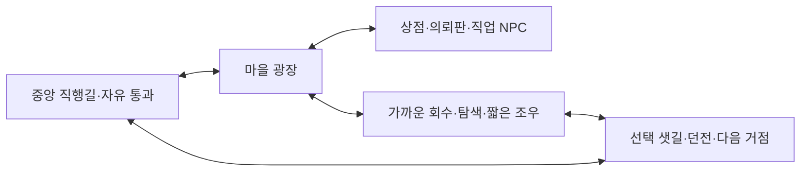

# 마비노기와 비교한 Rogue10m 맵 규모·밀도 개선 기획서

작성: 2026-11-12 한국 시간. **기획안이며 맵 변경은 적용하지 않았다.** 사용자 요청에 따라 개발은 일시 중단하고 확보한 프로젝트 증거와 마비노기 PC 공식 자료로 정리했다. 새 개발·빌드·에디터 작업은 시작하지 않는다.

## 제안의 핵심

**현재 1.8km 사방의 외곽을 먼저 줄이고, 마을 중심에 서비스와 가까운 활동을 묶는다. 중앙 300m 직행로와 선택 순환로는 유지한다.** 마비노기에서는 마을 NPC·게시판·주변 채집/던전이 연결되는 방식을 참고한다. 마비노기 지형·에셋이나 검증하지 않은 축척을 가져오지 않는다.

권장 검토안은 **약900×560m의 편집 가능한 필드 후보**다. 같은 지형 간격을 유지한8×5 컴포넌트의 산술 크기는900×562.5m다. 원본1.8km 사방 대비 면적은 약84.4% 작다. 실제 보스 전투장·길·건물·사냥터가 모두 들어가는지는 재개 후 원본의 최신 저장본에서 검증해야 한다. 이 크기를 확정해 원본 Landscape를 잘라낸 상태가 아니다.

면적 축소만으로 콘텐츠가 채워지지는 않는다. 현재 새 필드의 NPC·일반 몬스터·책·무기 위치는 편집 표식 단계다. **작은 서비스 중심 공간 하나→가까운 현장 활동→재방문**을 먼저 실제 플레이로 연결한다.15분은 전투·탐색·거래·선택 의뢰에서 나오게 하고 빈 이동으로 맞추지 않는다.

## 1. 지금 실제로 무엇이 열리는가

설정의 기본맵과 Editor 시작맵은 `/Game/Rogue10m/Maps/L_Menu`다. 정상 준비 흐름은 메뉴→캐릭터 선택→StartHub다. 확보한 허브 기록에는 다음 세 목적지가 공존한다.

| 허브 포털 | 목적지 | 해석 |
| --- | --- | --- |
| 기존 `SV_RunPortal_ToOpenWorld` | `/Game/Rogue10m/Maps/OpenRunMap` | 기존 필드 |
| `SV_FiveVillageRunPortal` | `/Game/Rogue10m/Maps/Prototypes/FiveVillageGraybox20261110` | 과거 다섯 마을 경로 후보 |
| `WL20261112_RunPortal` | `/Game/Rogue10m/Maps/Production/WorldLayout20261112` | 최신 Landscape 배치 후보 |

근거: [새 입구 저작 기록](../doc/evidence/landscape-world-blockout-20261112/start-hub-entry.json), [현재 제작 결과](../doc/2026-11-12_landscape-world-blockout.md). 신규 필드 하나가 기본 런 목적지로 완전히 교체된 것으로 해석하지 않는다. 사용자가 피드백한 순간의 열린 에디터/선택 포털은 이번에 직접 확인하지 않았다. 아래 정량 비교 대상은 증거가 확보된 최신 `WorldLayout20261112`다.

## 2. 현재 규모와 빈 공간 진단

| 항목 | 확인 수치/상태 | 증거의 범위 |
| --- | --- | --- |
| Landscape 전체 | 1800×1800m, 3,240,000㎡ | 저장본 실제 검사 |
| 월드 XY 경계 | -900~900m | 지형·프록시 bounds |
| 지형 구성 | 1009² 표본,256개 지형/충돌 컴포넌트,16프록시 | 저장·재로드 검사 |
| 노드 앵커 분포 | 월드 X -200~560m, Y325.5~665.5m |21개 계획 앵커의 월드 변환 |
| 앵커 사각형 |760×340m=258,400㎡, 전체의 약8.0% | 건물·전투장·주변 경관 제외한 좌표 계산 |
| 도로 |29연결, 통행 폭8m 설계 | 전 길 통행 완료와 구분 |
| 실제 장면 저작 |1336개 생성 액터 | 환경 장식/표식을 포함한 개수 |
| 신규 콘텐츠 위치 |일반15·NPC12·책23·무기3 표식 |53개 편집 표식이며53개 실제 활동이 아님 |
| 보스 직행 |48.537초 프로그램 이동 | 필드 진입 후2초 안정화 뒤 측정,1회 |

근거: [지형 검사](../doc/evidence/landscape-world-blockout-20261112/terrain-inspection.json), [장면 저작](../doc/evidence/landscape-world-blockout-20261112/scene-author.json), [실제 보행 기록](../doc/evidence/landscape-world-blockout-20261112/runtime-walk.json).

**8.0%는 앵커 분포 지표다. '맵의92%가 비어 있다'는 실측이 아니다.** 나무/바위·보스 전투장·건물 외곽과 이동 가능 면적을 모두 분류한 결과는 없다. 다만 지형 전체에 비해 활동 앵커가 한쪽에 모여 있고 실제 기능 밀도는 아직 검증되지 않았다는 점은 구분할 수 있다.

현재 기본 장비 이동속도는620cm/s다.48.537초 기록에는 필드 진입 후 순간이동·속도 변경·무적이 없다. 허브의 포털 접근 준비에는 순간이동1회가 있고, 보행 측정 전2초 안정화 구간이 있다. 따라서 허브부터 전 구간 도보나 물리 키보드 입력 검증으로 표현하지 않는다. 입구까지 약50초 수준이라는 정황과 정밀한 RunActive 기준3회 검증을 구분한다.15분 성장 플레이는 미검증이다.

### 확보된 실제 화면

위 보관 프레임은 넓은 잔디 지형 안에 길·건물 묶음이 작게 모인 상태를 보여준다. 첫 배치 당시 프레임이며 현재 에디터의 재촬영이 아니다. 노출 경고도 남아 있어 최종 시각 품질의 근거로 사용하지 않는다.

이 한 시점의3인칭 시야에서는 잔디와 먼 지형이 화면 대부분을 차지하고 가까운 목적지가 뚜렷하지 않다. 전체 맵의 모든 방향이 같다고 단정하지 않는다. 축소 후에는 마을 출구·갈림길·다음 활동의 표식을 사람 시야에서 검수한다.

## 3. 마비노기에서 확인한 구성과 적용 해석

이번 비교는 **마비노기 PC** 공식 자료 기준이다. 모바일 자료·공식 사이트 안 이용자 게시글은 근거에서 제외했다. 공식 축척 지도, 정확한 출구 수, 보행 거리/시간, NPC 밀도는 확인하지 못했다. 마비노기 마을의 실측 크기나 우리 맵과의 크기 비율은 제시하지 않는다.

| 공식 자료에서 확인한 사실 | Rogue10m에 적용할 제안 |
| --- | --- |
| 광장 근처 게시판에서 가능한 아르바이트를 확인·수락하고, 완료 결과는 의뢰 NPC에게 보고한다. 배달·채집·제작 등 일이 나뉜다. | 광장을 준비·선택·복귀 기준점으로 삼는다. 수락/보고가 같은 마을의 다른 서비스를 지나게 하되 의무 순회는 만들지 않는다. |
| 암탉은 주로 마을 안, 젖소·양은 마을 주변에서 찾으며, 채집 도구는 마을 상점과 연결된다. | NPC만 있는 광장 대신 근처 회수·재료·짧은 전투·탐색을 배치한다. 서비스→활동→복귀가 짧은 단위로 읽히게 한다. |
| 공식 공지에 티르 코네일의 알비 던전 앞 언덕과 트레보가 같은 안내 맥락에 등장한다. | 마을 가장자리의 길·랜드마크·안내 NPC가 다음 위험 공간을 예고하게 한다. 해당 지형/지도 자체를 재현하지 않는다. |
| 비필수 퀘스트를 선택해 받을 수 있고 현재 위치와 목표 위치를 함께 안내한다. | 갈림길에서 선택 가능한 활동과 보스 방향을 동시에 알린다. 안내가 강제 수락·보스 통행 조건으로 바뀌지 않게 한다. |

공식 근거: [아르바이트 가이드](https://mabinogi.nexon.com/page/archive/guide_view.asp?id=4890806&num=26), [채집 가이드](https://mabinogi.nexon.com/page/archive/guide_view.asp?id=4888257&num=15), [2022-07-14 편의성 개선 공지](https://mabinogi.nexon.com/page/news/notice_view.asp?id=4889990).

위 오른쪽 열의 거리·밀도·여러 출구 구성은 우리 설계 해석이다. 마비노기의 시간제 아르바이트·반복 성장·워프·보상 체계를20분 런에 그대로 이식하지 않는다. 특히 중·상위 비급은 우리 규칙대로 탐험에서 발견하며 일반 의뢰의 확정 보수 메뉴로 바꾸지 않는다.

## 4. 규모 개선안 비교

| 안 | 외곽 면적 | 현재 대비 | 효과와 한계 |
| --- | --- | --- | --- |
| 현재 유지 |1800×1800m=3.24㎢ |기준 | 바깥 지형의 여유가 크고 빈 배경/편집 비용을 유지 |
| 보수적 후보·권장 |900×562.5m=0.50625㎢ |면적84.375% 감소 | 같은 앵커/속도/직행길을 유지하며 외곽을 줄일 검토안. 전체 전투장과 지형 여유 확인 필요 |
| 더 작은 후보 |900×450m=0.405㎢ |면적87.5% 감소 | 경계가 더 가까워짐. 북쪽 보스장/중간보스/남쪽 진입의 실제 여유가 확인된 뒤 검토 |

900m 폭은 현재760m 앵커 분포에 여유를 둔 제안이다.562.5/450m 높이는 현재63quads/component·178.5714cm 간격을 유지한8×5/8×4 컴포넌트의 산술 크기다. 예상 높이 데이터는505×316/505×253 표본이다. 현재 생성 helper는1009²/원래 후보만 받으므로 이 후보를 곧바로 import할 수 있다고 주장하지 않는다. 표본·레이어·프록시·외부 패키지 처리는 재개 후 새 사본에서 별도 검증한다.

**권장 순서:** 원본의 최신 편집 데이터를 보존한 복제/내보내기 → 실제 액터/충돌/도로를 포함한 사용 범위 산출 → 보수적 후보에서 외곽만 재구성 →3인칭 시야·전 길·보스장 확인 → 필요할 때 더 작은 후보. 캐릭터 속도, 건물/캐릭터 전체 스케일, 중앙300m 축은 면적 축소 수단으로 바꾸지 않는다.

외곽만 줄이면 길 사이의 기능 없는 구간은 그대로다. 예를 들어 기존 Q→J240 중심선은 약280.7m이며6m/s 계산으로 약46.8초다. 이 구간은 지형 잘라내기와 별개로 검토한다. 재개 후에는 긴 선택 길 옆에 서로 다른 짧은 조우·탐색·단서 지점을 두거나 거점 위치를 후보 데이터에서 좁혀 비교한다. 중앙 직행로에는 적 추적·강제 대화·필수 회수를 끼워 넣지 않는다.

## 5. 다섯 마을 기능과 가까운 활동

최신 참조는3큰거점+5전문초소다. 과거 동급5마을로 되돌리지 않으면서 사용자가 원하는 다섯 핵심 기능을 **H수렵촌·M장터·Q돌샘·T마탑·F잔불**에 유지하는 안을 제안한다. P/G/O 전문 위치와 주변 사냥터·중간보스도 지우지 않는다. 이 매핑은 축소 기획상의 기능 묶음이며 이름/분류를 원본 카탈로그에서 바꾼 상태가 아니다.

| 핵심 거점 | 작은 중심 공간의 기능 | 가까운 선택 활동·복귀 이유 |
| --- | --- | --- |
| H 수렵촌 |회복·의뢰판·재료·사냥 단서 | P/W 회수·사냥·유품 탐색 뒤 재료 정리/보고 |
| M 장터 |일반 상점·기초 수련·운송 정보 | A 운송품/수레 현장·G 방면 탐험 뒤 거래 |
| Q 돌샘 |너클 입문/하위 수련·채석 단서 | 초소 바깥 일반 조우·동굴/기록 발견 뒤 보고 |
| T 마탑 |기록 해석·학습 조건/미발견 단서 | R/O 탐험·기록 조사 뒤 정보 확인 |
| F 잔불 |장비·재료 교환·제련 단서 | Z 위험 조우·실험실·은닉함 탐험 뒤 정리 |

위 도식은 기능 관계 제안이며 원본29간선을 새 도로로 대체하는 배치도나 축척 도면이 아니다.

처음 검토할 밀도 기준은 큰 거점 중심40~60m 지름, 작은 거점25~35m 지름, 중심→첫 활동25~65m다. 이는 마비노기 실측이 아닌 우리 튜닝 출발값이다. 일반 선택 길에서15~20초 넘게 걷기만 하는 구간을 표시하고, 실제 활동/의미 있는 선택이 없는지 검수한다. 모든 방향에 적을 강제로 놓거나 쉬는 공간을 없애는 기준은 아니다.

## 6. 거리·시간과 콘텐츠 예산

중앙축 S→J100→J180→J240→B의300m는 보존한다.6m/s 산술50초와 기본장비6.2m/s 실제 관측을 구분하고, 런 Running 시작·필드 조작 가능·입구선 통과 시간을 각각 기록한다. 세부 지형을 바꾸면 기존48.537초 결과를 새 후보의 통과 증거로 재사용하지 않는다.

| 성장 경로의 서로 겹치지 않는 활동 | 초안 예산 |
| --- | --- |
| 실제 이동·NPC 접근·샛길 왕복 |180초 |
| 일반 조우·성장 |270초 |
| 선택 도전1곳(해당 공간의 전투·이동 포함) |180초 |
| 현장 목표·단서/책 탐색 |180초 |
| 실제 시간이 흐른 거래·보고·정리 |90초 |
| 보스 입구 도착 |900초 |
| 보스 교전 가정 |180초 |
| 편차 여유 |120초 |
| 전체 런 상한 |1200초 |

초안은 강제 대기 시간이 아니다. 선택 도전의 전투를 일반 조우 시간에 다시 더하지 않고, pause된 메뉴의 생각 시간도 런 활성 시간에 더하지 않는다. 활동을 덜 고르면 더 빨리 보스에 갈 수 있다. 보스180초는 미검증 가정이므로 실제 전투가 길면 성장 활동량을 먼저 조정한다.

일반 몬스터 최소15종, 별도 중간보스4종·최종1종은 유지한다. 크기를 줄이면서 모두 한 화면/같은 추적 범위에 겹치지 않게 한다. 중·상위 책은 탐험 발견, 입문/하위 책만 허용된 간단 수련 보수 예외를 따른다. 무기별 동시입력/차징 지원, Ctrl→첫Q 고정기한→QQQ 자동발사 계약과 런/영구 성장 구분은 변경하지 않는다.

## 7. 사용자가 직접 수정하는 맵

- Landscape와 Edit Layer를 유지해 Unreal의 조형/페인트 도구로 높이·평지·길 주변을 편집한다. 보이는 가짜 바닥 한 장으로 교체하지 않는다.
- 건물·서비스/NPC 앵커·사냥터·책/무기 지점·길을 독립 액터/편집 가능한 설정으로 둔다. 위치·회전·크기는 Details/기즈모로 조정하고, 되돌리기와 선택 저장·재로드를 확인한다.
- 현재 World Map Maker는 OpenRunMap 전용이다. 새 후보도 이미 지원한다고 안내하지 않는다. 도구 확장이 필요하면 원본 맵 가드를 풀지 말고 지원 맵/경계 정책을 별도 검증한다. 기존 Landscape/Outliner 기본 편집은 유지한다.
- 런 시작/맵 열기에서 사용자 수정이 자동 생성값으로 덮어써지지 않게 한다. 현재 확보 자료에서 전체 월드 런타임 재생성 경로는 확인되지 않았다. 명시적 생성 도구는 원본이 아니라 새 후보에만 쓰고 기존 생성물 재실행 거부를 유지한다.
- 원본 높이/페인트·레이어·PCG·OFPA·보스 바닥/경사로를 먼저 보관한다. 과거 R16 파일만 복사해 최신 사용자 Landscape 편집이 보존됐다고 표현하지 않는다.

## 8. 재개 후 검증 순서와 완료 기준

| 단계 | 완료 조건 | 아직 하지 않은 것 |
| --- | --- | --- |
| 대상 확인 | 현재 사용자가 선택한 포털·열린맵·최신 저장본/사용권 확인 | 실시간 사용자 에디터 확인 |
| 원본 보존 | 독립 물리 사본/백업·원본/외부 패키지 SHA, 수정 동결 범위 합의 | 원본 복제·지형 절단 |
| 범위 검산 | 모든 거점/도로/전투장/추적거리·여유 포함, 원본29연결 유지 | 새 후보 범위의 실제 충돌 |
| 공간 편집 | 사용자가 지형·마을·길 하나씩 수정,Undo/Redo·저장/재로드 유지 | 새 후보 helper/도구 통합 |
| 직행 | 정상 프로필·기본 장비·속도 변경 없이3회60초 이내, 실제 입구선·접지 | 후보 실제 보행/물리 입력 |
| 선택/재방문 | 미수락·마을 건너뛰기·역순·보고/보상1회, RunId/시계 연속 | 새 필드의 실제 서비스/목표 |
| 성장 경로 | 서로 다른 경로로 사람 최소5회, 목표13~16분/중앙값 약15분은 초기 튜닝 제안 |15분 성장·전체 보스전 |
| 조우/안전 |15일반/4중간/1최종 분리, 중앙/서비스 침범0, 기존 피격 취소 유지 | 전체 AI·내비게이션·전투 검증 |
| 패키지 | 동일 체크포인트 Game EXE에서입장·서비스·전투·귀환·재실행 | 이번 기획의 cook/package |

확보된 최초 `PhysicsA`는3431검사 중20실패가 남아 있고, 확보한 도로 시각 보정 시도에도 실패 기록이 있다. 새 후보 검증 전에 이를 모두 해결됐다고 전제하지 않는다. 프로그램 입력·물리 입력·정적 수치·실제 기능/전체 런은 따로 보고한다.

## 9. 의사결정과 현재 정지 상태

재개 시 먼저 비교할 선택은 **900×562.5m 보수적 사본**이다. 더 작은900×450m는 전투장/경계 여유가 확인된 후의 대안이다. 핵심 거점의 건물 수·서비스 반경·긴 길의 활동 배치는 후보 플레이로 정한다. 원본 카탈로그/지도 좌표는 이번에 변경하지 않았다.

이번 작업에서 완료한 것은 현재 맵/경로·크기·화면 증거 조사, 공식 자료 비교, 축소·밀도·시간·편집·검증 기획이다. Source·설정·맵·에셋·높이 파일을 수정하지 않았고 새 UE·UBT·게임 프로세스를 실행하지 않았다. 새 지형/R16/사본 레벨도 만들지 않았다.3인칭·피격 시 스킬 취소를 유지하며 면역은 사용자 결정 전 보류한다. 사용자 중단 지시 뒤에는 문서 안전 저장만 진행한다.

참조: [월드 제작 기준](../../Docs/WorldMapProductionGuide.md), [지도/카탈로그 묶음](../../Docs/References/WorldMap/README.md), [기존 첫 제작](../doc/2026-11-12_landscape-world-blockout.md). 콘셉트 PNG와 실제 UE 캡처, 계획 좌표와 실제 관측을 구분한다.
