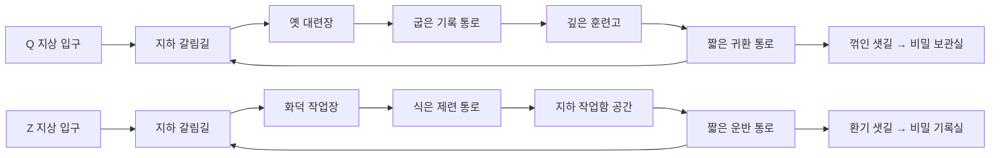

# 지하 훈련고·제련로 동굴 구조와 동선

2026-11-18 · Sprint#9-32 맵 제작 후속 · 설계 제시 후 에디터 저작

사용자 요청은 Q 지하 훈련고와Z 제련로 지하 작업함 공간을 실제 지하 동굴로 만들고, 내부 갈림길·비밀방·지름길을 추가하는 것이다. 중앙 이동로와 세 마을은 평지로 유지한다. 기존 월드 기획·획득 카탈로그와 [위치·자산 조사](2026-11-18_cave-site-audit.md)를 따른다.

## 먼저 보여드리는 공간 구성

| 항목 | Q 돌샘 지하 훈련고 | Z 제련로 지하 작업장 |
|---|---|---|
| 입구 | 수련초소 북동쪽, 기존 길에서 벗어난 완만한 하행로 | 제련로 남동쪽, 기존 길 옆의 하행로 |
| 규모 | 내부60×60m 범위, 지표 아래 약10m | 내부70×60m 범위, 지표 아래 약10m |
| 주 동선 | 입구→갈림길→옛 대련장→굽은 기록 통로→깊은 훈련고 | 입구→갈림길→화덕 작업장→식은 제련 통로→지하 작업함 공간 |
| 선택 갈림길 | 흔적을 따라 들어가는 측면 통로 | 운반로에서 벗어난 환기 통로 |
| 비밀방 | 닳은 석벽·목재 흔적을 단서로 찾는 보관실. 입구가 꺾여 직접 보이지 않음 | 막다른 것처럼 보이는 환기 통로 뒤 작은 기록실 |
| 지름길 | 훈련고에서 입구 갈림길로 돌아오는 짧은 순환 통로 | 작업함 공간에서 입구 갈림길로 이어지는 운반 통로 |
| 공간 구분 | 회갈색 바위·목재 지지대·따뜻한 등불 | 어두운 석재·작업대·차가운 유도등과 화덕 흔적 |

두 동굴은 같은 월드에서 걸어서 들어가고 돌아온다. 지름길은 처음부터 열린다. 특별한 기술·열쇠·퀘스트 완료가 통행을 잠그지 않는다. Q의 무극패왕권과Z의 대지파쇄는 탐험 중 고정 보관함에서 발견한다는 기존 기획을 유지한다. 이번 공간 제작에서 미확인 런타임 픽업ID나 자동 학습·중상위 비급 확정 의뢰 보상을 새로 만들지 않는다.

## 실제 지형과 구조

현재 지표는Z9600cm다. Q의 실제 앵커는(-13000,54550), Z는(52000,60050)cm다. 중앙X15000의300m 직행로, H/M/T 광장·갈색 바닥·울타리, 기존29개 도로의 중심선19m 보호 범위는 굴착하지 않는다. Q/Z 본래 앵커와 기존 건물·NPC·소품의 transform도 유지한다.

동굴은 국소 굴착 후 천장 메시로 덮는 방식으로 제작한다. Landscape의 원본 레이어를 보존하고 기존 두 번째 높이층의 국소 표본만 고친다. 바닥은Z8600cm, 얕은 석재 표면 윗면은8610cm, 천장 아랫면은9200cm로 잡는다. 지하 실내 높이는 약5.9m다. 천장 윗면은9602cm로 기존 지표와2cm만 겹쳐 이음부를 덮으며 지상도 걸을 수 있게 한다. 열린 경사로에는 천장을 놓지 않는다.

Q 내부 기준은X[-11000,-5000],Y[62050,68050]cm다. X-9750의 폭8m 하행로가Y58050→62050으로40m 이어지며10m 내려간다. Z 내부 기준은X[52000,59000],Y[47650,53650]cm다. X55750의 하행로가Y57650→53650으로40m 이어진다. 하행로 기울기는25%(약14도)다. 주변 지형과의 연결과 실제 캡슐 통행은 별도 검사한다.

내부는5m 모듈과80cm 벽을 사용한다. 일반 통로 유효 폭은약4.2m로 잡고, 훈련장·작업장은 더 넓게 연다. 입구·분기·중요 방은 지지대와 빛으로 읽히게 한다. 바위 장식과 물리 충돌 셸을 분리해 바위끼리 겹친 복잡한 충돌로 길을 막지 않는다. 비밀방의 인접 통로 쪽 벽은 막아 꺾인 샛길을 실제로 찾아야 들어갈 수 있게 한다.

지형이 먼저 로드돼도 굴착부로 떨어지지 않도록 지붕·벽·바닥의 필수 actor는 항상 로드한다. 기존 지형45개와 원본 raw 높이·paint는 보존하고 새 높이 목표179,488개 및 허용 마스크 밖의 바이트 일치를 검사한다.

## 제작 패킷과 완료 조건

| 패킷 | 목표·수정 범위 | 검증 | 복구 경계 |
|---|---|---|---|
| C1 | 실제 세션·지형·1404 actor·소유 재질과 저장본 조사, 설계 공개, 물리 백업 | idle 후보/원본층/dirty, 기존 파일 SHA, 순환·비밀방·지름길 그래프 검사 | 현재 커밋a7bb4af3과 별도 물리 백업 |
| C2 | Q/Z 국소 굴착과 하행로 | 전체 목표 격자·수정 마스크·29도로/3마을/21지점 보존 | 기존 두 번째 레이어만 수정; 새 레이어·컴포넌트 삭제0 |
| C3 | 방·분기·비밀방·지름길·천장·바위·표식 | 실제 instance·재질·항상 로드·머리 공간·지상 천장 통행 검사 | 신규 동굴 actor와 후보 전용 파생물; vendor 원본 보존 |
| C4 | 보행·캡슐·화면·한정 저장·독립 재로드·리뷰·기록 | 양방향 경사로/분기/비밀방/지름길, 바닥/벽/천장, 중앙로 평지, cold/파일 범위 | 실패 원문을 보존하고 검증 조건을 완화하지 않음 |

기존59개 검사는 이전 높이와actor 수를 고정한 과거 결과다. 이를 수정해서 새 동굴을 합격시키지 않는다. 새로운 동굴 검증으로 현 상태를 검사하며 물리 키보드·전체 게임플레이·최종 미술·패키징 인수와 구분한다.

## 자산과 도구 선택

기존 프로젝트 소유 석재·목재 재질, Engine 기본 메시, 현재 맵에서 쓰는 바위·소품부터 재사용한다. 필요한 ISM 재질은 후보 소유 파생물로 만들어 원본의 자동 사용 플래그 변경을 방지한다. 신규 Fab 구매·팩 반입은 없다. 과거 Fab 보유 기록과 현재 계정 소유 확인은 구분한다.

등록된 PCG 기본 스킬도 읽었다. 이번 두 공간은 방별 연결과 충돌을 고정한 고유 배치이므로, 기존 native 지형 도구와 공개 Editor 컴포넌트 API를 이용한 명시적 계획 데이터로 저작한다. PCG 그래프나 런타임 생성 시스템을 추가하지 않는다. 스크립트 예외나 비동기 결과 불명확 시 재실행하지 않고 실제 부분 결과를 먼저 확인한다.

## 추가 사용자 지시 — 카메라 방해 검증

통로 캡슐 검사만으로 시야를 합격시키지 않는다. 현재 로드된 기본값은 삼인칭·SpringArm320cm·Camera 채널 반경14cm·FOV90도다. 실제 PIE에서도 이 값을 확인하고 경사로·직각 통로·비밀방·귀환로를 양방향으로 걷는다. 원래 카메라 위치와 충돌 보정 후 위치, 보정 지속시간·최소 카메라 거리·시야각을 기록한다. 시야가 지속해서 좁아지거나 캐릭터에 너무 붙으면 해당 구조를 보완한다.

벽·천장은 Pawn과Camera를 차단한다. 보행을 방해하지 않는 바위 장식도Camera에는 응답하게 해 카메라가 장식 안으로 들어가지 않게 한다. 바위의 단순 충돌 지원을 먼저 확인한다. 카메라 오프셋이나 충돌 검사를 꺼서 문제를 숨기지 않는다.

공식 `CaptureViewport`는 에디터 카메라를 기준으로 하므로 실제 플레이 시야의 증거로 사용하지 않는다. 실제 플레이 중 활성 게임 뷰포트에서 `AutomationLibrary.take_high_res_screenshot(camera=None, force_game_view=True)`를 실행해 UI 없는 3D 화면을 기록한다. 스크린샷 작업 완료와 파일 생성을 확인하고, 직접 화면을 검토한 뒤에만 시각 검증 통과를 기록한다. 이 API와 게임 뷰포트 선택 경로는 설치된 UE5.8 소스에서 확인했다.

## 제작 중 확인한 순서·시각 보완

native 높이 보정은 dirty 패키지가 없는 상태를 요구한다. 굴착부가 열리기 전에 천장을 갖추기 위해 구조 셸을 먼저 만들되, 재질7개·구조 actor2개·폴더3개의12패키지 체크포인트를 한정 저장한 뒤 국소 높이를 적용한다. 그 다음 바위·소품·조명을 추가한다. 첫 잘못된 순서의 호출은 지형 변경 전에 거절됐으며 실패 원문을 보존한다.

실제 첫 내부 화면이 어두웠다. 원래 지상 전역 노출EV11.5는 보존하고, 두 동굴 내부의 새 Dressing actor에 bounded Box/PostProcess 컴포넌트를 추가한다. 천장 아래의Z8400~9200cm 범위, 우선순위100·블렌드200cm·실내EV3을 사용한다. 지붕 위의 지상 카메라는 이 범위 밖이다. 천장 위 잔디는 유지하되 수직 옆면은 법선 방향에 따라 석재 색으로 전환해 늘어난 잔디 무늬를 없앤다.

등불 색은 `Color(r=..., g=..., b=..., a=255)`로 명시한다. 첫 생성에서 위치 인수의BGR순서로 색이 바뀐 것을 통합 검사가 발견했으므로, 원래 계획RGB로만 한정 수정하고 새 검사로 확인한다. 재질 파라미터 setter의 반환값 문제는 설치UE5.8 소스와 실제 getter 값으로 확인했다. 원래 실패를 합격으로 덮지 않는다.

## 추가 사용자 지시 — 발헤임 맵 참고

2026-11-18에 [발헤임 공식 FAQ](https://www.valheimgame.com/faq/)와 [공식 Press 자료의 Frost Caves·야외 거점 이미지](https://www.valheimgame.com/press/)를 확인했다. 공식 설명의 지역별 환경·비밀 탐험과, 실제 공개 이미지에서 관찰한 거친 암벽·목재 지지대·국소 조명·바위와 수목으로 둘러싸인 거점을 참고한다. 아래는 이 프로젝트에 맞춘 해석이며 발헤임이 같은 수치·동선·카메라 규칙을 쓴다는 주장이 아니다.

- Q의 목재 지지대와 따뜻한 등불, Z의 작업 흔적과 차가운 유도등으로 장소 성격을 읽게 한다.
- 통로에서 넓은 방으로 이어지는 변화와 꺾여 숨은 공간, 선택 탐험 후 돌아오는 짧은 길을 유지한다.
- 벽에 붙인 바위만 따로 떠 보이지 않도록 기존 동굴의 벽·석재 천장 두 ISM 묶음에 연속된 암반 재질을 적용한다. 원래 구조286개와 충돌은 유지한다.
- 입구의 절개·바위·지지대와 바깥의 평탄한 이동면을 이어 외부에서 탐험 지점을 읽게 한다. 중앙 이동로와 마을 평지라는 사용자 조건을 우선한다.

발헤임의 원본 모델·텍스처·지도는 반입하지 않는다. 현재 프로젝트의 기존 바위 파생 재질과 목재·등불을 활용한다. 이번 패킷은 두 동굴에 적용하며 전체 필드를 새 절차 생성 월드로 교체하지 않는다.

## 통합 충돌 검사 후 굴착 경계 보정

첫 완주한 2,016개 검사에서 2,015개가 통과했다. `Z_wall_09`만 Landscape 보간면이 구조 벽보다 약9.25cm 먼저 잡혔다. 검사 벡터·캡슐·기대 구조체를 그대로 유지하고, 기존300cm 전이 범위 안을150cm의 완전 평탄부와150cm 전이로 조정한다. 지형447개 값만 추가로 낮추며, 변경 표본의 위치3,300개와 경사로198개 표본, 도로·마을 보존 범위는 유지한다. 174개 벽 중앙 면의 보간 꼭짓점도 확인했다.

실제 에디터 보정 후 `qa-collar-final-live`의 같은2,016개 검사가 모두 통과했다. 원본층 해시와45개 Landscape/충돌이 보존됐고 새 레이어는 없다. 체크포인트12개 → 보정 전24개 → 최종 지형17개를 각각 정확한 dirty 집합으로 저장하며 고유 저장 패키지는33개다. 실제 삼인칭 왕복, 독립 재로드, 파일 보존 검사는 결과 문서에 별도로 기록한다. 이전 실패 보고서는 수정하지 않는다.

## 실제 플레이의 실내 노출 경계 수정

첫 정상 PIE는 입구까지11개 지점에 도착했고 입구 캡처의 카메라 거리331cm·당김0과 바닥 접촉을 확인했지만 실제 화면이 어두워 시각 검증을 거절했다. 임시 EV0 후보는 저장하거나 시각 합격으로 처리하지 않았다. 설치 엔진의 `GetAllPhysicsObjects`가 NoCollision 부모에서도 null을 담은1원소 배열을 반환하고, `PostProcessComponent::EncompassesPoint`가 빈 배열 여부만 검사해 Shape의 CalcBounds 대체 경로에 도달하지 못하는 구현을 확인했다. 근거는 `exposure-bounds-source-proof.json`에 기록한다.

새 경계 Box2개를 QueryOnly로 바꾸되 모든 채널Ignore·오버랩/내비게이션false를 유지하고 실내 노출을EV3으로 되돌린다. 실제 물리 경계의 closest-point 질의와 기존2016개 검사를 함께 요구한다. 스크린샷도 실제 PlayerCameraManager의 시점이2프레임 안정된 뒤 찍고 전후 위치2cm·회전1도·FOV0.01도 이내를 확인한다. 새 정상 PIE는 기존12개 왕복 동선·276개 지점·게임 화면6개 기준을 그대로 적용한다.

## 실제 복귀 코너의 카메라 여유 보정

두 번째 실제 PIE의83번 지점(Q 비밀방 복귀)에서 카메라 거리가139.557cm로 줄었다. 실제 Camera채널14cm 구체 질의도 Q 장식ISM의120번 바위를 정확히 같은139.557cm에서 잡았다. 실패 화면과 기록을 보존하고, 해당 벽의120/121번 바위만X+50cm로 벽 안쪽에 옮긴다. 반대편 셀은 비통행 영역이다. 기존 물리 벽286개·나머지 장식424개·지형·동선·재질·조명은 유지한다.

실제 에디터의 같은 위치에서360도를0.25도 간격으로 질의했다. 수정 전1440개 중288개가 기준에 미달했고 최소121.214cm였으나 수정 후에는 실패0·최소155.260cm·최대당김175.988cm다. 기존2016개 Pawn 검사도 그대로 통과했다. 이 정적 결과와 실제 전체 플레이 인수는 별도로 기록한다.

자동 보행의 고정120cm 접근거리가 낮은 프레임의206~248cm 이동보다 짧아 코너를 지나쳐 되돌아보는 것도 확인했다. 검사 입력만 실제 프레임 간격에 맞춰 아날로그 접근량을 계산한다. 정상 AddMovementInput, 이동 속도620cm/s, 시간 배율1, 카메라 거리140cm·당김180cm 기준과 모든 경로·도착 오차35cm를 유지한다. 이전 실패를 통과로 바꾸지 않고 새 전체 PIE를 실행한다.
