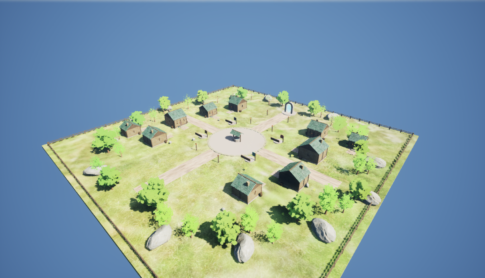
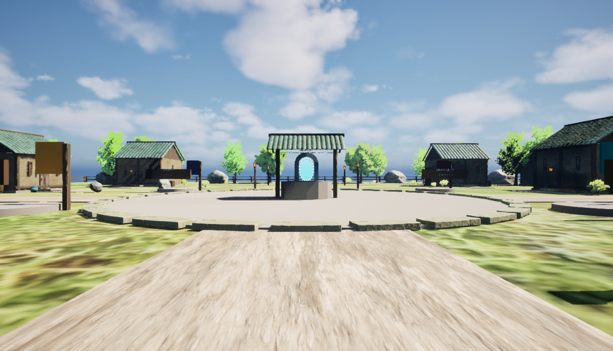

# 기본맵 기반 시작 마을 제작 결과

## 결과와 현재 상태

`Sprint#5-10-start-village`에서 기본 플레이맵 `/Game/FirstPerson/Lvl_FirstPerson`을 Unreal Editor의 템플릿 복제 API로 복제하고, `/Game/Rogue10m/Maps/StartHub`에 120m × 120m 판타지 시작 마을을 저장했다. 보유 `Stylized_Village` 메시를 사용해 주택 외관 10채, 중앙 우물과 돌 광장, 네 방향 길, 준비 구역 네 곳, 북쪽 전투 포탈을 구성했다.

메뉴 → 캐릭터 선택 → 시작 마을의 실제 PIE 이동을 확인했다. 마을에서는 20분 타이머가 대기하고, 실제 포탈 overlap으로 기존 전투맵에 진입하면 1200초 런이 시작된다. 신규 맵의 정적·착지·보행·포탈·타이머 검증 50개 항목이 통과했다. 커밋과 푸시는 하지 않았다.

전체 배치와 플레이어 높이의 최종 렌더 화면을 확인했다. 에디터를 명시적 MCP 시작 명령 없이 재기동해 포트 8001 자동 시작과 StartHub 재로드를 검증했고, 공식 MCP 저장 도구로 신규 맵·전용 재질 13개 경로의 저장 성공을 확인했다.

## 제작한 공간

| 구성 | 적용 내용 |
| --- | --- |
| 지면·동선 | 120m 정사각형 보행 지면, 중앙 돌 광장, 네 방향 흙길, 외곽 울타리와 숨겨진 4방향 BlockAll 경계 |
| 주택 | 보유 모듈 메시로 구성한 외관 10채. 실내와 출입 서비스는 제작하지 않음 |
| 중심부 | 지붕이 있는 우물, 광장 테두리, 소품과 식생 배치 |
| 준비 구역 | Equipment, Traits, Difficulty, Story 표지와 NPC 자리. 실제 NPC·장비 지급·특성 선택·난이도 저장·스토리 서비스는 미구현 |
| 시작점 | 남쪽 PlayerStart 1개, 위치 `(0, -2240, 112)`cm. 태그 없는 중복 시작점도 검사 |
| 포탈 | 북쪽 `(0, 4270, 200)`cm, 보이는 문 구조와 효과. 목적지는 실제 존재하는 `/Game/FirstPerson/Lvl_FirstPerson` |

신규 소유 액터는 `Rogue10m.StartVillage` 태그로 구분한 667개다. 전용 머티리얼 자산은 12개이며 풀·흙길 Material Instance 2개와 돌·목재·물·포탈·등불·깃발 Material 10개로 구성했다. 기존 구매 메시와 머티리얼을 직접 수정하지 않았다.

## 메뉴·런 연결과 설정

`Rogue10mPlayerController.cpp`의 기본 GameplayMap을 `StartHub.StartHub`로 변경하고 메뉴 이동의 `StartRun=1` 옵션을 제거했다. 값 없는 옵션 존재 여부로 런을 시작하는 기존 GameMode 경로에 맞춰 `StartRun=0`도 사용하지 않는다. 선택 프로필과 기존 전투 입력 코드는 보존했다.

허브는 기존 `BP_FirstPersonGameMode`를 사용하며 `bStartRunOnStartPlay=false`, `bUsePrototypeRunDuration=false`를 확인했다. 원본 GameMode Blueprint의 기본값도 이미 false였으므로 원본 Blueprint를 수정하지 않았다. 포탈은 기존 C++ `Rogue10mRunPortal` 경로에서 `StartRun=1`을 전달한다.

`Config/DefaultEditorPerProjectUserSettings.ini`에 MCP 자동 시작, 포트 8001, `/mcp`, 도구 검색을 기록했다. 에디터 설정 API에서 `bAutoStartServer=true`, `ServerPortNumber=8001` readback을 확인했다. 미저장 패키지가 없는 것을 확인하고 재기동했으며 `-ExecCmds`나 포트 지정 인자 없이 8001 서버가 시작됐다. 공식 MCP가 재로드된 `/Game/Rogue10m/Maps/StartHub`를 반환했다.

## 사용한 에디터 작업 경로

`unreal-engine-mcp-codex` 스킬에 따라 Epic 공식 로컬 Streamable HTTP MCP 서버에 연결했다. 이 대화에 네이티브 Unreal MCP 도구가 노출되지 않아 프로젝트의 `Scripts/InvokeUnrealMCP.py`가 같은 JSON-RPC initialize·도구 목록·toolset 스키마·호출 절차를 수행했다. 연결·등록 도구 조사, 맵 로드와 뷰포트 캡처, 신규 맵과 전용 재질의 최종 저장에 공식 MCP를 사용했다.

대량 메시 배치·신규 머티리얼 구성·맵 저장과 실제 PIE callback 검증은 기존 `Scripts/RunEditorRemote.py`를 통한 Epic Python Remote Execution으로 진행했다. 임의 Python 실행을 MCP 도구라고 기록하지 않는다. 에디터 호출은 직렬 실행했고 `.uasset`·`.umap`은 에디터 API로 생성·저장했다.

처음 에디터 실행에서 XGE 분산 셰이더 작업의 실패·로컬 재시도가 반복된 것을 `editor-initial-xge.log`로 확인했다. 후속 실행은 `-NoXGEShaderCompile`로 로컬 셰이더 컴파일을 사용했다. 게임 렌더링 설정이나 엔진 파일을 수정한 해결책은 아니다.

## 검증 결과

| 검증 | 확인 결과 | 근거 |
| --- | --- | --- |
| Editor 빌드 | UE 5.8 Editor 타깃 NoHotReload 빌드 성공 | root의 빌드 실행 결과 |
| 메뉴 정적 검사 | 메뉴 GameMode·StartHub 목적지·전체 화면 UI 앵커 통과 | `menu-static-output.json` |
| 메뉴 실제 PIE | 캐릭터 선택 후 StartHub, 선택 Pawn, 입력 복구, WaitingToStart·타이머 미시작 통과 | `editor.log`의 Rogue10mMenuMapPIE PASSED |
| 허브 정적·런타임 | 50개 항목 모두 통과 | `runtime.json` |
| 실제 시작점 착지 | 남쪽 PlayerStart와 XY 오차 0cm, 접지 true, 캡슐 바닥과 지면 간격 약 2.15cm | `runtime.json`의 spawn_samples |
| 허브 대기 | 착지 후 2초 이상 WaitingToStart·비활성, 1200초 유지 | `runtime.json`의 hub_samples |
| 광장 실제 보행 | 우물을 피한 `(350, 0)`cm에서 AddMovementInput으로 약 2.01초·11.50m 이동, 접지·지면 관통 검사 통과 | `runtime.json`의 walking_samples·plaza_actual_walking |
| 실제 포탈 이동 | 포탈 collision 중심으로 플레이어를 이동해 native overlap 발생, 전투맵 도착·Running·활성 확인 | `runtime.json`의 portal_overlap_target·combat_samples |
| 전투 시간 | 도착 1200초, 약 2초 후 1198초로 감소 | `runtime.json`의 combat_samples |
| 생성 경로 검사 | CheckGeneratedChanges.ps1 통과 | root의 하네스 검사 결과 |
| Python 구문 | 신규·수정 검증 스크립트 AST 검사 통과 | UE 내장 Python 검사 |
| 화면 검토 | 정상 지붕·주택 비례·광장·동선 확인, 전체 배치 독립 검토 완료 | `village-overview-clean.png`, `village-player-view.png` |
| MCP 자동 시작·재로드 | 명시적 서버 시작 없이 8001 연결, StartHub 반환 | `restart-launch.json`, `editor-restart.log`, `restart-current-level.json` |
| 최종 저장 | 신규 맵·전용 재질 13개 경로 save_assets=true, 허브 미저장=false | `save-owned-assets.json`, `hub-is-dirty.json` |

광장 이동과 포탈 입장은 실제 PIE Actor·GameState를 관찰했다. 이 검증은 건물 전체 내부 접근, 모든 메시의 충돌, 네트워크, 패키징 빌드나 프레임 성능을 보증하는 검사가 아니다. 대규모 전투 오픈월드와 Landscape 확장은 이번 시작 마을 범위에 포함하지 않았다.

## 기존 작업 보존

`preservation.json`은 시작 전 Content 4,302개 파일의 크기와 정확한 UTC 수정 시각이 모두 동일함을 확인한다. 기준선에서 선정한 70개 파일은 SHA256도 동일하다. 기본 전투맵, 메뉴 맵과 기본맵 외부 액터·외부 객체가 해시 대상에 포함됐다. 전체 4,302개를 모두 해시 검증했다고 표현하지 않는다.

새 Content 파일 720개는 `StartHub.umap`, 전용 `World/StartVillage`, 해당 맵의 `__ExternalActors__`·`__ExternalObjects__` 범위 안에 있다. 기존 파일 누락, 변경 시각·크기 차이, 선정 해시 차이, 범위 밖 추가 파일은 없다. 이전부터 있던 전투·스킬·애니메이션 미커밋 변경은 이번 제작 결과와 구분해 보존했다.

## 작업 중 확인한 오류와 수정

- Material Instance setter 반환 false만으로 실패를 확정했던 검사를 적용값 readback 검사로 보완했다.
- Rotator의 위치 인자 해석으로 방향이 어긋나는 문제를 `pitch`·`yaw`·`roll` 키워드 인자로 수정했다.
- overlap getter가 UFUNCTION이어도 BlueprintGetter 메타데이터 때문에 Python에서 제외되는 것을 확인했다. 같은 노출 오류가 두 차례 반복된 뒤 Reviewer 모드로 전체 API를 검토하고 Box·Capsule 모두 `generate_overlap_events` reflected property로 통일했다.
- CollisionResponse의 Python 노출 이름을 실제 `CollisionResponseType.ECR_OVERLAP`으로 수정했다. 실패 증거 JSON은 보존하고 최종 `runtime.json`의 성공 결과와 구분했다.

## 변경 파일과 관련 자료

| 위치 | 변경·역할 |
| --- | --- |
| `Source/Rogue10m/Core/Rogue10mPlayerController.cpp` | 메뉴 목적지·옵션의 native 경로 수정. 기존 미커밋 코드 유지 |
| `Scripts/Editor/CreateStartVillage.py` | 템플릿 복제, 신규 소유 공간·머티리얼 생성과 에디터 저장 |
| `Scripts/Editor/InspectStartVillageInputs.py` | 기본맵·보유 에셋·설정 조사 |
| `Scripts/Editor/ValidateStartVillage.py` | 정적·실제 착지·보행·포탈·시간 검증과 JSON 기록 |
| `Scripts/Editor/ValidateMenuMapFlow.py`, `ValidateMenuMapPIE.py` | 시작 마을 메뉴 이동 검증으로 갱신 |
| `Scripts/InvokeUnrealMCP.py` | 공식 로컬 MCP JSON-RPC 호출 클라이언트 |
| `Config/DefaultEditorPerProjectUserSettings.ini` | 자동 시작·8001 포트의 프로젝트 기본값 |
| `Content/Rogue10m/Maps/StartHub.umap` | 신규 시작 마을 맵 |
| `Content/Rogue10m/World/StartVillage/Materials/` | 신규 전용 머티리얼 12개 |
| `Content/__ExternalActors__/Rogue10m/Maps/StartHub/`, `Content/__ExternalObjects__/Rogue10m/Maps/StartHub/` | 신규 맵의 에디터 저장 파일 |
| `Feature/architect/2026-10-05_start-village.md` | 목표·Ultrawork Packets·롤백 경계 |
| `Feature/doc/2026-10-05_start-village.md` | 결과와 검증·남은 범위 |
| `Feature/doc/evidence/start-village-20261005/` | MCP 응답, 생성·런타임·보존 JSON, 실행 로그와 캡처 |
| `Docs/UE58MCPSetup.md`, `Docs/SprintChangeLog.md`, `DevLog/20261005.txt` | 연결 안내·Sprint·일일 기록 |

기존 `RunEditorRemote.py`와 `CheckGeneratedChanges.ps1`는 실행에 사용한 도구다. 최종 캡처는 생성 이미지가 아닌 Unreal Editor의 실제 렌더다.

## Notion 요약 후보

기본 전투맵을 복제해 보유 Stylized Village 에셋으로 120m 시작 마을을 제작했다. 집 외관 10채, 우물 광장과 길, 네 준비 구역, 실제 전투 포탈을 저장했다. 메뉴에서 마을로 이동하면 20분 타이머가 대기하고 포탈 진입 후 시작된다. 실제 착지·보행·포탈·타이머와 50개 검증 항목을 통과했으며 기존 Content 4,302개의 크기·수정 시각 및 선정 70개 해시를 보존했다. 최종 화면 검토와 MCP 재기동·자동 연결·저장도 확인했다. NPC 서비스와 실내는 후속 작업이다.
