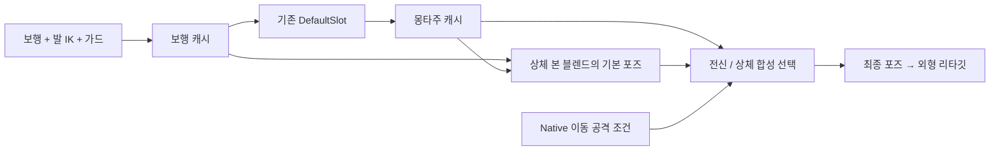

# 이동 중 상체 공격과 하체 보행 분리

- 날짜: 2026-10-09
- 브랜치: `Sprint#5-20-moving-upper-body-attack`
- 상태: 구현·저장·Editor 빌드·집중 QA 완료

## 결과

플레이어가 지상에서 이동하며 공격하면 하체는 기존 보행과 발 IK를 유지하고 상체에 공격 몽타주를 합성한다. 이동 속도가 10cm/s 이하가 되면 0.12초에 걸쳐 원래 전신 공격으로 돌아간다. 제자리 공격, 점프 공격·공중 상태와 회피는 전신 동작을 유지한다.

원인은 `ABP_Common_Unarmed`의 최종 `DefaultSlot`이 보행 결과를 전신으로 덮던 연결이었다. 숨겨진 Manny 소스를 사용하는 실제 캐릭터와 외형 리타깃 결과를 함께 수정했다. 공격 몽타주, Data Asset, 원본 슬롯, 콤보·피해 타이밍은 유지했다.

## 구현

- Native AnimInstance의 `MovingAttackUpperBodyAlpha`가 실제 지상 속도와 수락된 스킬·현재 몽타주를 비교한다. HUD가 보여주는 다음 콤보 대신 실제 수락된 스킬의 약한 참조를 사용한다.
- 기존 FootIK → 제자리 가드 이후 포즈와 DefaultSlot 결과를 각각 캐시한다. 보행과 슬롯을 중복 평가하지 않는다.
- `LayeredBoneBlend`는 `spine_01`과 `ik_hand_root`부터 후손에 공격을 적용한다. root·pelvis·다리·발 IK 본은 보행 가중치를 유지한다. 원본 노드 11개와 설정을 보존하고 9개 노드를 추가했다.
- 몽타주 블렌드 종료 구간에도 이동 보행을 유지한다. 회피가 블렌드 종료 중이면 전신 회피를 우선하며, GC 이후에는 재생 중인 몽타주의 경로로 약한 캐시를 복원한다.
- 이동·공중 진입 시 제자리 가드가 하체에 남지 않게 해제한다. 정지 상태의 가드 상승·만료 시간은 유지했다.
- 에디터 제작·감사 명령은 Editor 타깃에만 포함한다. 새 에디터 의존성은 AnimGraph, AnimGraphRuntime, BlueprintGraph, KismetCompiler다.



## 검증

| 검증 | 실제 결과 |
|---|---|
| Editor 빌드 | 최종 Editor 빌드 성공, 프로젝트 파일 재생성 완료 |
| 그래프 적용 | 컴파일 오류·경고 0, 캐시 참조·본 마스크·원본 노드 보존 검사 후 저장 |
| 별도 프로세스 재로드 | 읽기 전용 native 감사 및 Python 핀 검사 통과 |
| 원본 그래프 대조 시험 | 1100프레임, 하체 비교 474회 실패로 기존 문제 재현 |
| 수정 그래프 통합 시험 | 1100프레임, 최종 258066개 검사, 실패 0 |
| 실제 렌더 시험 | 같은 1100프레임 검증 통과, 3인칭 실제 화면 14장 생성·확인 |
| 기존 가드·회피·시점 전환 | 640프레임, 실패 0 |
| 기존 공격·이동·점프·카메라 | 840프레임, 실패 0 |
| 이전 가드/FootIK 제작 스크립트 | 새 중간 캐시와 상체 블렌드를 인식하고 읽기 전용 감사 통과 |
| Content SHA256 | 6366파일 중 Common AnimBP 1개만 변경, 나머지 6365개 동일, 추가·삭제 0 |

통합 시험은 실제 `DoMove`/`AddMovementInput`과 CharacterMovement로 캐릭터를 이동시킨다. 같은 소유자와 바닥을 읽는 별도 source·외형 메시를 순수 보행 대조군으로 사용한다. 원본 그래프의 안정된 공격 구간에서는 양쪽 종아리 회전 범위가 0도였고, 수정 후 9종 공격에서 7.28~54.29도로 보행 대조와 일치했다. 이동 중 source와 실제 리타깃 하체의 최대 본 회전 차이는 약 0.000002415도, source 위치 차이는 0cm였다.

맨손 잽·콤보·스트레이트·차징 훅과 너클 5종의 상체 공격을 확인했다. 이동 거리 1714.30cm, source 손 자세 차이 최대 84.20cm, 외형 손 차이 95.60cm로 공격 상체와 보행 하체가 동시에 출력됐다. 실제 타깃의 체력 감소 16회와 피해 시점 오차 최대 0.03318초는 원본 대조와 동일했다. 제자리 공격은 원본 시퀀스의 하체 자세와 최대 0.052도 이내로 일치했다.

`foot_cycle_travel_cm`은 여러 자세 전환을 포함한 누적 진단값이라 보행 진폭으로 해석하지 않았다. 피해는 기존 타이머 기반이며 Notify/curve 기록은 진단 자료다. metrics 기록의 검사 수 258065와 최종 로그 258066 차이는 마지막 파일 저장 검사 1개다. 이 검증은 현재 맨손·너클 경로에 집중했다.

## 변경 파일과 재검증

- 런타임: `Character/Rogue10mFighterCombatStanceAnimInstance.h/.cpp`, `Components/Rogue10mCombatComponent.h/.cpp`의 이번 증분.
- 에디터: `Editor/Rogue10mMovingAttackAuthoring.cpp`, `Rogue10m.Build.cs`, `Content/Rogue10m/Animation/Common/ABP_Common_Unarmed.uasset`.
- 검증: `Tests/Rogue10mMovingAttackRuntimeTest.cpp`, `Scripts/VerifyMovingAttack.ps1`, `VerifyMovingAttackGraph.ps1`, `AuditMovingAttackContent.py`, `Editor/ConfigureMovingAttackUpperBody.py`, `AuditMovingAttackStance.py`.
- 기존 계약 갱신: `Editor/PrepareFighterCombatStance.py`, `ConfigureBrawlerSourceFootIKOrder.py`.
- 기록: 설계·결과·증거, `Docs/SprintChangeLog.md`, `DevLog/20261009.txt`.

```powershell
.\Scripts\BuildEditor.ps1 -NoHotReload
.\Scripts\VerifyMovingAttackGraph.ps1 -Phase audit -Label fresh-graph-label
.\Scripts\VerifyMovingAttack.ps1 -Phase runtime -Label fresh-runtime-label
.\Scripts\VerifyMovingAttack.ps1 -Phase render -Label fresh-render-label
.\Scripts\VerifyFighterCombatStance.ps1 -Phase runtime -Label fresh-stance-label
.\Scripts\VerifyFighterCombatStance.ps1 -Phase combat -Label fresh-combat-label
.\Scripts\VerifyMovingAttackGraph.ps1 -Phase stance -Label fresh-guard-label
```

핵심 증거: [통합 비교](evidence/moving-upper-body-attack-20261009/runtime-comparison.json), [재로드](evidence/moving-upper-body-attack-20261009/graph-reload.json), [콘텐츠 보존](evidence/moving-upper-body-attack-20261009/content-after.json), [실제 이동 공격](evidence/moving-upper-body-attack-20261009/visual/frame_0078.png).

원본 AnimBP SHA는 `e516c167736708885fe12231676d28aaf1cd68ff84da06844d3dfafbf9166f18`, 저장 후 SHA는 `eef1e7fe9dcaf7919d86326c8cc878b21a84524046688288db3d1fd0ae4e8f67`이다. 저장 전 Python에 노출되지 않는 weak cache 참조를 발견했으며, 원본 해시가 유지된 상태에서 native 읽기 전용 감사로 보완한 후 저장했다.

StartHub Editor를 새 빌드로 복원했고 PIE 종료·미저장 에셋/맵 0·120FPS 설정을 확인했다. 기존 아린, 월드, HUD 등 미커밋 작업을 보존했다. 커밋·푸시는 하지 않았다.
