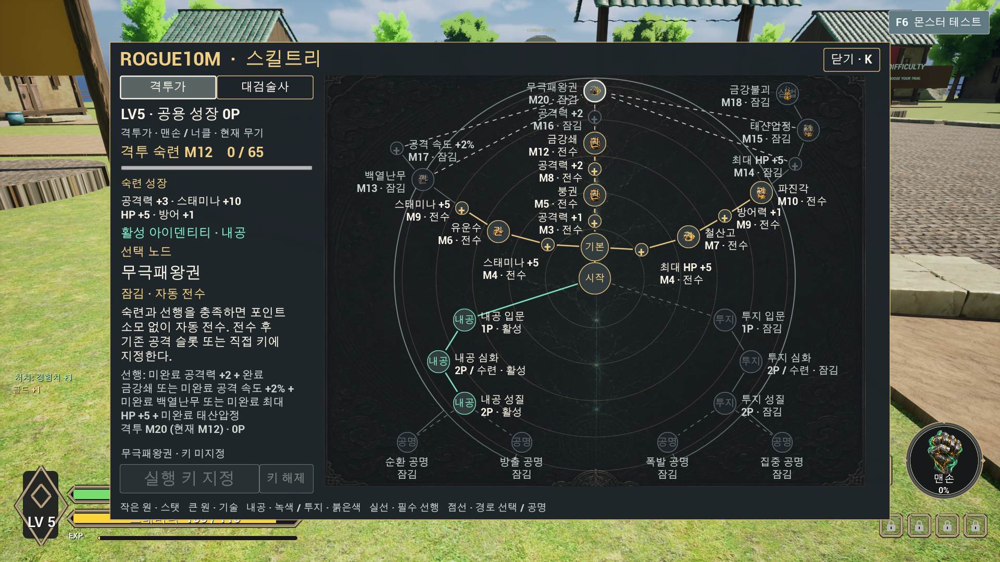
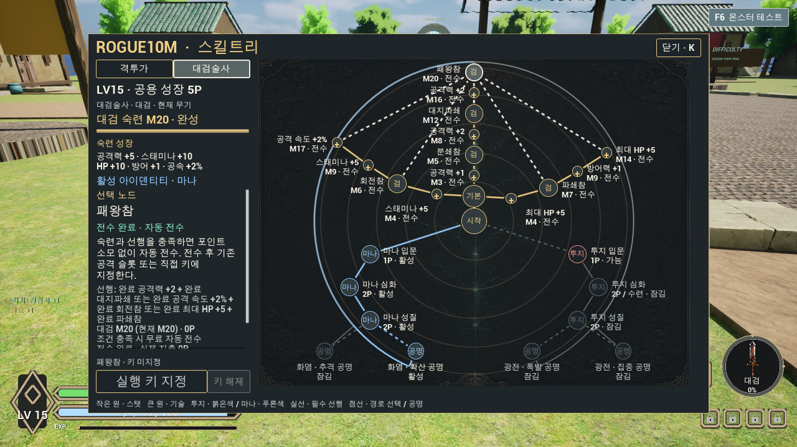

# 격투가·대검술사 혼합 성장 스킬트리

사용자가 확정한 [성장 설계](../../Docs/HybridSkillTreeDesign.md)와 [v3 시안](evidence/hybrid-skill-tree-20261018/imagegen-mockup-v3.png)을 실제 성장·전투·저장과 K 메뉴에 연결했다. 최종 검증 결과는 아래에 기록한다.

## 구현 범위

- 격투가: 맨손·너클 숙련 공유, 내공·투지만 사용. 기존 기본기 5개를 유지하고 나머지 무공을 숙련으로 전수한다.
- 대검술사: 별도 숙련, 투지·마나 사용. 기존 기본기 5개에 분쇄참·회전참·파쇄참·대지파쇄·패왕참을 추가했다. 기존 공격의 몽타주·타격 시점·효과를 재사용하는 프로젝트 파생 Data Asset이다.
- 카탈로그: 고유 노드 53개. 직업별 기본기·스탯·기술, 공유 아이덴티티 입문·심화·성질, 핵심기와 성질을 모두 요구하는 공명으로 구성했다.
- 실제 살아 있는 몬스터에 양수 피해를 준 공격 실행당 숙련 XP 1. 다단·다중 대상은 중복 지급하지 않고, 공타·무적·훈련 대상에는 지급하지 않는다.
- 숙련 M12 누적 XP 385, M20 누적 XP 1,045. 최대 보상은 계열별 공격력 5·체력 10·스태미나 10·방어력 1·공격 속도 0.02이며 현재 무기 계열에 한 번 적용한다.
- 특성과 트리는 `캐릭터 레벨 − 1 − 특성 실제 지출 − 트리 실제 지출`을 공유한다. 내공·투지 심화는 2P 또는 숙련/영구 성장 조건으로 전수하고, 마나 심화는 2P 전용이다.
- 아이덴티티 활성은 한 계열만 유지한다. 게이지·발동 피해·범위·연계 비용·회복 시간·공명을 전투에 연결했다. 마나 발동은 MP 5를 추가 소비한다.
- 저장 v3에는 숙련·실제 투자 비용·성질·활성 계열을 기록한다. v1/v2의 기존 전수 기술은 보존하고 숙련 XP·스탯을 소급 생성하지 않는다. 테스트 해금·임시 장착은 정상 저장 원장과 분리했다.

## 실제 사용

K로 스킬트리를 연다. 왼쪽 직업 탭은 트리 열람만 바꾸며 장착 무기를 교체하지 않는다. 중앙에서 기본기·아이덴티티로 분기하고 외곽으로 스탯·무공·핵심기·공명 노드를 연결했다. 노드를 선택하면 조건과 비용을 확인할 수 있다.

투자·성질 선택·활성 변경·환급은 출발 전 마을의 NPC 가까이에서 한다. 숙련 자동 전수는 전투 중에도 적용한다. 입문·심화·성질의 부분 재분배는 선택 단계와 선행 조건을 잃는 후속 단계만 철회하며 실제 지출을 돌려준다. 무료 숙련 보상은 보존한다. 전수한 액티브 기술은 키 선택 또는 기존 드래그 방식으로 장착한다.

## 자산과 코드

|영역|위치|
|---|---|
|카탈로그|`/Game/DataAsset/SkillTree/DA_HybridSkillTreeCatalog`|
|대검 파생 5개|`/Game/DataAsset/AttackSkill/HybridSkillTree/GreatSword/DA_Hybrid_GreatSword_*`|
|대검 프로필|`/Game/DataAsset/SkillProfile/DA_SkillProfile_Combat_GreatSword`|
|정의·기본 노드|`Source/Rogue10m/Data/Rogue10mSkillTreeData.*`, `Rogue10mSkillTreeCatalog.cpp`|
|영구 성장·전투 상태|`Source/Rogue10m/Components/Rogue10mSkillTreeProgressionComponent.*`, `Rogue10mSkillTreeCombatComponent.*`|
|실제 UI|`Source/Rogue10m/UI/Widgets/Rogue10mHybridSkillTreeWidget.*`|
|생성·검증|`Scripts/Editor/CreateHybridSkillTreeAssets.py`, `Scripts/VerifyHybridSkillTree.ps1`|

PlayerState가 영구 성장을 소유하고 Character가 일시적인 전투 게이지와 재사용 시간을 소유한다. 신규 Tick을 사용하지 않는다. 기존 Combat/GAS·입력·NPC·프로필 저장에 연결했으며 바이너리 자산은 Unreal Editor에서만 생성·저장했다.

## 검증

QA 전용 프로필·진행·키 저장 접두사를 모두 지정한 격리 검증을 완료했다. 실제 사용자 프로필을 테스트 대상으로 사용하지 않았다.

|검증|결과와 증거|
|---|---|
|최종 Editor 빌드|성공, 4 actions / 83.55초. [최종 로그](evidence/hybrid-skill-tree-runtime-20261020/editor-build-8.log). 병행 보스 정산 변경을 포함한 직전 통합 빌드도 26 actions / 81.39초 성공.|
|Editor 자산 생성|53노드·대검 기술 총10개·파생5개 확인. 원본 공격19개 및 기본 입력·초기 전수·회피·점프 설정 보존. [자산 보고서](evidence/hybrid-skill-tree-runtime-20261020/asset-authoring.json)|
|C++ Automation|3개 Success, 실패0·경고0. 숙련 보상·공유 원장·허용 계열·심화 대안·legacy 검사. [JSON](evidence/hybrid-skill-tree-runtime-20261020/automation-report/index.json), [로그](evidence/hybrid-skill-tree-runtime-20261020/automation-HybridAuto02.log)|
|실제 게임 실행|50개 PASS, 실패0, exit0. 실제 피해 어댑터의 XP 집계, 정상/테스트 장착 분리, NPC 거래, Slate hit-test와 마우스 이동·클릭을 통한 수련0P/성질2P 전수, 키 지정·잠금 거절, 마나·공명·부분 환급 확인. [결과](evidence/hybrid-skill-tree-runtime-20261020/runtime-results.txt), [로그](evidence/hybrid-skill-tree-runtime-20261020/runtime-HybridRun05.log)|
|독립 프로세스 재시작|14개 PASS, 실패0, exit0. 정상 캐릭터 진입·Attach 경로로 성장/인벤토리/트리/특성/전투 저장을 실제 복원. 격투M12(385XP)·대검M20(1,045XP), 트리 실제 지출8P·공유 잔액5P, 마나/확산/공명, 대검10기술·기본 공격, 금강쇄 F7 지정 유지. [결과](evidence/hybrid-skill-tree-runtime-20261020/runtime-read-results.txt), [로그](evidence/hybrid-skill-tree-runtime-20261020/read-HybridRun05.log)|
|실제 화면|격투가1920×1080, 잠긴 대검1920×1080, 완성 대검1280×720 캡처. 전수/키/환급 액션은 고정 영역에 두고 긴 상세 조건만 스크롤한다. 중앙 라벨 겹침을 해소했다.|
|커밋 전 검사|73파일 명시 목록과 스테이징 일치, `CheckGeneratedChanges.ps1`·활성 소스/스크립트/문서 공백 검사·Python/PowerShell 구문·문서 링크 검사 통과. 원문 증거 로그의 공백은 보존했다.|

실행 중 발견한 정상 기본 점프 공격의 복원 거절은 활성 프로필의 정확한 원래 슬롯·기술 조합을 허용해 수정했다. 신규 캐릭터 초기 전수 순서, 실제 카탈로그 연결, MP 비용과 임시 테스트 장착의 저장 분리는 [독립 리뷰](evidence/hybrid-skill-tree-runtime-20261020/review.md)에 기록했다. 이전 실패 로그는 수정 근거로 보존한다. 엔진의 `-game` 도구 플러그인 시작 로그와 대상 테스트 결과를 구분했으며 전체 엔진 로그에 오류가 없다고 주장하지 않는다.

검증 실행기는 `Scripts/VerifyHybridSkillTree.ps1`이다. `assets`, `automation`, `runtime`, `read` 단계를 제공한다. `runtime`은 매번 새 `TestId`를 사용하고 `read`는 직전 `runtime`과 같은 ID를 사용한다. 세 QA 저장 접두사가 없으면 실행 테스트를 거절한다.

## 범위와 인계

이번 작업은 두 직업의 성장과 UI 구현이다. 무기 모델·전용 신규 애니메이션 제작과 무기별 바인딩 archive는 별도 작업에서 진행한다. 현재 대검 신규 기술은 기존 동작을 재사용한다. 드래그 경로는 기존 API에 연결했으나 이번 실행 QA는 직접 키 지정과 버튼 클릭을 검사했다. 20분 전체 플레이·Shipping 패키징·네트워크 동기화·장기 전투 밸런스는 이번 검증 범위에 포함하지 않는다.

작업 브랜치 `Sprint#5-38-hybrid-skill-tree-runtime`은 main 체크포인트 병합 전에 생성돼 번호를 유지한다. 공유 체크포인트 `05f74f1`과 병행 보스 정산 `f49915b4`를 보존했으며, 스테이징이 비어 있고 fast-forward 관계임을 확인한 뒤 작업 파일을 바꾸지 않고 기준을 앞당겼다.

기능 커밋은 `a2a1db8bb4ae0908684bd1e7ebebc453c5699e2c`이다. 원격 갱신과 조상 관계·다른 worktree의 브랜치 사용 여부를 확인하고, 갱신된 사용자 상시 승인에 따라 로컬 `develop` → `test` → `main`을 이 커밋으로 fast-forward했다. 작업 파일을 다시 쓰지 않았고 `Sprint#5-37-main-checkpoint=05f74f1`도 유지했다. [통합 기록](evidence/hybrid-skill-tree-runtime-20261020/local-integration.json)에 소스·자산 tree와 검증·참조를 보존한다. 최종 문서 확정 커밋도 같은 작업·통합 브랜치에 이어진다.

공개 원격 전송은 선행 체크포인트의 자동 승인 검토가 코드·에셋·원본·검증 자료의 공개 게시 확인을 요구한 상태이므로 우회하지 않았다. 이번 기능의 push는 미시도이며 원격 main 반영 완료로 보고하지 않는다.

이후 사용자가 현재 상태와 향후 완료 기능의 공개 GitHub 푸시를 명시 승인했다. 체크포인트 게시 작업에서 이 기능의 `77a52b6a`와 완료된 선행 보스 정산까지 함께 게시한다. 최신 승인·게시 결과는 [체크포인트 통합 결과](2026-10-20_main-checkpoint.md)를 따른다.
