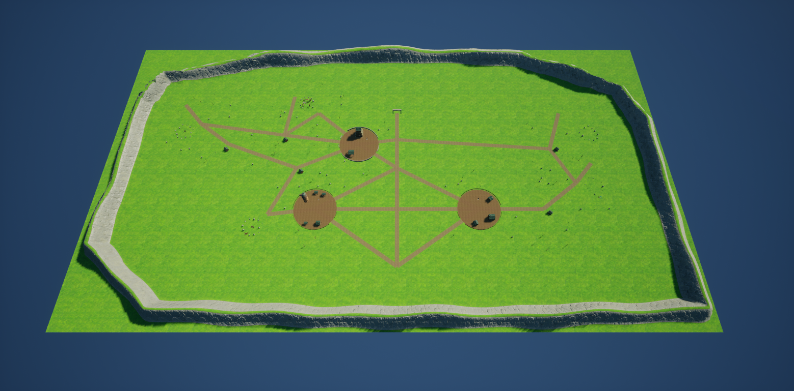

# 평탄한 필드·자연 외곽·마을 경계 제작 결과

2026-11-17 착수 · 2026-11-18 보완 · Sprint#9-32 · **시각 확인·저장·독립 cold·파일 범위 검증을 마친 Landscape 블록아웃 체크포인트**.

[기획서](../architect/2026-11-17_natural-world-boundaries.md)에 따라 평탄한 플레이 구역, 외곽 능선, 세 마을 경계와 도로 전이를 구현했다. 실제 화면 검토 후 평평한 능선 꼭대기를 둥글게 고치고, 추가 사용자 요청인 울타리 안 갈색 흙바닥을 세 마을에 적용했다. 최종 AAA 미술 완성도나 전체 게임플레이 인수를 뜻하지 않는다.

## 현재 저장본

| 항목 | 결과 |
| --- | --- |
| 대상 | `/Game/Rogue10m/Maps/Production/WorldLayoutCompactCrop20261114A` |
| 지형·충돌 | 각각45개,9×5 컴포넌트,1,012.5×562.5m |
| 높이 | 568×316=179,488개 전체 비교,원본+수정 레이어 총2개 |
| 배치 | 기존1,390경로 보존+새14 actor=1,404개 |
| 구조물·소품 | 11개 그룹,24개 ISM,713개 인스턴스 |
| 마을 바닥 | 별도 원형 데칼3개,소유 재질1개 |
| 소유 자산 | 도로·흙바닥 재질2개+ISM 표면 재질5개+퀘스트 복제1개=8개 |

내부 지면은 Z9600cm다. 기존 두 번째 `NaturalBoundary20261117` 레이어에서30,426개 표본만 수정해 sine² 단면의 능선으로 바꿨다. 원본 레이어의 raw RG 높이·paint·B/A와 native 해시를 보존했다. 독립 수식으로 전체 격자를 다시 생성했고 uint16LE SHA256은 `a7f20b232a14f887ba96387c828ed717c0b02f3065bb6e39ba1a3b60a2d37154`다. 전체 Z 범위는9600~12894cm,폐곡선551개 표본은11169.488~12788.672cm로 평면보다 약15.7~31.9m 높다. 초기 기획의24~33m와 실제 최소 높이의 차이를 보존한다. 도로 폭8m의2,076개 계획 표본은 모두9600cm였다.

21지점·29개 양방향 도로·중앙300m 배치를 유지했다. 도로29개는 `M_RoadFeather`의 최소6m 갈색 중심과 양옆0.7~1m noise/smoothstep 전이를 사용한다. [도로 가장자리 실제 화면](evidence/landscape-natural-boundary20261117/visual/road-edge.png)을 확인했고 이후 재질 바이트는 그대로다. 기존 도로 메시663개는 숨김·NoCollision 상태다. H/M/T 경계는 반경38/38/37m,출입구4/4/5곳이며 실제 내부 폭은 모두14m다. W/A/R 소품3곳에는 새 보상·픽업·퍼즐 기능을 붙이지 않았다.

마을 흙바닥은 반경37.5/37.5/36.5m로 울타리보다50cm 안쪽에 놓았다. `M_VillageEarth`는 기존9노드 gravel 재질을 복제한16노드 원형 마스크이며 tint는(.70,.54,.34),opacity는.97이다. 투영 반깊이16cm로 지면을 얕게 덮고 충돌·Landscape paint를 바꾸지 않았다. [수렵촌H](evidence/landscape-natural-boundary20261117/visual/village-earth-hunter.png)·[장터촌M](evidence/landscape-natural-boundary20261117/visual/village-earth-market.png)·[기록촌T](evidence/landscape-natural-boundary20261117/visual/village-earth-archive.png) 실제 화면에서 갈색 내부,좁은 잔디 테두리,유지된 건물 색과 도로 연결을 확인했다. 보스 입구에는 NoCollision 부품5개를 한 actor로 추가했다. 기존 회색 지원 바닥은 이미 game-hidden이었으므로 원래 플래그·충돌·transform을 그대로 두고 Game View로 확인했다.

672개 기존 actor의 높이를 조정했고20개 건축 그룹은 같은 Z 차이를 유지했다. 별도 충돌 수정으로 기록촌 도서관8개 부품만 함께 서쪽200cm 이동했다. T/E17 왼쪽 접근6개가 기존 `Post11`에 초기 관통했기 때문이며 r34에서 깊이는8.2cm였다. [원래 계획](evidence/landscape-natural-boundary20261117/author-plan.json)을 보존하고 [한정 수정 계획](evidence/landscape-natural-boundary20261117/author-plan-gate-reflow.json)에 이8개 X 예외만 선언했다. 나머지 XY·회전·스케일·재질과 기존 보스 플래그는 유지했다.

## 검증과 저장

| 검증 | 실제 결과 |
| --- | --- |
| 둥근 능선 중간본 | [구조49/49](evidence/landscape-natural-boundary20261117/refinement-live/validation-height_only.json),[캡슐544/544](evidence/landscape-natural-boundary20261117/refinement-live/height-capsules.json),[17개 패키지 선택 저장](evidence/landscape-natural-boundary20261117/refinement-live/height-save-result.json) |
| 문주·세 마을 바닥 포함 | [구조59/59](evidence/landscape-natural-boundary20261117/refinement-live/validation-complete.json),24개 ISM·713개 transform·재질·충돌·원형 마스크 확인 |
| 최종 저장 | [6개 패키지 선택 저장](evidence/landscape-natural-boundary20261117/refinement-live/final-save-result.json),native 반환true,dirty0,SaveAll0 |
| 독립 재로드 | [cold60/60](evidence/landscape-natural-boundary20261117/refinement-cold/validation.json),dirty0,검증 중 저장0,[실제 프로세스 exit0](evidence/landscape-natural-boundary20261117/refinement-cold-host/process-exit.json) |
| 파일 범위 | [32/32](evidence/landscape-natural-boundary20261117/final-scope-refinement-verified.json),후보1,453→1,473개,변경709·추가20·삭제0 |

파일 변경은672개 이동 actor·도로29개·Director1개·지형 actor/proxy7개이며,추가는 새 actor14개와 native folder external object6개다. 후보 `.umap` 바이트는 같다. 보호3,952개 중3,951개는 바이트가 같고 Build.cs는 editor 전용 Foliage 추가만 허용했다. 새 native 소스2개는 성공한 정규 Editor 빌드의 해시와 같다. 원본 재질5개와 선택 QA 외 저장458개의 해시·파일 집합도 같다. 보완 전1,468개 후보+소유7개로 구성된 물리 백업1,475개를 두 immutable manifest와 전부 대조했고,기존 OWN7개도 바이트 그대로다. 새 OWN은 `M_VillageEarth` 하나다. 이 검사는 명시한 범위이며 전체 프로젝트·모든 vendor 파일 전수 검사로 확대하지 않는다.

544개 정적 캡슐 질의는 반경34/42cm·반높이96cm로 외곽13구간/모서리,문13곳의3개 횡방향 접근,지면51곳을 확인했다. 높은 차단52개는 정확한 숨김 Pawn 전용 backup actor hit를 요구했다.90/180cm는 JumpZ420·중력980에서 정한 참조 높이이며 실제 점프 입력과 구분한다. 도서관 수정 후에도 질의와 합격 조건을 유지했다.

최종 보완본의 [남쪽 대표 접근](evidence/landscape-natural-boundary20261117/runtime-boundary-jump-refinement.json)은 정상 CharacterMovement에 공개 Jump 요청2회를 보냈다. 실제 `jump_current_count=2`,공중 관측79회,146개 표본을 기록했고 가장 바깥 캐릭터 중심도 폐곡선보다 안쪽12.19m에 머물렀다. 물리 키보드·텔레포트·속도 변경은0이다. 이1개 접근을 모든 방향·이동 기술의 인증으로 확대하지 않는다.

첫 수치 프로필의 [중앙 보행3회](evidence/landscape-natural-boundary20261117/runtime-walk/summary.json)는48.5345/48.5447/48.5395초,[선택8간선 보행](evidence/landscape-natural-boundary20261117/runtime-optional-walk.json)은142.9130초였다. 렌더링 PIE의 프로그램 `AddMovementInput` 시험이며 처음2회는 미저장,3회차와 선택 경로는 첫 저장 후 실행했다. 이를 최종 보완본에서 다시 실시한3회 보행으로 보고하지 않는다. 정상 프로필의 캡슐34/96cm·JumpZ420·최대2회·hold0·중력−980은 [실제 캐릭터 값](evidence/landscape-natural-boundary20261117/runtime-walk/kinematics-3.json)에 남겼다.

## 실패 이력과 남은 범위

초기 좌표 단위 guard,기존 ActorFactory root,Python에서 제외된 BlueprintSetter,Rotator 인수 순서,dirty 목록 정렬,도서관 접근6개 실패를 보존했다. 기존 표면 재질5개가 ISM 플래그로 dirty가 된 첫 저장은 `save_called=false`로 거절됐다. 소유 파생5개를 만든 뒤22개 새 ISM만 retarget하고 원래5개는 저장하지 않고 재로드했다. [복구 기록](evidence/landscape-natural-boundary20261117/author-live/ism-material-repair.json)에서 원본 파일·그래프·clean 상태를 확인했다. 퀘스트 복제도 origin Z와 후보 Director 바인딩만 바꾸고 SupportedWorld·회전·전체5개 row·선택 이야기 텍스트를 유지했다.

컴파일 중 Slate 콜백이 중첩 호출된 재진입은 clean 가드에서 수정 전에 중단됐다. 중복 생성 없이 외부 호출의 두 저작은 완료됐고 busy 가드와 검증 전용 재개로59개 검사를 통과했다. [실패 원문](evidence/landscape-natural-boundary20261117/refinement-live/failure.json)은 남겼다. [첫 범위 실패](evidence/landscape-natural-boundary20261117/final-scope-refinement.json)도 candidate1,468개와 별도 소유 백업7개를 합치지 못한 검사 계약 오류였다. changed/missing0,예상 밖 파일이 정확히 선언된7개임을 확인해 합집합1,475개 모두를 검사하도록 고쳤다. 임의 파일을 허용하거나 실패 보고서를 덮어쓰지 않았다.

보완 에디터 로그에는 복구한 콜백 오류1개와 기존 vendor `SKEL_Hu_M`→`/Engine/EngineMeshes/Humanoid` LoadErrors1개가 남는다. [복구 후 경계 검사](evidence/landscape-natural-boundary20261117/refinement-host/post-recovery-log-check.json)와 [원인 대조](evidence/landscape-natural-boundary20261117/refinement-host/final-log-triage.json)는 기존 콜백1개·이후 vendor1개를 구분한다. [새 cold 로그2,388줄](evidence/landscape-natural-boundary20261117/refinement-cold-host/log-check.json)은 Error0이었다. 전체 작업 로그가 오류0이라고 보고하지 않는다.

이전 Undo/Redo composite seam과 E19/E27 exact-grid point-ray 실패는 이번 검사로 재분류하지 않았다. NavMesh·GPU 성능·물리 입력·정상 Hub 포털·전체 전투·15분 성장·20분 완주도 인수하지 않았다. 일반 몬스터15종·중간보스4종·최종보스1종의 신규 구현을 주장하지 않으며 입력·보상·진행 규칙은 기존 카탈로그를 따른다. Q/Z는 지하 요소의 기획 위치이고 실제 동굴 방·터널은 구현하지 않았다.

선행 작업 브랜치 WIP는 `65a0bf5a`, `9a2305a4` 등의 push 이력이 있다. 이번 최종 체크포인트 커밋·작업 브랜치 push 결과는 별도 게시 기록으로 남기며 main 승격은 로컬 AGENTS의 `MapMergeGate`를 따른다. 모든 게시가 없었다고 서술하지 않는다. [게시 의존성 검사](evidence/landscape-natural-boundary20261117/publication-dependency-check.json)의 원격 main 기반 부재는 해당 검사 당시의 기록으로 유지한다.

## 제작 참고

[Ghost of Tsushima 환경 제작 설명](https://blog.playstation.com/2020/07/09/crafting-the-world-of-tsushima/)의 자연 색·지역 정체성·환경 유도를 마을 색과 입구 프레이밍에 맞춰 해석했다. 바람·동물 안내 시스템은 구현하지 않았다. [Horizon Forbidden West 제작 설명](https://blog.playstation.com/2021/11/22/horizon-forbidden-west-an-authentic-world/)의 문화·목적에 맞는 재료와 소품,멀리서 구분되는 정착지 원칙을 참고했다. 다른 게임의 진행·보상 기능을 복제한 것은 아니다.

좌표·해시·기계 판독 상태는 [제작 카탈로그](../../Docs/References/WorldMap/landscape-natural-boundary20261117.json)에 기록한다. 첫 프로필의 [cold50/50](evidence/landscape-natural-boundary20261117/cold-live/validation.json)·[파일 범위19/19](evidence/landscape-natural-boundary20261117/final-scope-report.json)와 원래 높이 계획은 이력이며 새 프로필의 합격 근거로 재사용하지 않는다.
