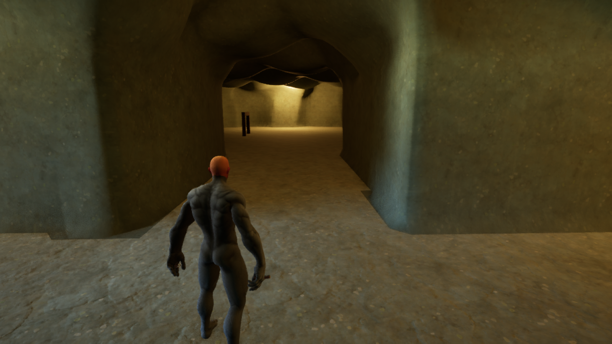
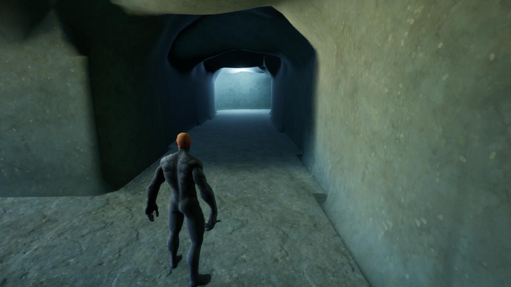

# Q·Z 동굴 연속 암반 보완 결과

2026-11-18 · **요청한 연속 암반 보완·검증 완료 · 전체 맵 제작 중 · 작업 브랜치 게시 준비**

사각 벽·평평한 천장 앞에 바위를 붙인 외형을 큰 암반 덩어리와 접힌 천장이 이어지는 연속 동굴로 보완했다. 기존 주 통로·비밀방·귀환로, 중앙·마을 평지와 지형 전체를 유지했다. **실제 기본 삼인칭의276/276경유점·양방향12체인·6개PCM화면을 통과했고 최소 카메라 거리는231.904cm, 최대 수축은99.344cm였다.8패키지 한정 저장, 정적19/19조건·2,016질의, 독립cold20/20조건·2,016질의·exit0, 파일범위24/24조건과 PIE종료 후clean상태까지 확인했다.** 요청한 동굴 형상 보완의 완료이며 전체 맵 제작·전투·Shipping 인수와 구분한다.

## 현재 확인된 단계

| 단계 | 실제 근거·현재 상태 |
|---|---|
| 기준 고정 | `3a33ee21`의 동굴4actor 포함1,408actor·47재질·Landscape45개 기준을 고정했다. [재질 기준](evidence/cave-organic20261118/baseline-live/materials.json), [지형 기준](evidence/cave-organic20261118/baseline-live/terrain.json), [기준 결과](evidence/cave-organic20261118/baseline-live/result.json)를 사용한다. |
| V1 시각 검토 | CPU 소스 미리보기의 넓고 평평한 방 벽과 규칙적인 둥근 통로가 요구에 부족해 Unreal 적용 전에 거절했다. 원본·규격·실패 관찰을 보존했다. |
| V2 소스 선택 | 큰 벽 굴곡과 접힌 천장을 직접 보고 Unreal 미리보기용 소스로 선택했다. [소스 게이트](evidence/cave-organic20261118/source-gate.json)는 최종 미술·게임 QA 인수가 아니다. |
| V2 소스 수치 검사 | 바닥 보정 후 Q/Z 모두 닫힌 연결 면·면 방향·재질 슬롯·정확한 시각 바닥 높이를 독립 검사했다. [보정 후 소스 검사](evidence/cave-organic20261118/source-mesh-v2-floor-snap-audit.json)를 따른다. 실제 충돌·시야·성능은 별도다. |
| 새 재질 생성 | [에디터 실행 receipt](evidence/cave-organic20261118/author-live/materials.json)는 `success=true`, 생성 당시 `assets_saved=false`다. 이후 별도8패키지 한정 저장에 포함했다. |
| Native 메시·장면 적용 | [메시 생성](evidence/cave-organic20261118/author-live/meshes.json)·[컴포넌트 배정](evidence/cave-organic20261118/author-live/scene.json) 뒤 [면 방향 보완](evidence/cave-organic20261118/author-live/winding-repair.json)을 같은 새 메시2개에 적용했다. 생성·보완 단계는 미저장이며 후속 저장과 구분한다. |
| 첫 통합 정적QA | [qa-live](evidence/cave-organic20261118/qa-live/validation.json)의19조건 중17개가 통과했고2개가 실패했다. 2,016질의 중벽20·천장112, 총132개가 실패했다. 이 실행은 실패로 보존한다. |
| 수정 후 정적QA·RenderData·단일pivot궤도 | [수정 후 결과](evidence/cave-organic20261118/qa-final-live/result.json)가 통과했다. 전체 실제 왕복 카메라·cold와 구분한다. |
| 런타임 전 Q보관실 미술 게이트 | 수정 후 실제 Q보관실1장을 직접 검토하고 런타임 검증 진행용으로 수락했다. 당시 큰 천장 음영의PCM가림 우려는 후속6화면·전체보행에서 별도 확인했다. |
| 한정 저장·독립cold | [8패키지 저장](evidence/cave-organic20261118/author-live/final-save-result.json) 후 dirty0. [독립cold](evidence/cave-organic20261118/cold-direct/result.json)20조건·2,016질의와 별도 관측 exit0·로그오류0을 확인했다. |
| 실제PCM6화면·최종파일범위 | Q/Z의 입구·직각통로·비밀방6장을 직접 검토했고 해시·PCM자세근거가 일치했다. 파일범위는24/24조건을 통과했다. |
| 새 실제 왕복 카메라·종료 후 상태 | [실제 전체 실행](evidence/cave-organic20261118/runtime-camera-verified/result.json)276/276지점·12체인이 통과했다. [PIE종료 후 상태](evidence/cave-organic20261118/final-editor-state.json)는dirty0·1,408actor·기존1,404/47재질/45지형 보존을 확인했다. |

## 보존할 동선과 표면

Q/Z의 주 통로·갈림길·꺾인 비밀방 진입·짧은 귀환로와 기존 경사로를 유지한다. 새 열쇠·스킬·퀘스트 완료 조건을 붙이지 않는다. 중앙300m 직행로·29도로·H/M/T의 평지와 Landscape 전체 composite는 기준과 같아야 한다. Q의K08·Z의G07 획득 기획과 Ctrl→첫Q 제한시간→QQQ 자동 발동, 학습·장착·발견 규칙도 이번 형상 작업에서 바꾸지 않는다.

기존 바닥 ISM은 보행면Z8610cm의 충돌·transform·인스턴스를 유지한 채 화면에서만 숨겼다. 새 연속 표면의 시각 바닥은1cm 아래인Z8609cm에 두고 슬롯1에 기존 `MI_CaveStoneFloor`를 사용한다. 벽·천장은 슬롯0의 새 `MI_OrganicRock`이다. 기존 경사로를 그대로 보존하고 동일 transform의 NoCollision 시각 컴포넌트2개를 추가했다. 셸2개와 경사로 시각2개는 기존 동굴 actor에 붙이며 actor 총수1,408개를 유지한다. 첫 정적QA에서 원래 바닥·경사로·지붕과 기존 컴포넌트 보존, 실제179,488높이 표본 일치가 통과했다. 벽·천장 충돌은 아래의 실패와 별도이며 전체 통행 합격으로 확대하지 않는다.

Landscape composite 기준 BLAKE3는 `67d6682a3bad4b9b480d0b4e264903e9665846b562d7b72fa5cd8ff10e0252fc`, 원본층은 `7b30bb0271250f6f4b2d4164c72940c83a3e49b13078ef91e9316992816a0955`다. 재질 생성·실제 형상QA·독립cold·PIE종료 후 관측에서 이 기준을 보존했다. 기존179,488높이 표본을 다시 저작하지 않았다.

## 형상 선택과 중요한 소스 실패

V1은 벽과 천장이 연결됐지만 방의 큰 벽은 둥근 사각 평면, 통로는 규칙적인 튜브처럼 보였다. 텍스처로 큰 평판을 감출 수 없다고 판단해 소스 단계에서 거절했다. [V2 변경 기록](evidence/cave-organic20261118/source-generation-review-v2.json)은 이전 V1 규격과 원본을 별도로 보존한다.

V1거절·V2선택 당시의 CPU미리보기는 [보존된 소스 화면 매핑](evidence/cave-organic20261118/retained-source-previews.json)의`source-previews/` 파일을 따른다. 실제 Unreal 캡처와 구분하며 원래 소스 게이트 기록을 수정하지 않았다.

V2는 큰 벽의 오목·볼록 변화와 비대칭 천장 덩어리를 강화했다. 최종 소스의 Q는62,990정점·125,980삼각형, Z는62,988정점·125,976삼각형이다. 두 소스의 모든 변은 두 면에 연결되고, 하나의 연결 표면·일관된 방향·퇴화면0을 독립 검사했다. 전역 자기교차·실제 엔진 충돌·프레임 비용까지 인증한 수치는 아니다.

첫 V2 독립 소스 검사에서는 단순화가 Z 바닥 정점을8609.011383cm까지 움직여 평면 오차0.01cm 조건에 실패했다. 허용 오차를 완화하지 않고 바닥 슬롯의 정점을 정확한Z8609cm로 고정하고 법선을 다시 계산했다. Q/Z의 후속 검사에서는 바닥 최소·최대가 모두8609.0cm, 바닥 법선Z최소가1.0이었다. [첫 실패](evidence/cave-organic20261118/source-mesh-v2-audit.json)와 [보정 후 검사](evidence/cave-organic20261118/source-mesh-v2-floor-snap-audit.json)를 구분한다.

실제 Unreal 저작은 `.mesh.json`의 로컬XYZ cm·삼각형·법선·재질 슬롯을 공개 GeometryScript로 DynamicMesh에 전달하고 프로젝트 소유 StaticMesh를 만드는 경로다. OBJ는 원본 교환·출처·독립 검증용으로 보존하며 FbxFactory로 import했다고 표현하지 않는다. [메시 생성 receipt](evidence/cave-organic20261118/author-live/meshes.json)는 Q/Z 자산을 메모리에 만들고 재질2슬롯·UseComplexAsSimple·원본 법선·삼각형 보존을 관측했다. 저장하지 않았으며 이 원본 방향 후보는 아래의 실제 엔진 QA에 실패했다.

## Native 적용에서 드러난 실패와 보완

첫 메시 준비는 UV용 Transform의rotation에Quat을 넘겨 설치Python 바인딩이 요구한Rotator와 맞지 않아 중단됐다. [첫 실패](evidence/cave-organic20261118/author-live/meshes-failure.json) 당시에는 새 메시가 없고 재질2개만dirty였다. 해당 인수를 바로잡은 다음 호출에서는 Q 메시 생성 뒤 비교기가 큰 위치 차이를 보고 중단했다. [두 번째 실패](evidence/cave-organic20261118/author-live/meshes-failure-2.json)의6,158.8755cm 차이를 에셋 손상으로 단정하거나 부분 생성물을 자동 삭제하지 않았다.

[실제 Q 추출본 진단](evidence/cave-organic20261118/Q-native-comparator-diagnosis.json)은 원본double좌표와native float32좌표를 서로 다른 정렬 기준으로 비교해 대응 삼각형이 어긋났음을 재현했다. 양쪽 좌표를 모두 명시적으로float32로 바꾸고, 방향을 유지하는 순환 정점 키와 재질ID의 Counter로 대조하자125,980삼각형의 누락·추가가 모두0이고 해시가 같았다. 최대 대응 위치 차이는0.0003221cm였다. 면 누락·역방향·재질 변경을 여전히 거절하고 순서 재배열만 허용하는 반례 검사를 거쳤다. 허용 오차를 크게 높여 통과시킨 것이 아니다. 실제 부분 Q를 읽어 확인한 뒤 명시적으로 이어서 설정했고 Z를 새로 만들었다.

그 뒤 [첫 통합 정적QA](evidence/cave-organic20261118/qa-live/validation.json)는 새 메시의 원본 좌표·방향·슬롯 대조와 기존 actor·지형·47재질·노출·카메라 보존은 통과했지만, 벽20·천장112질의가 모두 실패했다. 나머지1,884개 캡슐 질의가 통과해도 이132개 실패를 전체 합격으로 바꾸지 않는다. 원본의 수학적 면 방향이 그대로 저장됐다는 검사는 Unreal의 앞면·복합 충돌 방향이 맞다는 검사와 달랐다.

주 작업자는 Engine Cube의 실제 signed volume이-1,000,000cm³인 점과 양수 방향의 소스 면을 대조해 native 전달 방향 문제를 확인했다. [명시한 native adapter](evidence/cave-organic20261118/native-adapter.json)는 삼각형 인덱스`[a,b,c]→[a,c,b]`만 바꾼다. V2 원본 위치·삼각형 파일·저작 법선을 보존했고, [실제 보완 receipt](evidence/cave-organic20261118/author-live/winding-repair.json)는 같은 새 메시2개에 전달 순서를 고친 뒤 기대 native 삼각형·슬롯과 일치함을 확인했다. [adapter 사전 검사](evidence/cave-organic20261118/fixture-adapter-preflight.json)도 올바른UE방향 수락·이전 방향 거절·원본 소스 보존·기존2,016질의 불변을 확인했다. 재질 양면화나 충돌 검사 해제로 우회하지 않았다.

같은 첫QA의 나머지 실패1조건은 폐기한 기존 벽·바위4bin 중 **구조 벽2bin**의 NoCollision 전환에 따른 실제 프로필 이름`BlockAll→Custom`을 허용 변경 비교가 반영하지 못한 것이었다. [허용 overlay 사전 검사](evidence/cave-organic20261118/fixture-adapter-preflight.json)는 이2개 프로필 차이만 더 반영하면 실제 스냅샷이 일치함을 확인했다. 바닥 충돌·채널 응답·나머지 속성의 엄격 비교는 유지했다. 초기 원문이나 통행·재질·지형 조건을 완화하지 않았으며 수정된 fixture와 면 방향 adapter를 새 전체QA에서 함께 재확인했다.

그 뒤 [새 정적QA](evidence/cave-organic20261118/qa-final-live/validation.json)는19/19조건·2,016/2,016질의를 통과했다. [실제 RenderData LOD0 대조](evidence/cave-organic20261118/qa-final-live/render-geometry.json)는Q125,980·Z125,976삼각형을 실제 렌더 데이터에서 읽어 adapter 적용 원본과 방향·좌표·재질별 Counter가 정확히 같음을 확인했다. [이전 카메라 실패pivot의 새 궤도 검사](evidence/cave-organic20261118/qa-final-live/camera-arc.json)는0.25도 간격1,440각도·simple/complex2,880구체질의에서 실패0, 두 방식 모두 최소거리200.186cm였다. 이는 한 위치의 정적 검사이며 전체 동굴의 실제 왕복 카메라를 인증하지 않는다. 해당 통합 실행은21.625초·diagnostics0·traceback없음·저장없음이다.

## 런타임 전 한 장면의 미술 검토

보완 후 [실제 Q보관실 화면](evidence/cave-organic20261118/visual/after-Q-vault.png)을 독립 검토했다. 큰 갈색 암반이 벽에서 비대칭 천장으로 이어지고 석재 질감·바닥·보관함이 읽혔다. 반복 부착 바위나 사각 평판이 이 화면의 지배적인 외형으로 보이지 않아 [런타임 검증 진행용 게이트](evidence/cave-organic20261118/pre-runtime-artgate.json)를 수락했다. 당시 위쪽 중앙의 넓고 어두운 천장 띠는 실제PCM의 지속 가림 재검토 항목으로 남겼다. 이1장을 기본3인칭 전체6화면이나Z의 미술 인수로 확대하지 않았다.

`visual/after-Q-entry.png`는 면 방향 보완 전에 요청된 낡은 캡처임을 주 작업자가 확인했다. 현재 화면의 근거로 쓰지 않고 별도 거절 자료로 보존한다. 화면 파일명에`after`가 있다는 이유로 최신 렌더로 해석하지 않는다.

후속 실제PCM의 [Q입구](evidence/cave-organic20261118/runtime-camera-verified/captures/01_Q_entrance_under_roof.png)와 [Q직각통로](evidence/cave-organic20261118/runtime-camera-verified/captures/02_Q_narrow_right_angle_turn.png)도 독립 검토했다. 두 화면 모두 캐릭터 전신과 길이 읽히며, Q통로의 어두운 천장 굴곡은 열린 진행 방향 위에 머물러 이전editor뷰의 큰 띠 같은 가림이 재현되지 않았다. 입구의 가까운 돌은 밝고 옅지만 질감은 남아 있다. [첫2화면 검토](evidence/cave-organic20261118/runtime-first-two-artreview.json)는 나머지4화면·Z미술·전체왕복 완료를 인증하지 않는다. 별도로 보존한 [새 editor입구 화면](evidence/cave-organic20261118/visual/accepted-Q-entry.png)은 앞의 낡은`after-Q-entry`를 현재 증거로 대체하는 새 관측이며 실제PCM시험과 구분한다.

이어 [Q비밀방](evidence/cave-organic20261118/runtime-camera-verified/captures/03_Q_secret_dogleg_room.png)·[Z입구](evidence/cave-organic20261118/runtime-camera-verified/captures/04_Z_entrance_under_roof.png)·[Z직각통로](evidence/cave-organic20261118/runtime-camera-verified/captures/05_Z_narrow_right_angle_turn.png)·[Z비밀방](evidence/cave-organic20261118/runtime-camera-verified/captures/06_Z_secret_dogleg_room.png)도 실제로 보고 [6화면 미술 인수](evidence/cave-organic20261118/runtime-six-artreview.json)를 기록했다. 주 작업자의각capture요청·승인해시와 현재파일해시, 기존PCM의2프레임고정자세근거가 모두 일치했다. 연속암벽·불규칙천장과 Q온색/Z냉색이 읽혔고 캐릭터·진행방향을 가리는천장은 보이지 않았다. 이 미술 인수는 요청한동굴외형 범위이며 최종전체맵미술·전체보행·전체게임플레이 인증이 아니다.

## 한정 저장과 독립 재로드

[최종 한정 저장](evidence/cave-organic20261118/author-live/final-save-result.json)은 새 재질2·메시2·기존 동굴외부actor4의 정확한8패키지만 저장했고 native반환true·dirty0이었다. SaveAll은 사용하지 않았다.

첫 독립 실행은PID47224의exit0만 관측됐고 새 로그·의미적 결과가 없어 인수하지 않았다. [첫 종료 기록](evidence/cave-organic20261118/cold-host/process-exit.json)을 보존하며 성공한cold로 보고하지 않는다. 실행 경로를`UnrealEditor-Cmd` 직접 프로세스로 정리한 뒤 새로 실행했다.

[새 독립cold](evidence/cave-organic20261118/cold-direct/result.json)는PID30776에서20/20조건·2,016/2,016질의를22.984초에 통과했고 diagnostics·traceback은 없었다. 검증 종료의`passed=true`와 [같은PID의 실제 프로세스 종료](evidence/cave-organic20261118/cold-host-direct/process-exit.json)46.360초·exit0을 별도로 확인했다. [로그 검사](evidence/cave-organic20261118/cold-host-direct/log-check.json)는2,382줄에서 기존·신규·전체오류가 모두0이었다. [종합 인수](evidence/cave-organic20261118/cold-host-direct/acceptance.json)는 의미적 결과와 실제 프로세스 종료를 함께 확인한다. 검사·실행기가 자산이나언어설정을 저장하지 않았으며 cold는 실제왕복카메라 인수를 대신하지 않는다.

[파일범위 검사](evidence/cave-organic20261118/scope-final.json)는24/24조건·위반0을 통과했다. 후보1,482파일 중 기존 동굴외부actor4개만 바뀌고 추가·삭제는 없으며, 새 소유자산은재질2·메시2다. 기존소유15자산·원본47재질의51파일·보호입력3,969개·물리백업1,497개·비선택세이브458개가 바이트단위로 보존됐다. 이 검사는에디터·Git·자산수정을 실행하지 않았고, 실제왕복 카메라 검증과 별도다.

## 실제 전체 왕복과 에디터 종료 상태

[새 실제 런타임 결과](evidence/cave-organic20261118/runtime-camera-verified/result.json)는 시뮬레이션883.369초·벽시계894.609초에276/276경유점과 Q/Z각6개, 총12개 양방향 체인을 완료했다. 관측2,689회는 모두 지상 상태였고 공중 관측과 cleanup오류는0이었다. 최소 카메라 거리는231.903671cm, 최대 충돌 수축은99.343970cm였다. 기존 SpringArm320cm·Camera반경14cm·FOV90·최대보행620cm/s와 정상 AddMovementInput을 사용했으며 텔레포트·속도·시간·카메라 변경은0이었다. 이전 숨김 박스의 형상 가정 대신 실제 Camera14 복합 질의를 관측했고6개PCM화면을 모두 직접 검토했다. 물리 키보드 조작이나 전체 전투 시험은 포함하지 않는다.

[PIE종료 후 검사](evidence/cave-organic20261118/final-editor-state.json)는 기존 에디터PID49456·PIE종료·게임world없음·dirty0을 확인했다. actor1,408개·기존1,404actor와 컴포넌트·기존47재질·Landscape45렌더/45충돌과 원본/합성 높이 해시가 보존됐다. 읽기 전용 검사이며 추가 저장은 없었다.

작업 시작 전 로그에는 기존 오류 항목13개가 있었다. [전체 작업 경계 검사](evidence/cave-organic20261118/whole-task-log-check.json)는 이번 구간 새 항목45개, 전체58개를 기록하며 위 도구·비교기·면 방향 실패를 보존한다. 전체 작업의 오류가0이었다고 보고하지 않는다. 별도의 [런타임 시작 경계 검사](evidence/cave-organic20261118/runtime-start-log-check.json)는UTC2026-11-17T20:13:40이후 새 오류0이며, PIE종료와 에디터 복귀까지 포함한 [최종 동일 경계 검사](evidence/cave-organic20261118/final-runtime-log-check.json)도 새 오류0이었다. 독립cold의 오류0도 이 에디터 로그 전체의 오류0을 뜻하지 않는다.

## 기존 자원을 재사용한 무광 석재

현재 소유 `M_CaveSurface`의43노드 그래프를 새 `M_OrganicRock`으로 복제했다. 기존 월드XY/XZ/YZ의240cm 석재 투영 합계를 새 `OrganicTint`와 곱해 BaseColor에 직접 연결했다. 기존 윗면·옆면 분기를 거치지 않으므로 모든 면이 같은3차원 월드 투영을 사용한다. 곡면에서 기존 XY Normal이 늘어지는 문제를 피하도록 새 parent의Normal은 접선 공간 중립 상수(0,0,1)를 사용한다. 기존43노드를 보존하고 tint·곱·중립Normal3노드를 추가해46노드다.

새 `MI_OrganicRock`은 `OrganicTint=(0.30,0.32,0.28,1)`, Roughness0.92를 getter로 확인했다. 실제 float readback은 [생성 receipt](evidence/cave-organic20261118/author-live/materials.json)에 있다. 설치UE5.8의 scalar/vector setter는 성공 후에도false를 반환하는 기존 동작을 보였으므로 반환값을 합격 근거로 쓰지 않고 정확한 getter를 검사했다. 새 두 자산은 다음 소유 경로 아래에 생성한 뒤 별도8패키지 저장에 포함했다.

`/Game/Rogue10m/World/Production/WorldLayoutCompactCrop20261114A/NaturalBoundary20261117/Caves20261118/Organic20261118/`

기존47개 재질의 graph·파라미터·parent·플래그·디스크 파일을 같은 reader로 대조했다. 생성 전후 상태 SHA256은 모두 `34cbb2e4971c2a388db34f43764885e47096345b29c46c1169953b6138286c70`였다. 원래7개 동굴 재질과 vendor 원본을 수정하지 않았다. 비교에서는 Struct repr의 임시 메모리 주소만 정규화하고 색·필드·실제 값은 유지했다.

기존 `T_GroundRock_01_basecolor`·바닥 재질·목재·등불·소품을 재사용한다. 신규 Fab 구매·팩 반입은 없으며 과거 보유 카드·로컬 존재·현재 씬 사용과 현재 계정 소유 재확인은 구분한다. [Valheim 공식 FAQ](https://www.valheimgame.com/faq/)와 [공식 Press 이미지](https://www.valheimgame.com/press/)에서 스타일·큰 암반·국소 조명을 참고했다. 회갈색 무광 재질과 Q온색/Z냉색 처방은 이 프로젝트의 설계 판단이며 다른 게임의 자산·지도·진행 규칙을 복제하지 않았다.

## 실제 기본 카메라 화면과 완료 범위

요청한 연속 암벽·천장 보완과 기존 동선·평지 보존의 기능 범위는 완료했다. 물리 키보드·전체 전투·NPC/비급 지급 통합·NavMesh·cook/Shipping·전체 맵 최종 미술은 이번 인수에 포함하지 않는다. 한국어 DevLog·Sprint기록과 [게시 파일별 목적·해시](evidence/cave-organic20261118/publication-manifest.json)를 함께 구성했다. 실제 게시 식별자는 Git 작업 브랜치 이력을 따르며 전체 맵 제작 완료 전 develop/test/main승격은 보류한다.

최종 형상·소스·에셋·보존·검증 범위는 [연속 암반 보충 카탈로그](../../Docs/References/WorldMap/cave-organic20261118.json)를 따른다. 기존 두 원본 카탈로그는 변경하지 않았다.
