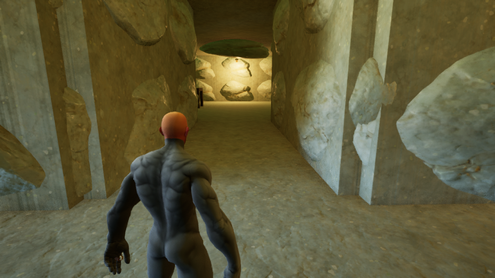
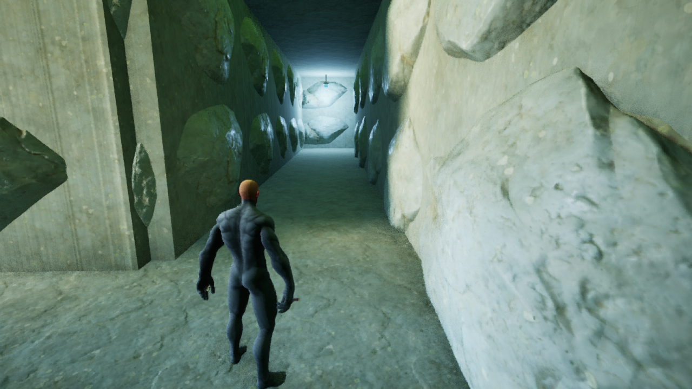

# 지하 훈련고·제련로 동굴 제작 결과

2026-11-18 · Sprint#9-32 · **동굴 공간 제작·검증 완료 · 전체 맵 제작 중**

사용자에게 [구조·동선 기획서](../architect/2026-11-18_underground-caves.md)를 먼저 제시한 뒤 기존 Crop 후보에 실제 지하 공간을 저작했다. 두 동굴·갈림길·비밀방·짧은 귀환로와 바위·목재·조명을 배치했고 월드 투영 돌 재질을 보완했다. 실제 카메라의 첫 어두운 입구 화면을 거절한 뒤 국소 노출 경계를 고쳤다. **실제 충돌 바위2개를 보완한 뒤 전체276경유점과 양방향12체인·대표 화면6개를 실제 PIE에서 통과했다. 최소 카메라 거리는176.87cm, 최대 충돌 수축은154.38cm였다. 정적31조건·2,016개 질의와 종료 후 clean 에디터도 확인했다. 독립 cold32/32조건·2,016개 질의·프로세스 exit0과 최종 파일 범위46/46조건까지 통과했다.** 최종 미술이나 전체 게임플레이 합격을 뜻하지 않는다.

## 공간과 동선

| 공간 | 구조 | 갈림길·귀환 |
|---|---|---|
| Q 지하 훈련고 | 수련초소 북동쪽 하행로, 옛 대련장, 굽은 기록 통로, 깊은 훈련고 | 주 경로110m, 짧은 귀환80m, 한 개의 꺾인 입구로만 연결된 비밀 보관실 |
| Z 제련로 지하 작업장 | 제련로 남동쪽 하행로, 화덕 작업장, 식은 제련 통로, 작업함 공간 | 주 경로115m, 운반 귀환로65m, 환기 샛길 뒤 비밀 기록실 |

Q는60×60m, Z는70×60m 내부 범위다. 두 하행로는40m에10m 내려가는25% 경사이며, 석재 바닥 윗면은Z8610cm, 천장 아랫면은9200cm로 내부 높이590cm다. 천장 윗면은9602cm로 기존96m 평지와 이어진다.5m 모듈과80cm 벽의 기본 통로 폭은420cm이고, 바위 장식 뒤의 계획상 시각 폭은342.76cm 이상이다. 수치 폭만으로 실제 카메라 합격을 주장하지 않는다.

같은 필드에서 걸어서 왕복하며 출입 시 런 시간을 채우지 않는다. 중앙300m·29도로·세 마을의 평지를 유지한다. 지름길은 처음부터 열린다. 새 열쇠·퀘스트·특정 기술이 통행을 잠그지 않는다. Q의 무극패왕권, Z의 대지파쇄는 탐험 고정 보관함이라는 기존 기획을 유지한다. 런타임 픽업 식별자는 미확인이므로 이번 시각 보관함을 실제 비급 지급·학습·장착 구현으로 보고하지 않는다.

## 실제 저작과 보존

대상은 `/Game/Rogue10m/Maps/Production/WorldLayoutCompactCrop20261114A`다. 기존1,404 actor를 유지하고 구조2개·장식2개를 추가해1,408개가 됐다. 새 구조286개·바위와 지지대·소품426개가 ISM으로 배치됐고 PointLight12개를 추가했다. 전체 ISM은38개 컴포넌트·1,425개 인스턴스다.

Landscape의 원본 레이어를 유지하고 기존 두 번째 레이어만 수정한다. 첫 굴착본은179,488개 표본 중3,300개를 바꿨고 composite BLAKE3는 `b9f28e82d7661e83555d5f72942ea999ca6aea9554969753a889ea50f87e1970`였다. 원본층은 `7b30bb0271250f6f4b2d4164c72940c83a3e49b13078ef91e9316992816a0955`를 보존했다. 도로19m 보호 폭과 한 격자 여유, 마을 원과 여유,21지점 및 허용 마스크 밖 높이의 보존 사전 검사가 통과했다. 이 수치는 첫 굴착본의 기록이며 후속 평탄 여유 폭 보완본의 저장·cold 합격으로 재사용하지 않는다.

기존 프로젝트 재질·현재 맵에 쓰는 바위와 Engine Cube를 재사용했다. 새 재질7개는 기존 NaturalBoundary 소유 경로 아래 `Caves20261118`에 둔다. 바위용 파생 인스턴스는 이미 ISM을 지원하는 기존 parent를 유지한다. 신규 Fab 반입·구매는 없고 현재 Fab 계정 소유를 새로 확인했다고 주장하지 않는다. [자산 조사](../architect/2026-11-18_cave-site-audit.md)에 과거 보유·로컬 존재·기존 사용을 구분했다.

원본 후보1,473개와 소유8개, 총1,481개·9,797,924바이트를 [물리 백업](evidence/caves20261118/baseline-files.json)했다. 보호 입력3,962개와 비선택 저장458개를 재대조했다. 현재 native DLL과 빌드 당시 소스 해시도 일치했다. C++ 변경이 없는 공개 Editor API 기반 저작이며 새 C++ 빌드를 했다고 표현하지 않는다.

## 실패 기록과 보완

재질 setter의 실패 반환으로 최초 저작이 중단됐다. 읽기 전용 관측에서는 BaseColorTexture가 이미 실제 목표 텍스처로 바뀌어 있었다. 설치UE5.8의 scalar/vector/texture setter가 결과 변수를 갱신하지 않아 항상false를 반환하는 구현을 확인했다. 이후 정확한 getter 값으로 검증했고, 두 부분 생성 자산을 중복 복제하지 않고 나머지 파생물만 완성했다. [소스 근거](evidence/caves20261118/material-setter-source-proof.json)와 첫 실패 원문을 보존했다.

높이 수정의 첫 호출은 dirty 패키지 조건 때문에 `mutation_started=false`로 거절됐다. 구조·재질·폴더12패키지만 정확 저장해 clean 상태를 만든 뒤 [확인된 높이 수정](evidence/caves20261118/author-live/apply-height-confirmed.json)을 실행했다. 첫 `apply-height.json` 실패와 새 성공을 구분한다. SaveAll은 사용하지 않았다.

첫 통합 검사에서는 등불RGB 불일치를 발견해 캡슐 질의 전에 중단됐다. 위치 인수로 만든 Color의BGR순서가 원인이었다. 정확한 계획색 또는R/B만 바뀐 기존 결과인12개 새 조명만 허용해 원래 계획RGB를 명명 인수로 적용하고 실제 채널을 다시 읽었다. 초기 저작 helper의 readback도 실제 색을 기록하도록 고쳤다. 첫 결과는 [qa-live](evidence/caves20261118/qa-live/result.json)에 유지하며 색상 합격 조건을 완화하지 않았다.

첫 내부 화면의 어둠과 입구 천장의 잔디 늘어짐을 실제3D뷰에서 확인했다. [초기 가시성 보완](evidence/caves20261118/author-live/visibility.json)은 기존 전역EV11.5를 유지하고, 두 Dressing actor에 숨김 Box·bounded PostProcess를 각각1개씩 추가했다. Box는Z8400~9200cm, 우선순위100·블렌드200cm·실내EV3이다. 가장 높은 전이 범위9400cm는 지상 카메라9880cm보다 낮다. 전역 PostProcessSettings와 카메라 기본값의 전체 export는 같았다. 다만 NoCollision Box에서 엔진의 Shape bounds fallback이 적용될 것이라는 초기 판단은 후속 실제 플레이에서 성립하지 않았다. 이 실패와 아래의 수정 단계를 구분한다.

## 발헤임 참조와 재질 보완

[Valheim 공식 FAQ](https://www.valheimgame.com/faq/)와 [공식 Press 자료](https://www.valheimgame.com/press/)를 참고했다. 주 작업자는 공식 이미지3장을 실제로 보고 거친 암벽·천장, 목재 보강, 국소 조명과 바위·수목이 외부 탐험 지점을 감싸는 구성을 관찰했다. 이를 Q의 따뜻한 훈련고와 Z의 차가운 폐작업장, 숨은 곁가지·짧은 귀환로에 맞춰 해석했다. 다른 게임의 모델·텍스처·지도를 반입하거나 절차 생성 시스템을 복제한 것은 아니다.

밝아진 첫 내부에서는 평면 벽 앞에 바위만 붙은 인상이 남아 기존 Boulder 재질을 구조 벽·천장 두 ISM에도 적용했다. [슬롯 변경 receipt](evidence/caves20261118/author-live/wall-texture.json)는 성공했으나, 실제 Cube면에서는 UV 펼침이 달라 큰 각진 색 조각과 밝은 띠가 나타났다. **이 후보는 시각 검토에서 거절했다.** 성공한 배정·보존 수치를 시각 합격으로 바꾸지 않고 원래 receipt와 실패 관측을 유지한다.

후속 [월드 투영 돌 재질](evidence/caves20261118/author-live/triplanar.json)은 이미 만든 소유 `M_CaveSurface`만13→18→43노드로 보완한 최신 재질 저작 단계다. 기존 지형의 Stone Base Color를XY/XZ/YZ의240cm 월드 좌표로 샘플링하고 절대 법선XYZ의 정규화 비중으로 섞는다. 바닥·지붕 윗면의 기존 입력은 유지하고 수직 면과 천장 밑면에 연속된 돌 질감을 제공한다. 원래13노드·Normal·다른 출력과 재질 파라미터·부모 연결은 보존했다. Q벽83개+천장1개, Z벽85개+천장1개의 두 bin만 `MI_CaveStoneFloor`로 연결하고 장식 바위는 올바른 BoulderUV 재질을 그대로 쓴다. 새 자산은 여전히7개이며 원본40개 재질은 같았다. 이 보완의 숫자·그래프 검증을 전체 미술·실제 카메라 인수로 확대하지 않는다.

## 검증 범위

새 검증기는 양방향 주 통로·지름길·비밀방, 두 캡슐 반경과3개 횡방향 위치, 바닥·경사로 지지, 벽·천장·지붕 위 통행을 포함한다. [보완 전 실행](evidence/caves20261118/qa-final-live/result.json)은2,016개 정적 질의 중2,015개가 통과했다.29개 집계 검사 중27개는 통과했으며, 한 사례 때문에 벽 actor 일치와 전체 질의 성공의 두 집계 조건이 실패했다. 구조·경로·재질·국소 노출·원본 보존 조건은 통과했다.

실패 사례 `Z_wall_09`는 X58960cm의 구조 벽 안쪽 면보다 앞인 X58950.75/Z8636.26cm의 Landscape 보간면을 먼저 맞았다. 검증기의 질의나 기대 actor를 바꾸지 않고, 기존300cm 외곽 수정 범위 안에서 먼저150cm를 바닥 높이로 더 평탄하게 유지하고 나머지150cm를 전이시키는 지형 보완으로 원인을 고쳤다. 실패 원문은 그대로 유지했다.

[보완 사전 검사](evidence/caves20261118/collar-preflight.json)는 기존3,300개 변경 표본의 집합과300cm 외곽 범위를 유지하면서447개 값만 더 낮췄고, 내부·경사로·29도로·3마을·21지점 보존을 확인했다. 진단한 벽 밑 사각 격자의 높이는8600/8892/8600/8892cm에서 네 점 모두8600cm가 됐다. [native 적용](evidence/caves20261118/author-live/apply-height-collar.json)과 [settle 관측](evidence/caves20261118/author-live/collar-settled.json)은 성공했다. 목표 composite BLAKE3는 `67d6682a3bad4b9b480d0b4e264903e9665846b562d7b72fa5cd8ff10e0252fc`, uint16LE SHA256은 `a2c8846963f7d08f7df561b6c800f2f389255e6f52c14a1453a6e5e3f7674726`이며 원본층 해시는 같다. 적용 전에 [24패키지 체크포인트](evidence/caves20261118/author-live/collar-pre-save-result.json)를 한정 저장해 dirty0을 확인했다. 이 저장은 새447개 값의 최종 저장이 아니며 동일 조건의 실제 재검사와 새 저장·cold를 여전히 요구한다.

후속 [동일 조건 재검사](evidence/caves20261118/qa-collar-final-live/result.json)는14.984초에30/30조건·2,016/2,016질의를 통과했고 diagnostics와 traceback은 없었다. `Z_wall_09`의 case 파라미터는 이전과 같으며 이제 X58960cm에서 정확한 `CV18_Z_ISM_01` 구조 벽에 맞았다. 이 결과는 수정 후 새 실행이며 이전 실패를 소급해서 합격으로 바꾼 것이 아니다. 해당 QA는 저장하지 않았고 dirty0·독립 cold·실제 카메라 합격을 대신하지 않는다.

[지형 저장](evidence/caves20261118/author-live/final-save-result.json)은 이후17패키지에 한정해 성공했고 당시 dirty는0이었다. 이 저장은 아래의 국소 노출 경계 수정 전 체크포인트다.

## 실제 플레이 화면의 첫 실패와 노출 경계 수정

[첫 런타임 시험](evidence/caves20261118/runtime-camera/result.json)은276개 중11개 경유점에 도착한 뒤 Q입구 화면이 어두워 시각 검토에서 거절됐다. 승인된 실제 게임 캡처는0개이며 전체 카메라 합격이 아니다. 입구의 한 정지 표본은 카메라 거리331.25cm·보정0cm였지만, 부분 런 전체에서는 최소175.33cm·최대155.92cm의 충돌 보정도 관측됐다. 이 숫자를 전체 동굴에서 보정이 없었다는 뜻으로 표현하지 않는다. 촬영 전후 yaw135→90도의 자세 차이도 확인돼 촬영 시점의 캐시 갱신을 보완한다.

실내EV3를0으로만 내리는 [제한된 시도](evidence/caves20261118/author-live/exposure.json)는 값 변경·보존 검사에는 성공했으나 시각 인수를 통과한 후보가 아니다. [설치 엔진 소스 조사](evidence/caves20261118/exposure-source-review.json)에서 NoCollision의 `GetAllPhysicsObjects`가 빈 배열이 아닌 `{nullptr}`를 반환할 수 있음을 확인했다. PostProcessComponent는 이 배열 분기에 들어가 유효 객체를 못 찾으면false를 반환해, 앞서 기대한 Shape fallback에 도달하지 않는다. 전역 조명을 더 바꾸는 방식으로 우회하지 않는다.

[경계 보완](evidence/caves20261118/author-live/exposure-bounds.json)은 기존 Box2개만 QueryOnly로 바꾸되 모든 채널을Ignore로 유지하고 overlap·내비게이션·Tick을 끈다. 국소EV는0에서 원래3으로 되돌려 전체 원래 설정과 일치시켰다. 경계의 크기·우선순위·전이, 기존 배치·충돌·조명·전역 노출·카메라·재질은 그대로다. 공개 closest-point 조회는 보완 후 각 Box 중심0cm·바깥500cm를 반환했다. 보완 전 중심 조회도0cm였으므로 이 조회 하나만으로 이전 물리 handle이 유효했다고 주장하지 않는다. 최신 실제 렌더와 동일 캡슐·카메라·cold 검증은 별도로 요구한다.

[경계 수정 후 QA](evidence/caves20261118/qa-exposure-final-live/result.json)는13.14초에30/30조건·2,016/2,016질의를 통과했다. [새 장식2패키지 저장](evidence/caves20261118/author-live/exposure-save-result.json)도 성공해 dirty0이었다. 새 런타임의 첫 Q입구 게임 화면은 전체 캐릭터와 통로가 읽히고 가림이 없어 주 작업자가 승인했다. 촬영 전후 PCM 위치·회전·FOV 차이는0으로, 갱신된2개 프레임에서 고정된 자세를 확인했다. 런타임의 실제 경계/설정·거리 조회와 확장EV범위도 확인했다. 이후 Q의 직각 통로와 비밀방 화면도 같은 고정 자세 조건으로 승인돼 대표 화면3개를 확인했다. 그러나 [같은 런타임 결과](evidence/caves20261118/runtime-camera-final/result.json)는 비밀방에서 돌아오는83번 경유점에서 중단됐다. 447.107초·1,356회 관측에서 최소 카메라 거리는139.557cm, 최대 충돌 수축은191.691cm였다. 플레이어는 지상 상태였고 이동 속도·카메라·타이머 변경이나 텔레포트는 없었다. 140cm 미만의 심한 수축 조건에 실패했으므로 전체 카메라 합격으로 보고하지 않는다. 실제 반경14cm Camera trace가 Q 바위 ISM의120번 인스턴스에서139.557cm를 재현했다. 같은 벽의 바위120·121번만 월드X축으로50cm 바깥에 옮기는 [한정 보완](evidence/caves20261118/camera-relief-spec.json)을 준비했다. 구조286개·기존 지형·다른 장식·충돌 응답·276경유점·140cm/180cm 카메라 기준은 그대로 둔다. [실제 적용](evidence/caves20261118/author-live/camera-relief.json)은 두 인스턴스의X좌표만 정확히50cm 옮겼고 새 구조·장식712개 중 해당2개를 제외한710개와 기존 actor·재질·지형·조명·노출·충돌 응답을 보존했다. 실패한 같은 pivot에서 [실제 Camera14 전방향1,440각도 재검사](evidence/caves20261118/camera-arc-after.json)는 최소155.260cm·최대수축175.988cm·실패각도0으로 통과했다. 이는 한 위치의 궤도 검사이며 새 전체 런타임 합격은 아니다. [수정 후 정적QA](evidence/caves20261118/qa-camera-final-live/result.json)는13.375초에31/31조건·기존2,016/2,016캡슐 질의를 통과했다. [장식1패키지 저장](evidence/caves20261118/author-live/camera-relief-save-result.json)은 이후 성공해 dirty0이 됐다. 새 전체 실행·독립 cold 결과는 아래에 구분한다.

초기 cold 실행들은 GUID의Python 비공개 `a` 필드와 private LandscapeGuid 별칭을 읽는 메타데이터 기록 단계에서 중단됐다. [첫 실패](evidence/caves20261118/cold-live/result.json)는 그대로 두고 공개 GUID 문자열·native proxy 교차 대조 경로로 보완한다. 이 제어 흐름 실패를 저장 데이터 손상이나 독립 재로드 합격으로 바꾸지 않는다. 이후 공개 경로로 실행한 [NullRHI cold 검사](evidence/caves20261118/cold-verified-live/result.json)는17개 지형 actor의 메타데이터 교차 대조와2,016개 캡슐 질의는 통과했으나32조건 중 재질 비교2조건에 실패했다. 원본 인스턴스21개와 MI_CaveRock의 차이를 새 독립 프로세스에서40개 원본·7개 소유 재질 전체와 대조했다. [정확한 차이 요약](evidence/caves20261118/cold-material-diagnosis-summary.json)은 한글/영문 입력 핀 표시 이름34개와 그 문자열을 포함한 파생 graph SHA21개만 달랐음을 기록한다. 어트리뷰트/Attr·머티리얼 어트리뷰트/MaterialAttributes·베이스 컬러/Base Color 차이이며,51개 관측 파일 해시·parent·사용 플래그·파라미터·노드 속성·연결·출력 차이는 없었다. 설치 소스에서도 공개 입력 이름 조회가 지역화된 표시 이름을 문자열로 읽는 것을 확인했다. renderer나 ISM 플래그가 원인이라는 가설은 실제 차이와 맞지 않았다. 원래 NullRHI와 모든 비교 필드를 유지하고, 소유 cold 프로세스의 관측 언어·로캘을 기준과 맞춰 새로 검사했다. 합격 기준을 완화하지 않았다.

보완 후 [새 실제 카메라 전체 시험](evidence/caves20261118/runtime-camera-verified/result.json)은801.741초에276/276경유점·양방향12체인·대표 화면6개를 통과했다. 기존 삼인칭 SpringArm320cm·Camera 채널 반경14cm·FOV90도와620cm/s 최대 보행 속도를 유지했다. 저프레임에서 경유점에 접근할 때 일반 아날로그 입력 크기를 줄여 정지 거리를 맞췄으며, 이동 속도 속성·velocity·시간·카메라 setter나 텔레포트로 경로·판정 조건을 바꾸지 않았다. 앞서 실패했던 실제 pivot의1,440각도 검사도 별도로 통과해 그 위치를 피하기만 한 결과로 다루지 않는다. 총2,442회 관측의 최소 카메라 거리는176.871cm·최대 수축은154.377cm였고 공중 상태·cleanup 오류는 없었다. 두 동굴의 입구·직각 통로·비밀방6장은 UI 없는 실제 PIE 게임 뷰포트로 직접 검토했다. [PIE 종료 후 상태](evidence/caves20261118/final-editor-state.json)는 기존 에디터PID49456·actor1,408·지형45쌍·원본/보완 높이 해시와 dirty0을 확인했다. 물리 키보드 조작이나 전체 전투를 시험했다는 뜻은 아니다.

최종 [독립 cold](evidence/caves20261118/cold-final-validated-live/result.json)는 새PID11016에서32/32조건·2,016/2,016캡슐 질의를 통과했고 diagnostics·traceback·dirty는 없었다.17개 지형 actor의 공개 메타데이터/native 교차 대조, 원본40개와 소유7개 재질의 모든 엄격 비교도 통과했다. startup은en/en, 실제 관측은ko/ko-KR로 맞추되 설정 파일에 저장하지 않았다. 검사10.188초와 [별도 관측한 프로세스 종료](evidence/caves20261118/cold-host-validated/process-exit.json)32.259초·exit0을 구분해 확인했다. cold가 실제 런타임 카메라를 검증했다고 표현하지 않으며 앞의 별도 PIE 결과가 그 근거다. [최종 파일 범위 검사](evidence/caves20261118/final-scope.json)도46/46조건을 통과했다. 보호 입력3,962개·비선택 저장458개·물리 백업1,481개·기존 소유8개·원본 재질 파일44개를 바이트 단위로 보존했다. 후보는1,482개 파일이며 추가된 외부 actor4개와 폴더 객체5개 외 임의 추가·삭제는 없다. 기존 지형17패키지 허용 범위 중 실제 바뀐 파일은2개이고,5회 한정 저장의 고유 패키지 합집합은33개다. 이 동굴 기능은 검증 완료한 작업 브랜치 체크포인트로 게시하며 커밋·푸시 식별자는 일일 로그와 Sprint 변경 기록에 남긴다. 전체 맵 제작은 계속되므로 develop/test/main 승격은 보류한다. 물리 키보드·전체 전투·NPC/보상 통합·내비게이션·최종 미술·cook/Shipping 인수는 이 동굴 공간 제작과 구분한다.

기계 판독용 위치·규칙·현재 상태는 [동굴 보충 카탈로그](../../Docs/References/WorldMap/caves20261118.json)를 따른다. 기존 두 원본 카탈로그의 획득·입력·성장 규칙은 그대로다.

## 실제 게임 화면

따뜻한 조명으로 구분한 Q 훈련고와 차가운 조명의 Z 작업장이다. 다음은 최종 통과한 실행에서 확인한 실제 화면이며 완성 미술이나 Shipping 인수를 뜻하지 않는다.

다른 검토 화면: [Q 입구](evidence/caves20261118/runtime-camera-verified/captures/01_Q_entrance_under_roof.png) · [Q 비밀방](evidence/caves20261118/runtime-camera-verified/captures/03_Q_secret_dogleg_room.png) · [Z 입구](evidence/caves20261118/runtime-camera-verified/captures/04_Z_entrance_under_roof.png) · [Z 비밀방](evidence/caves20261118/runtime-camera-verified/captures/06_Z_secret_dogleg_room.png).
