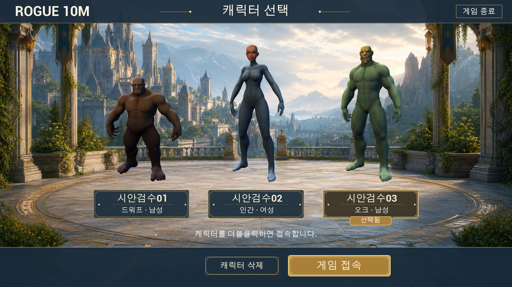

# 캐릭터 선택창 회색 재질과 구형 스켈레톤 참조 수정

캐릭터 선택창에서 인간·드워프·오크의 몸체가 회색으로 보이던 문제를 수정했다. 기존 프리뷰 텍스처의 명암과 질감을 바탕으로 드워프는 갈색, 인간은 청색, 오크는 녹색을 적용하고 드워프의 두 얼굴 재질에도 피부색을 적용했다. 기존 문신 8종의 텍스처·순서와 재질 설정을 유지했다. 눈과 일부 여성 모델의 얼굴 장식 슬롯에서는 Skeletal Mesh용으로 동작하는 재질을 사용한다.

기존 머리·눈·몸체 옵션을 해제하면 이전 재질이 붙어 있던 슬롯을 메시의 기본 재질로 되돌린다. 에디터 게임에서 활성 프리뷰의 재질 컴파일이 끝나면 다음 프레임에 다시 그린다. 선택창이 닫혀 있거나 메시가 숨겨진 상태에서는 캡처하지 않는다.

기존 외형 스켈레톤 6개에서 제거된 UE4 `RigConfig` 참조를 발견했다. 1인칭 팔과 전투 애니메이션의 스켈레톤 일치 조건을 보존하기 위해 액티브 패키지의 경로를 유지하고 UE 5.8 에디터에서 다시 저장했다. 원본 6개와 재질 연결을 바꾼 기존 메시·카탈로그 13개의 복구 사본은 저장 전에 만들고 SHA256을 대조했다.

최종 `Rogue10mEditor` 빌드는 7작업을 46.31초에 통과했다. 새 에디터에서 6종 모두의 구형 종속성 제거, 몸체 및 1인칭 팔의 재질, 리타깃과 캐릭터 클래스 연결, 문신 8종을 확인했다. 실제 1920×1080 게임에서는 생성·취소·선택·삭제 확인·접속과 시작 마을 이동 등 238개 검사가 통과했다. 기존 세이브 499개는 바이트가 동일했다.

최종 게임의 전체 출력 로그 오류는 0건이다. 앞서 나온 `Humanoid` 종속성 오류 5건과 `M_2sidedLit` Skeletal Mesh 사용 경고도 재발하지 않았다. 입력으로 프리뷰를 다시 고르기 전에 셰이더 완료 알림이 새 캡처를 요청했고, 드워프의 첫 생성 화면과 세 종족이 찬 선택창에서 정상 색상이 보였다. 실제 게임 검증에는 프로그램으로 실행한 UMG 동작과 Slate 입력 영역 검사가 포함된다.

작업 계획과 고유 실패는 아래 기록에 남겼다.

- [작업 계획](../architect/2026-11-19_character-lobby-asset-compatibility.md)
- [중간 검증에서 발견한 문제](evidence/character-lobby-asset-compatibility-20261119/observations.md)
- [첫 생성 프리뷰](evidence/character-lobby-asset-compatibility-20261119/dwarf-creation.png)
- [검증 결과 및 자산 목록](evidence/character-lobby-asset-compatibility-20261119/verification.json)
