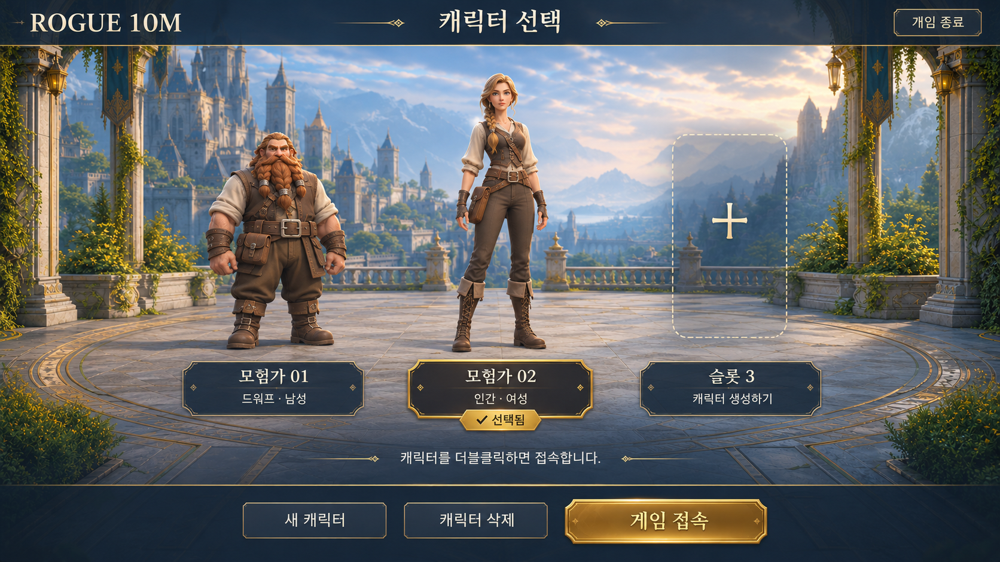

# 캐릭터 선택창 ImageGen 시안 결과

기존 성채 테라스 배경과 3슬롯 프로필 선택 구조를 살린 UI 시안 1장을 내장 `image_gen`으로 제작했다. 선택한 중앙 캐릭터의 금색 이름표와 접속 버튼을 강조하고, 빈 슬롯 생성 진입과 보조 액션을 정리했다. **디자인 시안 완료이며 실제 Unreal 선택창 적용은 하지 않았다.**

- 결과 PNG: `SourceArt/UI/CharacterLobby/2026-11-19/character-select-v1.png`
- 최종 생성 프롬프트: `SourceArt/UI/CharacterLobby/2026-11-19/character-select-v1.prompt.txt`
- 방식: 기본 내장 ImageGen, 로컬 배경과 기존 UI 캡처를 참조. CLI/API fallback은 사용하지 않았다.
- 원본 결과: `C:/Users/PC/.codex/generated_images/01a1ef89-82b9-71d3-8157-5894e3974f9d/exec-0a859bf4-8054-4aaa-bc40-ae957ef5245b.png`. 생성 결과 바이트를 변경 없이 프로젝트로 복사했다.
- 이미지: 1672×941, RGB PNG, 2,361,160 bytes, SHA256 `2A76FA197CE616EEAD7901CA72523E4E3DDF631B8963FDF780B06F0DF273DAA6`.

## 검증

이미지 디코딩·치수·해시·검수 JSON 파싱과 `Scripts/CheckGeneratedChanges.ps1`, 범위 `git diff --check`를 통과했다. 전체 작업 트리 검사에 표시된 `Content/AI/Monster/BT_Monster.uasset`는 작업 시작부터 있던 별도 변경으로 이번 스테이징 대상에서 제외했다. 기존 `DevLog/20261118.txt` 변경과 무관한 미추적 자료도 보존했다. 한글 문구·세 슬롯·전신 프리뷰·선택 강조는 별도 검토자를 포함해 육안 확인했다. 실제 게임 입력·프리뷰·접속 동작 검증은 시안 검사에 포함되지 않는다.

## 검수

주 담당자와 별도 검토자가 이미지를 직접 확인했다. 드워프 남성·인간 여성·빈 슬롯의 총 3슬롯, 정면 전신, 한글 이름표/종족·성별/선택 표시, 생성·삭제·접속·종료 버튼과 더블클릭 안내가 읽힌다. 캐릭터 레벨·직업·전투력 등 기존에 없는 규칙은 추가하지 않았다. 인물은 레이아웃을 설명하는 생성 예시이며 실제 게임 메시나 Fab 반입 결과가 아니다.

오른쪽 위 종료 버튼은 2026-11-18 기존 로비 캡처와 공용 QuitMenu 구현을 참조해 시안에 포함했다. Lobby Widget 내부 바인딩으로 확인한 기능은 아니며, 실제 적용 시 공용 종료 위젯과 중복 배치하지 않아야 한다.

원본 결과의 비율은 약 1.777로 16:9에 가깝지만 1920×1080 정규 화면 치수는 아니다. 수정 가능한 UMG 레이아웃이나 분리된 투명 UI 리소스가 아닌 전체 화면 래스터 시안이다. 실제 통합 시 캐릭터 프리뷰는 기존 3D 렌더를 사용하고 텍스트·버튼은 동작 가능한 위젯으로 구성해야 한다.

Unreal Editor/빌드/PIE/로그 작업은 수행하지 않았다. 런타임·애니메이션·세이브·맵·바이너리 자산을 변경하지 않았다. PNG 디코딩/치수/해시를 확인했으며 문서 및 생성 경로 검사를 수행한다. 기존 다른 작업의 Monster Blueprint와 이전 일일 로그 변경은 커밋에서 제외한다.

## 근거 및 게시 경계

- 계획: `Feature/architect/2026-11-19_character-select-concept.md`
- 최종 검수 및 입력 출처: `Feature/doc/evidence/character-select-concept-20261119/verification.json`
- 선택 PNG 하나만 `.gitignore` 예외로 등록했다. 기존 source-art 및 비공개 보고서 ignore 정책은 유지한다.
- Sprint#9-34 작업 브랜치에 시안 체크포인트를 게시한다. 맵 제작 게이트에 따라 develop/test/main 승격은 보류한다.
