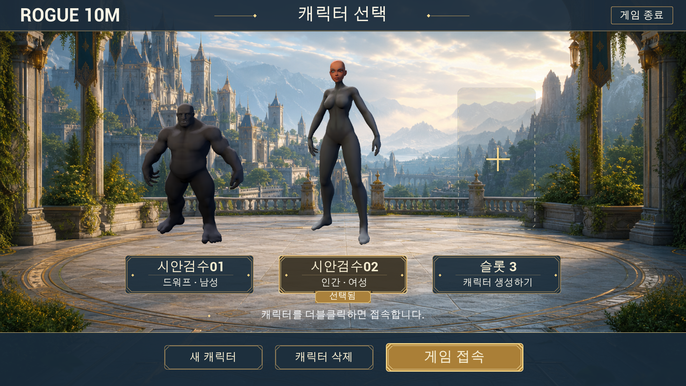

# 캐릭터 선택창 시안 실제 적용

승인된 ImageGen 시안을 기존 `/Game/Widget/Lobby/WBP_CharacterLobby`에 적용했다. 남색·금색 헤더와 이름표, 선택 배지, 빈 슬롯 더하기 버튼, 주요 접속 버튼을 실제 위젯으로 구성했다. 저장 프로필의 이름·종족/성별과 선택 상태를 표시하며, 생성·취소·삭제 확인·접속은 기존 기능에 연결된다.

## 구현

- 기존 root·필수 BindWidget·생성 화면을 보존하는 재실행 가능한 Editor authoring. 공식 AddWidget/MoveWidget을 사용하고 WBP 하나만 저장한다.
- C++에서 선택 이름표·배지·프리뷰 밝기·빈 슬롯 입력·버튼 상태를 갱신한다. 이름과 종족/성별 표시를 나누며 긴 이름은 생략 표시한다.
- 실제 창의 캐시된 루트 좌표로 장식선을 배치하고, 선택 배지가 겹치는 이름표 하단선에는 간격을 낸다. 공용 종료 버튼은 선택창에서만 헤더에 맞춘다.
- 360×600 프리뷰에 480×800 Render Target을 맞추고 화면비에 따라 전신과 발 위치를 계산한다. 캡처 직전에 기존 Manny→리타깃→부착 파츠 포즈를 동기 평가한다. Tick 추가와 애니메이션 자산 수정은 없다.
- 캐릭터 외형·의상·재질은 기존 게임 자산을 사용한다. 시안 속 예시 인물을 새 게임 모델로 반입한 작업이 아니다.

## 확인 결과

| 검사 | 실제 결과 |
| --- | --- |
| 정규 Editor 빌드 | 최종 BuildD 성공, 6 actions, 27.93초 |
| 자산 검사 | EditorC의 선택창·외형 카탈로그·상속 리타깃·화면 흐름 4개 통과 |
| EditorC 출력 로그 | 신규/전체 오류 0 |
| 최종 실제 렌더 | C1119, 1920×1080, 238검사/실패0, 40.834초 |
| 기능 범위 | 생성·취소·3슬롯·선택 배지·빈 슬롯·삭제 두 번 확인·선택 캐릭터 StartHub 접속·입력 복원 |
| 클릭 영역 | 실제 Slate 중앙 hit path 검사. 별도 B1119에서 OS 마우스로 이름표 선택·프리뷰 선택·접속 확인 |
| 저장 보존 | B의 기존491개 및 C의 기존493개 전부 바이트 보존. 각 실행이 QA namespace 파일2개만 생성 |
| 보호 입력 | 기존 몬스터 WIP·전날 로그·배경·카탈로그·프리뷰 재질·시안 원본 6개 SHA256 동일 |
| 시각 검토 | 독립 검토 포함 전신·한글·테두리 정렬·빈 슬롯·선택 배지 통과 |

## 남은 기존 자산 문제와 상태

**UI 적용과 기능 검사는 통과했지만 전체 런타임 출력 로그 검사는 미통과다.** 최종 C1119에도 vendor skeleton의 제거된 `/Engine/EngineMeshes/Humanoid` 참조 LoadErrors 5건이 남았다. `2026-11-16_reference-scanner-compatibility.md`에 기록된 기존 호환성 문제와 일치하며, 원본 skeleton을 임의 수정하거나 로그를 억제하지 않았다. 실행기는 이를 계속 실패1로 반환한다.

몸체가 회색으로 보이는 기존 Debug 재질의 SkeletalMesh usage 경고도 별도로 남았다. UI 테마·배치의 완성 여부와 캐릭터 외형 자산 호환성 해결을 구분한다. 전체 오류 없는 게임 QA나 의상·재질 보완 완료를 주장하지 않는다.

현재 상태는 **UI 구현·시각 확인·기능 검증 완료, 기존 외형 호환성으로 전체 로그 QA 보류**다. 검증한 UI 체크포인트만 작업 브랜치 `Sprint#9-35-character-select-ui`에 게시하며, 맵 제작 게이트에 따라 develop/test/main 승격은 하지 않는다.

## 보존 자료

- [기획](../architect/2026-11-19_character-select-implementation.md)
- [최종 검증 요약](evidence/character-select-implementation-20261119/final/verification.json), [검사 상세](evidence/character-select-implementation-20261119/final/checks.csv)
- [최초 빌드의 동시 편집 실패](evidence/character-select-implementation-20261119/build-A-link-race.md)
- [저작 도구 실패와 수정](evidence/character-select-implementation-20261119/authoring-failures.md), [실행·시각 실패 및 기존 자산 문제](evidence/character-select-implementation-20261119/runtime-review.md)
- [프리뷰 애니메이션 기록](../../DevLog/20261119_CharacterSelect/AnimationRecord.md)

연속 캡처와 원문 로그는 `tmp/CharacterLobbyStyle20261119` 및 `tmp/CharacterLobbyStyleQA`에 유지했다. DevLog에는 최종 대표 이미지1장만 두고, 기능 상태3장·고유 시각 실패1장·정식 검사 결과를 Feature 증거에 보존했다. 무관한 코드 정리·사진 정리·미추적 자료와 세이브 원문은 이번 게시에 포함하지 않는다.
