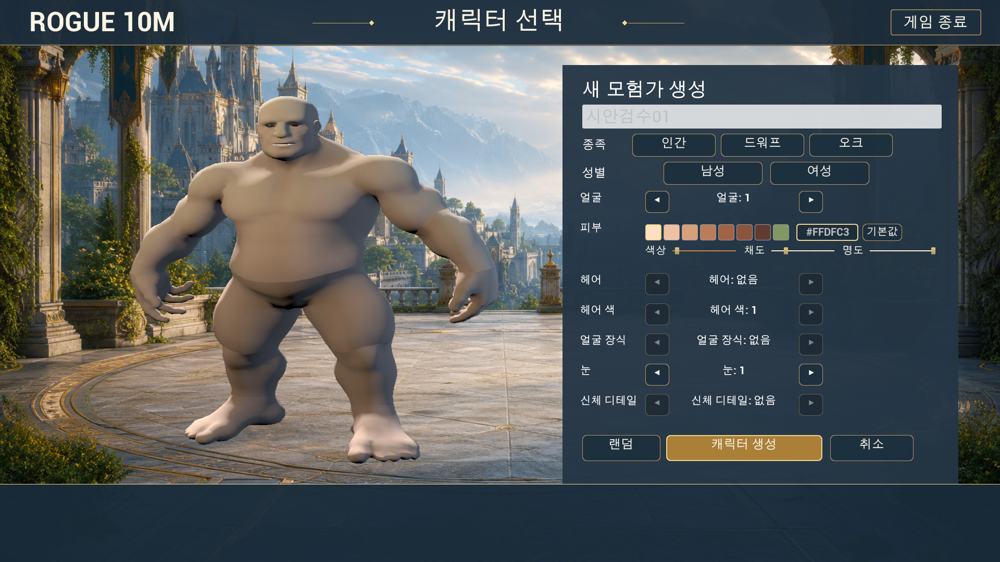

# 캐릭터 생성 피부색 지정

생성 화면의 피부색 견본 8개에서 고르거나 색상·채도·명도 슬라이더로 바꿀 수 있다. 원하는 RGB 값은 6자리 HEX로 입력하고, 기본값을 누르면 현재 종족의 기본 피부색으로 돌아간다. 잘못된 HEX를 입력하면 현재 색을 유지하고 범위에 맞는 입력을 안내한다.

얼굴과 몸에는 같은 색을 전달한다. 인간·드워프·오크의 남녀 외형 6종에서 얼굴과 몸이 맞닿는 목 경계의 동일 좌표를 찾아, 기존 텍스처 82장의 명암 기준을 보정했다. 얼굴은 피부 UV 영역에만 새 색을 적용해 치아와 입 안 색을 유지한다. 의상·문신의 합성, 법선, 표면 질감은 기존 재질을 사용한다. 기존 얼굴 옵션 70개와 오크 문신 8개를 유지했다.

프로필에 사용자 지정 색을 저장한다. 선택창을 다시 열면 목록 프리뷰에 색이 나타나고, 시작 마을에 들어가면 캐릭터와 1인칭 팔에도 같은 재질이 적용된다. 새 필드가 없던 구버전 QA 저장 파일에서 두 프로필을 읽어 기존 피부 인덱스와 읽기 전후 바이트를 확인했다.

변경한 115개 에셋은 Unreal Editor에서 저장했다. 새 에디터에서 다시 열어 얼굴 재질 76개, 몸체 재질 14개와 외형 6종의 메시·카탈로그 연결을 확인했다. 1920×1080 실제 게임에서 색상 입력, 잘못된 값 거부, 기본값, 목록 재진입, 접속을 포함한 341개 검사를 두 차례 통과했다. 두 실행의 게임 로그 오류는 0건이고 최종 실행 전 세이브 503개를 보존했다.

- [작업 계획](../architect/2026-11-19_character-skin-color.md)
- [실제 게임 검사 및 대표 화면](evidence/character-skin-color-20261119/verification.json)
- [드워프 기본색으로 비교](evidence/character-skin-color-20261119/dwarf-default.png)
- [인간 직접 지정색 예시](evidence/character-skin-color-20261119/human-custom.png)
- [재질과 자산 목록](evidence/character-skin-color-20261119/materials.json)
- [작업 중 발생한 실패와 대응](evidence/character-skin-color-20261119/validation-notes.md)
