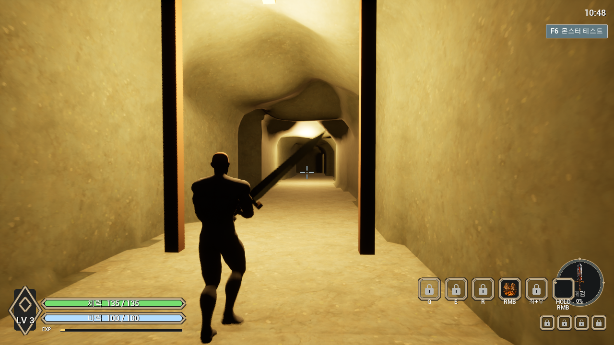

# 맵 1차 작업 마감

현재 게임 레벨 두 개는 `StartHub`와 `OpenRunMap`이다. 시작 마을 규모, 출발 포탈, 중앙로와 마을 터, 지하 훈련고와 지하 작업함을 한 배포 기준으로 묶었다. 캐릭터 선택창과 외형 자산 호환성 수정, 개발 기록 정리도 기존 배포 이력에 합쳤다.

## 실제 연속 플레이

맵 복구 커밋에서 시작 마을 포탈을 이동 입력으로 통과하고 서쪽 다리와 중앙로, 두 동굴의 안쪽 통로와 출구, 보스 방까지 같은 런으로 이동했다. 경유점 148개를 모두 지났고 현장 위치 표본 4,654개에서 비정상 이동은 0건이었다.

| 구간 | 이동 중 카메라 표본 | 카메라 경로 가림 |
| --- | ---: | ---: |
| 지하 훈련고 | 2,406 | 0 |
| 지하 작업함 | 2,051 | 0 |

쉬움 난이도의 연속 플레이에서는 보스전 중 20분 제한이 끝났고, 결과 화면에서 시작 마을로 돌아왔다. 보스 처치 후 승리 정산, 귀환과 저장을 확인하는 검사는 별도 세션에서 진행했다.

## 통합본 검증

UE 5.8 Editor 빌드의 35개 작업이 성공했다. 두 레벨과 복구한 `OpenRunMap`의 지형·동굴 패키지를 맵 복구 커밋과 비교해 동일함을 확인했다. 포탈은 실제 이동 입력으로 통과했고 17항목을 검사했다. 기본 3인칭 카메라는 지정한 48시야에서 가림 0건이었다. 보스의 마지막 타격과 승리 정산·귀환은 77항목, 새 프로세스에서 저장 불러오기는 17항목을 통과했다.

캐릭터 선택, 생성, 취소와 접속 검사 238항목을 통과했다. 검증 스크립트에 Python 실행 파일 경로를 지정하는 `-PythonExecutable` 옵션을 추가하고 독립 체크아웃에서 다시 실행했다. 테스트 전 세이브 7개는 바이트가 동일했다. 포탈, 동굴 카메라, 보스 승리, 저장 재로드, 캐릭터 선택 출력 로그에서 오류 0건을 확인했다. 에디터 빌드에는 기존 Landscape 편집 API의 사용 중단 경고가 남았다.

[통합 검증 데이터](evidence/map-phase-one-20261119/summary.json) · [마감 계획](../architect/2026-11-19_map-phase-one-publication.md) · [맵 복구 결과](2026-11-19_openrun-recovered-terrain-caves.md) · [캐릭터 선택창과 에셋 호환성](2026-11-19_character-lobby-asset-compatibility.md)
