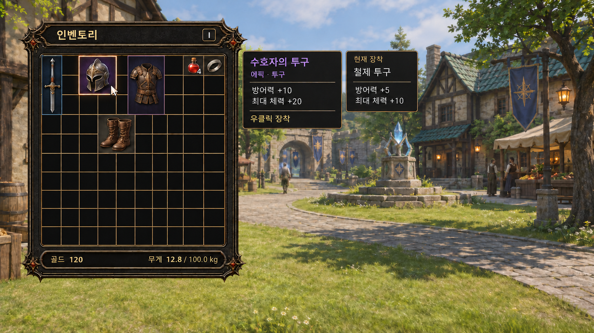

# 인벤토리 ImageGen 시안

가방에서 수호자의 투구에 마우스를 올리면 현재 장착 중인 철제 투구를 옆에서 비교한다. 포션 수량은 아이콘에, 골드와 가방 무게는 창 하단에 표시한다. `P` 장비창을 함께 쓰는 흐름과 드래그 중 배치 상태는 기획서에 정리했다. [인벤토리 UI 기획](../architect/2026-11-20_inventory-imagegen-concept.md)

## 검수

- 내장 ImageGen으로 배치와 색상 시안을 만들었다. 기존 고딕 인벤토리 프리뷰에서 프레임을, StartHub 캡처에서 배경과 UI 색을 참조했다. 1차 결과의 격자 행수와 등급 용어를 보정하고, 갑옷 카드 폭을 줄인 최종본을 선택했다. [생성·편집 프롬프트](evidence/inventory-concept-20261120/inventory-imagegen-prompts.txt)
- PNG 디코딩과 저장본 SHA-256 일치를 확인했다. 시안은 1672×941이고 격자는 10열×10행이다. 인벤토리 제목, 포션 수량 4, 골드 120, 무게 12.8/100.0kg, 투구 비교 수치와 우클릭 안내를 육안으로 확인했다.
- 이미지에서 셀 폭이 조금씩 다르고 갑옷 카드 테두리가 열 경계와 어긋난다. 실제 점유 기준은 아래 52px 균일 셀 도식의 가죽 갑옷 2×3이다. 시안은 호버 비교 순간을 간략히 그렸으며 UMG에서 표시할 전체 정보와 다른 조작 상태는 기획서를 따른다. [정확한 격자 배치 기준](evidence/inventory-concept-20261120/inventory-grid-guide.png)
- 시안 설계 단계의 검수 기록이다. 게임에 적용한 화면과 입력 검증 결과는 별도 문서에 있다. [실제 적용 결과](2026-11-20_inventory-concept-implementation.md)

| 산출물 | 크기 | SHA-256 |
| --- | --- | --- |
| 시안 PNG | 1672×941 | `b1828f25c5bedf042ebdd1070859d93e9ee466ec3d6ed5fe7b00d21b5a1b6994` |
| 격자 기준 PNG | 582×582 | `9c0ff821a1a1c12afa9dcdf91e31a33cf66d95ad3acbf9a5e89a4eb342eb2fb2` |
