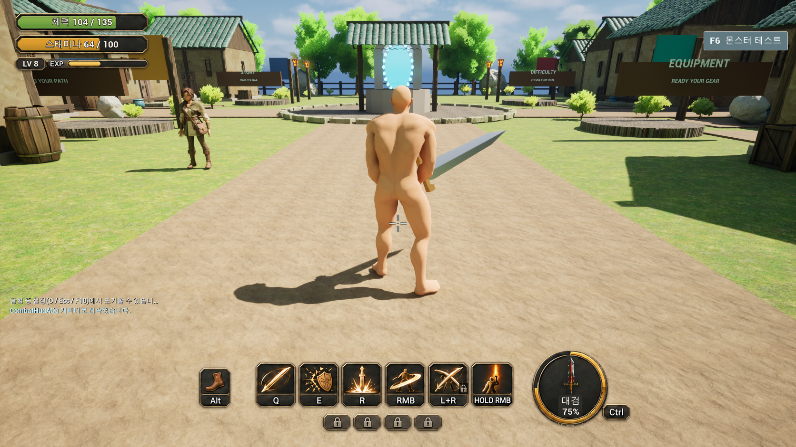

# 승인 시안 A 전투 HUD 적용

후속 HUD 글자·아이덴티티 표시와 최신 검수는 [A안 HUD 글자 정리](2026-11-21_hud-label-polish.md)에 있다.

StartHub와 전투 화면에서 좌측 상단에 체력·스태미나·레벨·경험치를 표시한다. 하단에는 왼쪽부터 `Alt` 회피, 공격 슬롯 6개, `Ctrl` 대검 아이덴티티가 있고, 스킬 아래에 잠금 아이템 4칸이 있다. 기준 좌표는 1672×941 승인 PNG에서 가져왔다. [승인 원본](evidence/main-combat-hud-concept-20261121/layout-a-single-row.png) · [설계](../architect/2026-11-21_combat-hud-a.md)

## 구성과 데이터

기존 Main HUD가 새 그리기 위젯을 화면에 붙이고 전투 부분만 교체한다. 자원은 기존 Gameplay Ability System, 성장, 장비와 스킬 바인딩에서 읽는다. 스태미나가 마력으로 전환되는 장비·아이덴티티 조건, 해금과 쿨다운, 각 기술의 툴팁과 스킬 드롭을 기존 경로에 연결했다. 기술 자체에 지정된 아이콘이 있으면 해당 아이콘을 쓴다. 대검의 빈 슬롯은 승인 아이콘 위에 잠금 배지를 표시한다.

25개 시각 요소를 1024×512 RGBA 아틀라스로 분리했다. 스킬 슬롯 6개, 회피, 아이템 슬롯 4개와 `Ctrl` 키의 불투명 픽셀 57,412개는 승인 PNG와 일치한다. 게이지와 숫자는 실시간 값에 맞춰 표시한다. 승인 시안의 대검 원호는 약 75%에 도달하지만 글자는 72%로 쓰여 있다. 게임 원호와 글자는 같은 현재 비율을 사용한다. [아틀라스 좌표](../../SourceArt/UI/CombatHudA/layout.json)

## 재현

```powershell
.\.venv\Scripts\python.exe -B .\Scripts\PrepareCombatHudAAssets.py --check
.\Scripts\BuildEditor.ps1 -NoHotReload
.\Scripts\VerifyCombatHudA.ps1
.\.venv\Scripts\python.exe -B .\Scripts\CompareCombatHudAVisual.py <1672x941-capture> --lock-badge SlotChord
```

아틀라스는 Unreal Editor Python의 [임포트 스크립트](../../Scripts/Editor/ImportCombatHudAArt.py)로 재생성할 수 있다. 검증은 격리한 테스트 프로필로 실행하고 실제 로그를 `-AbsLog`로 받는다.

## 실행 검수



| 검사 | 결과 |
| --- | --- |
| Editor 빌드 | 작업 폴더와 최신 통합 베이스에서 컴파일·링크 성공 |
| 스프라이트와 좌표 | 아틀라스 25개 좌표가 네이티브 테이블과 일치한다. 1672×941의 12개 고정 요소 위치 오차 0px. 실제 `L+R` 잠금 배지 영역 밖 불투명 픽셀 56,956개가 RGB 단위로 일치한다. |
| StartHub | 1672×941과 1280×720, 56개 검사·실패 0. 실제 체력·스태미나·경험치 갱신, 대검 게이지, `Alt` 입력 뒤 쿨다운, 스킬 해제와 지팡이 마력 전환을 확인했다. |
| 출력과 저장 | Atlas 임포트 오류 0. `-game` 엔진 초기화에서 기존 Python traceback 7건·오류 줄 58개, HUD 검증 구간과 그 외 오류 0. 작업 폴더의 기존 저장 508개 해시를 보존했다. |

대검의 현재 기술 목록은 테스트에서 6칸 중 5칸에 배정됐다. `L+R`의 작은 자물쇠와 아이덴티티 75%는 실제 테스트 상태다. 비교 캡처는 격리한 테스트 캐릭터의 카메라를 조정해 발 아래 여백을 확보했다. 기본 카메라에서의 캐릭터 위치는 기존 게임 설정을 따른다.

첫 빌드에서 UE 벡터 생성자와 변수명 충돌을 수정했다. 초기 실행은 일반 글자 크기가 승인 원본보다 컸고 잠금이 스킬 그림을 덮었다. 최종에서는 글자 크기와 게이지 끝을 보정하고, 잠금 표시는 스킬 모서리로 옮겼다. 로그 검증은 UE의 동일한 부팅 시간 표기인 `ms`와 `sec`를 처리하도록 수정했다. [런타임 계약](evidence/combat-hud-a-20261121/runtime-contract.txt) · [720p 캡처](evidence/combat-hud-a-20261121/runtime-720p.png) · [픽셀 비교](evidence/combat-hud-a-20261121/visual-comparison.txt) · [출력 분류](evidence/combat-hud-a-20261121/unreal-log-classification.json)
